# Administrator guide: prepare, supervise and restore the lab

Use this guide **before the customer session** and at the marked administrator
checkpoints in the [customer walkthrough](RUNBOOK.md). The customer does not
need to read the cluster inventory, operator configuration or cleanup commands.

| When | What to do |
| --- | --- |
| Before the session | [Set session values](#session), run [preflight](#preflight), then [create the lab](#setup). |
| Before customer test 5A | Complete [owner check, snapshot, Predictive configuration and health checks](#descheduler-prepare), sections 7.1–7.4. |
| Immediately before Automatic | Repeat [isolation checks and guarded activation](#activate). |
| Immediately after migration or on timeout | Return to Predictive using section 7.6. |
| After the session | [Restore the original shared settings](#restore). |
| Repeat the test / finished testing | [Reset and keep disks](#reset), or [remove the lab](#cleanup). |

**Keep these boundaries:** use only the agreed nodes and exclusive lab namespace.
Do not enable Automatic without a fresh priority/force-eviction inventory.
Snapshot the shared descheduler before changing it, and restore it afterward.
Do not apply MachineConfigs or enable PSI as part of this required test.

Use the screenshots as navigation examples. Black boxes cover environment-specific values; read and record your own values. The target OpenShift 4.21.31 environment still needs preflight against its installed Virtualization and Descheduler Operator versions.

Run all commands from test-cases/01-scheduling-and-migration in Bash. Keep
this administrator terminal open so its variables and evidence directory
remain available. A separate customer CLI terminal uses the short setup
block in RUNBOOK.md.

<a id="prepare"></a>

## Preparation checklist

- [ ] Agree worker names, storage class, boot source and the shared-resource change window.
- [ ] Complete sections 0–1; resolve every failed or incomplete check.
- [ ] Complete section 2, or verify recorded identities before reusing this lab.
- [ ] Hand over five Stopped VMs with their disks ready. For WaitForFirstConsumer storage, explain when cloning starts.
- [ ] Keep this guide open for the two mandatory descheduler checkpoints.
- [ ] Confirm who will restore the original shared configuration.

The detailed checks follow. They are an administrator reference, not the
customer's presentation script.

<a id="session"></a>

## 0. Administrator session

```sh
export NS=virt-scheduling-lab
export DS_NS=openshift-kube-descheduler-operator
export PC=virt-scheduling-lab-evictable
export THRESHOLD=-999999999
# Replace with the client's approved values:
export NODE_A='worker-a' NODE_B='worker-b' NODE_C='worker-c'
export RWX_SC='vxflexos'
export LAB_EVIDENCE="$HOME/virt-lab-evidence-$(date +%Y%m%d-%H%M%S)"   # private, never in Git
mkdir -p "$LAB_EVIDENCE"
printf '%s\n' "$NODE_A" "$NODE_B" "$NODE_C" > "$LAB_EVIDENCE/approved-nodes.txt"
LAB_VMS="placement-01 spread-01 spread-02 spread-03 negative-01"
```

Every node used below (including TARGET in step 7) is one of NODE_A/B/C.
Tools: `oc`, `jq`, and `virtctl` (console **?** > **Command Line Tools**).

| Node label | Meaning | Set on |
|---|---|---|
| `scheduling-lab.example.com/eligible=true` | approved for placement-01 | NODE_A, later moved |
| `scheduling-lab.example.com/spread-pool=true` | approved pool for spread VMs | NODE_A, NODE_B, NODE_C |
| `scheduling-lab.example.com/unsatisfiable` | must never exist | nobody |

Console - node label: **Compute > Nodes** > node > **Actions > Edit labels** >
type `key=value` > press **Enter** so it becomes a label > **Save**; remove only the test label by clicking **×** on its chip > **Save**.

<a id="preflight"></a>

## 1. Preflight (read-only, on the client cluster)

**Stop** on any failure. Do not work around it by enabling features, applying
MachineConfigs or removing taints.

### 1.1 Versions, operators, CRDs, schema

Console: **Administration > Cluster Settings** (version); **Operators >
Installed Operators** (newer consoles: **Ecosystem > Installed Operators**):
OpenShift Virtualization and Kube Descheduler Operator show **Succeeded**. Select their installation projects if needed: **openshift-cnv** and **openshift-kube-descheduler-operator**. In the project selector, turn on **Show default projects** to find them.

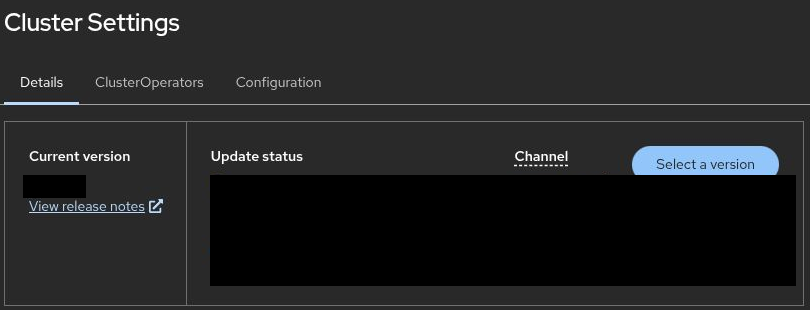


```sh
oc get clusterversion version -o jsonpath='{.status.desired.version}{"\n"}'
oc get csv -n openshift-cnv
oc get csv -n $DS_NS
oc get hco -n openshift-cnv kubevirt-hyperconverged \
  -o jsonpath='{range .status.conditions[*]}{.type}={.status}{"\n"}{end}'
oc get crd kubedeschedulers.operator.openshift.io virtualmachines.kubevirt.io \
  virtualmachineinstancemigrations.kubevirt.io datavolumes.cdi.kubevirt.io datasources.cdi.kubevirt.io
# profiles this descheduler release supports (from the HCOMisconfiguredDescheduler runbook)
oc get crd kubedeschedulers.operator.openshift.io -o json \
  | jq '.spec.versions[] | select(.name=="v1").schema.openAPIV3Schema.properties.spec.properties.profiles.items.enum[]'
oc explain kubedescheduler.spec.profileCustomizations.thresholdPriority --api-version=operator.openshift.io/v1
oc explain kubedescheduler.spec.profileCustomizations.devEnableEvictionsInBackground --api-version=operator.openshift.io/v1
oc explain kubedescheduler.spec.profileCustomizations.namespaces --api-version=operator.openshift.io/v1
oc explain kubedescheduler.spec.evictionLimits --api-version=operator.openshift.io/v1
oc explain virtualmachine.spec.template.spec.priorityClassName --api-version=kubevirt.io/v1
oc explain virtualmachine.spec.dataVolumeTemplates --api-version=kubevirt.io/v1
oc explain virtualmachineinstancemigration.spec.vmiName --api-version=kubevirt.io/v1
```

Expected: client version (4.21.31); both CSVs `Succeeded`; HCO
`Available=True`, `Degraded=False`; all CRDs exist; the profile enum contains
`AffinityAndTaints`, `LongLifecycle`, `EvictPodsWithLocalStorage`,
`EvictPodsWithPVC`; every `oc explain` prints a description.

### 1.2 RHEL 9 boot source

Console: **Virtualization > Bootable volumes** (project
`openshift-virtualization-os-images`): `rhel9` is listed and available.

```sh
oc get datasource rhel9 -n openshift-virtualization-os-images \
  -o jsonpath='{range .status.conditions[*]}{.type}={.status} {.reason}{"\n"}{end}{.spec.source}{"\n"}'
oc auth can-i create datavolumes.cdi.kubevirt.io --subresource=source -n openshift-virtualization-os-images
```

Expected: `Ready=True`; the clone permission check prints `yes`.

Resolve the DataSource's actual source before using the default 40Gi target disk.
Open **rhel9** and check the **Ready** badge. Under **Source**, click its PVC or VolumeSnapshot link.

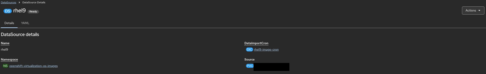

The source PVC details show **Status**, **Requested capacity**, **Capacity**, **Access modes** and **Volume mode**. Read **Capacity** before choosing the target disk size.

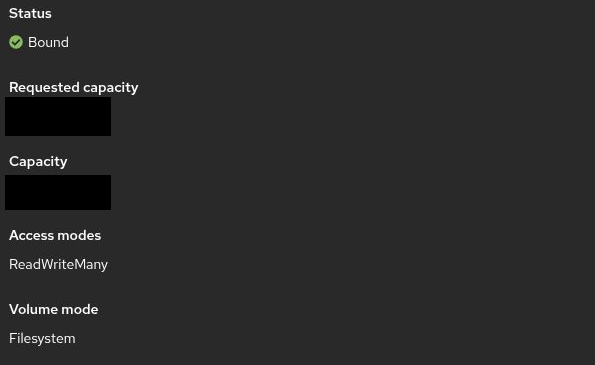
For the normal PVC-backed source, copy its name/namespace from the first command:

```sh
oc get datasource rhel9 -n openshift-virtualization-os-images -o jsonpath='{.spec.source}{"\n"}'
# Replace these with the source reported above; do not guess a versioned PVC name.
SOURCE_PVC='actual-source-pvc'
SOURCE_NS='openshift-virtualization-os-images'
oc get pvc "$SOURCE_PVC" -n "$SOURCE_NS" -o jsonpath='{.status.phase}{" capacity="}{.status.capacity.storage}{"\n"}'
```

For a snapshot-backed source, inspect the reported VolumeSnapshot instead:
`oc get volumesnapshot ACTUAL_SNAPSHOT -n ACTUAL_NAMESPACE -o yaml`.
Require `readyToUse: true` and inspect `status.restoreSize`. Stop if the source
cannot be resolved or is not ready. Its capacity/restore size must fit the
40Gi disk requested in each VM's DataVolume template; otherwise increase
**all five** disk requests before applying the YAML. Allow the storage
provider's filesystem/clone overhead in the capacity plan.

### 1.3 Shared block storage

Console: **Storage > StorageClasses** > `$RWX_SC`; **Storage > StorageProfiles**
(if shown) lists **ReadWriteMany / Block** for **vxflexos**. Read **Volume binding mode** on the StorageClass details page: it determines when to wait in section 2.4.

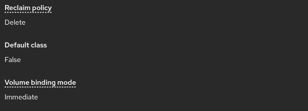

```sh
oc get storageclass "$RWX_SC" -o jsonpath='{.provisioner}{" binding="}{.volumeBindingMode}{"\n"}'
oc get storageprofile "$RWX_SC" -o jsonpath='{.status.claimPropertySets}{" clone="}{.status.cloneStrategy}{"\n"}'
```

Expected: the class exists; `claimPropertySets` includes `ReadWriteMany` with
`Block`. Confirm the class uses the PowerFlex block driver and the installed driver supports
RWX raw-block volumes. Do not enable filesystem sharing or change the StorageProfile
to advertise a capability the driver does not provide.

The approved image source must also support population into this target class and
mode. If CSI or snapshot cloning cannot cross the source/target storage types,
the storage administrator must confirm a supported CDI copy path before creation.
Stop on clone errors; do not switch to RWO to bypass them.

Five root disks = 5 x 40 GiB = **200 GiB guest disk requests**; confirm with
the storage owner that capacity plus provisioner headroom is available (a
`copy`/host-assisted clone writes the full image per disk; snapshot or CSI
clones may be thin). With `WaitForFirstConsumer`, clones start only when a VM
first starts.

### 1.4 Nodes and compute headroom

Console: **Compute > Nodes**: NODE_A/B/C **Ready**, no lab labels.

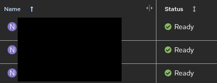

```sh
oc get nodes $NODE_A $NODE_B $NODE_C -L kubevirt.io/schedulable -L kubernetes.io/arch
oc get nodes $NODE_A $NODE_B $NODE_C -o custom-columns=NAME:.metadata.name,TAINTS:.spec.taints
oc get nodes -l scheduling-lab.example.com/eligible
oc get nodes -l scheduling-lab.example.com/spread-pool
oc get nodes -l scheduling-lab.example.com/unsatisfiable
for n in $NODE_A $NODE_B $NODE_C; do oc describe node "$n" | sed -n '/Allocated resources/,/Events/p'; done
oc get kubevirt -n openshift-cnv -o jsonpath='{.items[0].spec.configuration.migrations}{"\n"}'
```

Expected: Ready, `kubevirt.io/schedulable=true`, `amd64`, no
`NoSchedule`/`NoExecute` taints; the three lab-label queries return nothing
cluster-wide. Fixed footprint: at most 4 running VMs plus 1 migration target
(negative-01 stays Pending), i.e. up to 5-6 launcher pods of 2 GiB guest
memory plus virt-launcher overhead each, plus short-lived CDI clone pods.
Each approved node needs room for two launchers within its allocatable
requests. Migration limits: blank means platform defaults; fail only if
`parallelMigrationsPerCluster` or `parallelOutboundMigrationsPerNode` is
explicitly `0`.

### 1.5 Namespace and PriorityClass must be new

```sh
oc get namespace $NS            # Expected: NotFound
oc get priorityclass $PC        # Expected: NotFound
```

If either exists, stop unless it is positively this test case's own object:
its UID equals the one recorded in an earlier run's evidence folder, and (for
the namespace) a full inventory shows only lab objects:

```sh
fail=0
oc api-resources --verbs=list --namespaced -o name > "$LAB_EVIDENCE/ns-types.txt" || fail=1
[ -s "$LAB_EVIDENCE/ns-types.txt" ] || fail=1
: > "$LAB_EVIDENCE/ns-inventory-errors.txt"
while read -r r; do oc get "$r" -n $NS --ignore-not-found -o name 2>>"$LAB_EVIDENCE/ns-inventory-errors.txt" || fail=1; done \
  < "$LAB_EVIDENCE/ns-types.txt" > "$LAB_EVIDENCE/ns-inventory.txt"
[ "$fail" = 0 ] && echo "inventory complete" || echo "INVENTORY INCOMPLETE - stop"
cat "$LAB_EVIDENCE/ns-inventory-errors.txt" "$LAB_EVIDENCE/ns-inventory.txt"
```

The inventory passes only if the list of resource types itself was read and is
not empty, and every type could be listed. Each failed type's error is kept in
`ns-inventory-errors.txt` and shown. An incomplete inventory is a stop (have a
cluster admin run it). Allowed content: the five VMs and their VMIs, launcher/CDI pods,
DataVolumes, PVCs, migrations, plus the namespace's automatic objects
(default ServiceAccounts and their secrets, `kube-root-ca.crt` and
`openshift-service-ca.crt`, default RoleBindings). VM-owned ControllerRevisions and events from these test resources are also expected.

Installed platform operators can inject other automatic objects, such as service accounts, CA ConfigMaps or RoleBindings. Verify their owner references or documented injection labels. Copied operator entries must have **olm.copiedFrom**; catalog PackageManifests are projected catalog entries. These do not mean an operator was installed in the test project. Do not remove the original operator installation. An unexplained object is a stop; do not allow it merely because its kind looks familiar. Never reuse a foreign namespace or PriorityClass.

### 1.6 Pod priority inventory (protects every non-lab workload)

LongLifecycle's `LowNodeUtilization` ignores the namespace include, so
`thresholdPriority` is the boundary. Every pod outside the lab namespace must
have an explicit numeric priority >= `$THRESHOLD`, must not use `$PC`, and must
not carry `descheduler.alpha.kubernetes.io/evict` (that annotation bypasses the
evictor's filters). A missing (`null`) priority is **not** zero: it is a stop.

```sh
if oc get pods -A -o json > "$LAB_EVIDENCE/pods-all.json"; then echo "pod list complete"; else echo "INVENTORY INCOMPLETE - stop"; fi
jq '.items | length' "$LAB_EVIDENCE/pods-all.json"
jq -r --arg ns "$NS" --arg pc "$PC" --argjson t "$THRESHOLD" '
  .items[]
  | select(.metadata.namespace != $ns)
  | select(.spec.priority == null
           or .spec.priority < $t
           or .spec.priorityClassName == $pc
           or ((.metadata.annotations // {}) | has("descheduler.alpha.kubernetes.io/evict")))
  | "\(.metadata.namespace)/\(.metadata.name) priority=\(.spec.priority) class=\(.spec.priorityClassName // "-")"
' "$LAB_EVIDENCE/pods-all.json" | tee "$LAB_EVIDENCE/priority-violations.txt"
# PriorityClasses below the threshold or global defaults
oc get priorityclass -o json | jq -r --argjson t "$THRESHOLD" '
  .items[] | select(.value < $t or .globalDefault == true)
  | "\(.metadata.name) value=\(.value) globalDefault=\(.globalDefault)"'
```

Expected: the pod list is complete and `priority-violations.txt` is **empty**.
Before creating the lab, no class may be below the threshold. When repeating
this check after setup or for an identified reusable lab, the only permitted
below-threshold class is `$PC`: its UID must match the recorded lab identity,
value must be -1000000000, it must not be globalDefault, and preemptionPolicy
must be Never. A global-default class is acceptable only at or above the
threshold. Any other below-threshold class is a stop, even if currently unused.

Agree with the cluster owner that, during the short test window, no new pod
outside the lab uses `$PC` or the force-evict annotation. Console: there is no
single view for this; use the CLI result.

### 1.7 Permissions

```sh
oc auth can-i create namespaces
oc auth can-i create priorityclasses.scheduling.k8s.io
oc auth can-i list pods -A
oc auth can-i patch nodes
oc auth can-i patch kubedeschedulers.operator.openshift.io -n $DS_NS
oc auth can-i get pods --subresource=log -n $DS_NS
oc auth can-i get routes -n openshift-monitoring
```

Expected: `yes` for all. After step 2.1 also check in `$NS`: `create
virtualmachines.kubevirt.io`, `patch virtualmachines.kubevirt.io`, `create
virtualmachineinstancemigrations.kubevirt.io`, `get
virtualmachineinstances.subresources.kubevirt.io --subresource=console`.

<a id="setup"></a>

## 2. Create the lab

### 2.1 Create the namespace

1. Open [00-namespace.yaml](manifests/00-namespace.yaml) and copy its full contents.
2. In the console's top bar, click **+ → Import YAML**.
3. Click inside the editor and paste the YAML. Replace any sample text already there.
4. Click **Create**. The namespace details page should show **virt-scheduling-lab — Active**.

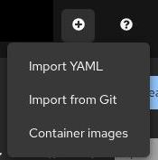

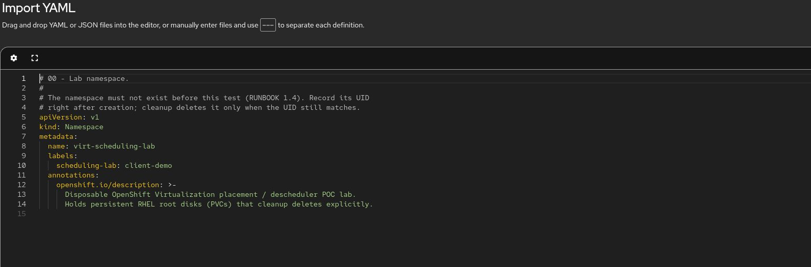

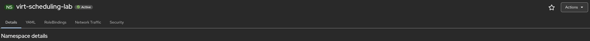

Record the new namespace UID in your private evidence folder. Namespace creation is cluster-wide; the project selected before this step does not change the name in the YAML.

<details>
<summary>Equivalent CLI and identity check</summary>

~~~sh
oc create -f manifests/00-namespace.yaml
oc get namespace $NS -o jsonpath='{.metadata.uid}{"\n"}' | tee "$LAB_EVIDENCE/namespace-uid.txt"
~~~

After a console creation, run only the second command. The same rule applies to the alternatives below: create once, then use the read-only check.

</details>

### 2.2 Create the reserved PriorityClass

1. Open [virt-scheduling-lab-evictable.yaml](priorityclass/virt-scheduling-lab-evictable.yaml) and copy its full contents.
2. Open **+ → Import YAML**, paste it into the editor, then **Create**.
3. On the new PriorityClass page, open **YAML** to read the values. Do not edit them.

**Check:** name **virt-scheduling-lab-evictable**, value **-1000000000**, **preemptionPolicy: Never**. **globalDefault** must be false or absent; the server can omit false.

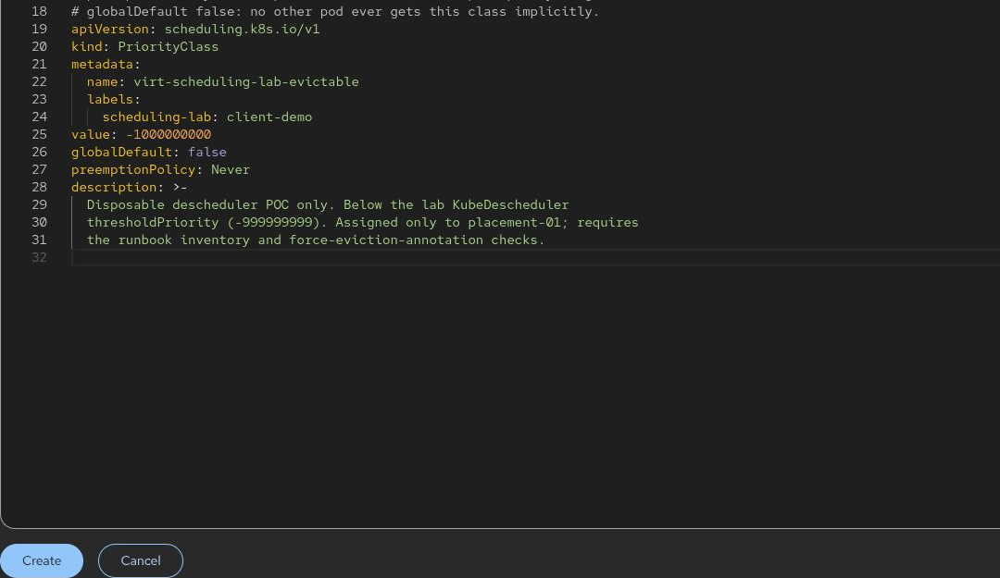

To find it again, use **Home → Search**, choose the **PriorityClass** resource, then open **virt-scheduling-lab-evictable → YAML**. Record its UID privately.

<details>
<summary>Equivalent CLI and identity check</summary>

~~~sh
oc create -f priorityclass/virt-scheduling-lab-evictable.yaml
oc get priorityclass $PC -o jsonpath='{.metadata.uid}{" value="}{.value}{" globalDefault="}{.globalDefault}{" preemption="}{.preemptionPolicy}{"\n"}' \
  | tee "$LAB_EVIDENCE/priorityclass-uid.txt"
~~~

</details>

### 2.3 Create the five VMs and their disks

The supplied YAML already uses **storageClassName: vxflexos**,
**volumeMode: Block**, and **accessModes: [ReadWriteMany]**. Confirm these
settings in preflight. Keep **runStrategy: Halted** so these VMs do not start during creation.

1. Select project **virt-scheduling-lab**. Open **+ → Import YAML**.
2. Copy and paste [01-placement-vm.yaml](manifests/01-placement-vm.yaml).
3. Keep **storageClassName: vxflexos**, **volumeMode: Block**, and **ReadWriteMany**. If section 1.2 required a larger disk, change **storage: 40Gi** too. Leave the other settings unchanged.
4. Click **Create**. The VM page opens. **Provisioning** is normal while its disk is cloning; it becomes **Stopped** afterward.

The image below illustrates the import editor using an alternate storage
configuration. Use the supplied **vxflexos / Block / ReadWriteMany** settings.

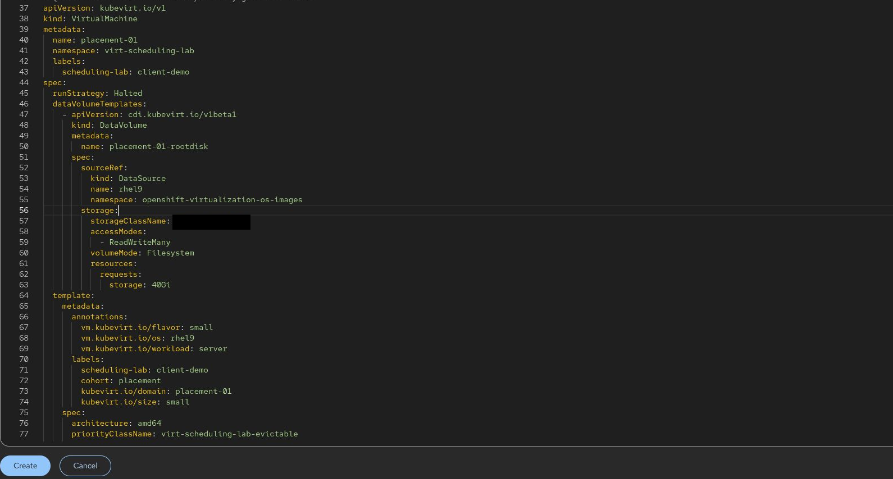

5. Open **+ → Import YAML** again. Paste the whole [02-spread-vms.yaml](manifests/02-spread-vms.yaml), including the **---** separators. It contains three VMs.
6. Confirm the same three storage settings on **all three VMs**. Change all three disk sizes if required, then **Create**. Check that **spread-01**, **spread-02** and **spread-03** each show **Created**.

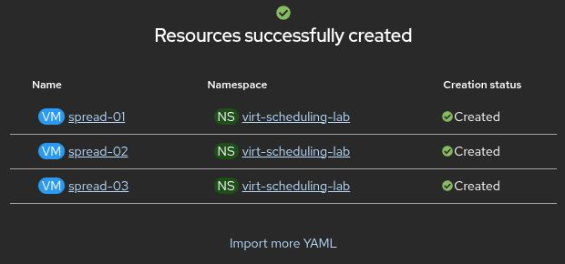

7. On that results page, click **Import more YAML**. Paste [03-negative-unsatisfiable-vm.yaml](manifests/03-negative-unsatisfiable-vm.yaml), confirm the same storage settings and adjust its disk size if required, then **Create**.
8. Open **Virtualization → VirtualMachines → Virtual machines**. Close a welcome dialog if it appears. Check that all five names are present. Finish the disk checks below before handoff.

**If your approved class has a different name:** change **storageClassName** on all five disks before creation. Keep **Block** and **ReadWriteMany**. Keep YAML indentation unchanged. If a create fails, inspect what was created before retrying; do not submit an entire batch again blindly.

<details>
<summary>Equivalent CLI</summary>

~~~sh
for f in manifests/01-placement-vm.yaml manifests/02-spread-vms.yaml manifests/03-negative-unsatisfiable-vm.yaml; do
  cp "$f" "$LAB_EVIDENCE/$(basename "$f")"
done
# If the approved class differs, edit storageClassName in all five private disk definitions.
# If section 1.2 requires larger disks, edit all five disk requests in these private copies first.
oc create -f "$LAB_EVIDENCE/01-placement-vm.yaml" -f "$LAB_EVIDENCE/02-spread-vms.yaml" \
          -f "$LAB_EVIDENCE/03-negative-unsatisfiable-vm.yaml"
oc get vm -n $NS
~~~

</details>

Existing disks do not change when you edit a VM template. Do not try to convert
a bound PVC in place. Keep suitable existing VMs unchanged. If a disposable test
VM needs a different disk, use the UID-checked cleanup procedure and
create a new disk after preserving anything needed.

### 2.4 Wait for the root-disk clones

Use the storage class's **Volume binding mode** from section 1.3:

| Binding mode | When to wait |
| --- | --- |
| Immediate | Wait for all five clones now, before handing over the Stopped VMs. |
| WaitForFirstConsumer | Start the relevant VM in the customer test to trigger population, then wait for its clone before evaluating that test. Do not wait for every clone while all VMs are Stopped. |

**In the console:**

1. Open **Storage → PersistentVolumeClaims** in project **virt-scheduling-lab**. The five **\*-rootdisk** claims should become **Bound** after population.
2. Open **placement-01-rootdisk**. On **Details**, check **Access modes: ReadWriteMany** and **Volume mode: Block** and **StorageClass: vxflexos**. Repeat for the other four claims.
3. Under **Owner**, click the **DataVolume** link with the same name. Check the **Succeeded** badge and **Ready=True** condition. **Running=False / Completed / Clone Complete** means the clone finished successfully.
4. Click the **DataVolumes** breadcrumb to compare all five clones. After population, each should show **Succeeded** and **100.0%**.

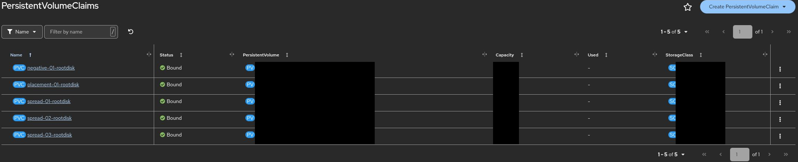

The screenshot below shows where to find the fields using an alternate
filesystem-backed example. **For these templates, require Block and vxflexos;
Filesystem is not the expected result.**

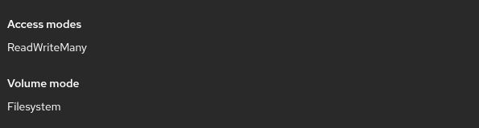

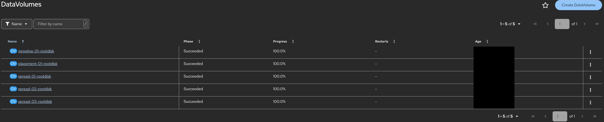

The negative-test VM has no schedulable worker, so its disk can legitimately remain unpopulated with **WaitForFirstConsumer**. Do not treat that as a failed clone or relax its impossible scheduling rule.

**Handoff:** return to the VM list. All five VMs should show **Stopped**, and their disks should be ready as described above. No test labels should be on the workers yet. **Ready=False** or **LiveMigratable=False** can appear while a VM is Stopped; evaluate those VM conditions after starting it. Use the disk checks above for the stopped handoff. The guest-agent and console checks happen after the first start, as described in the walkthrough and section 3 below.

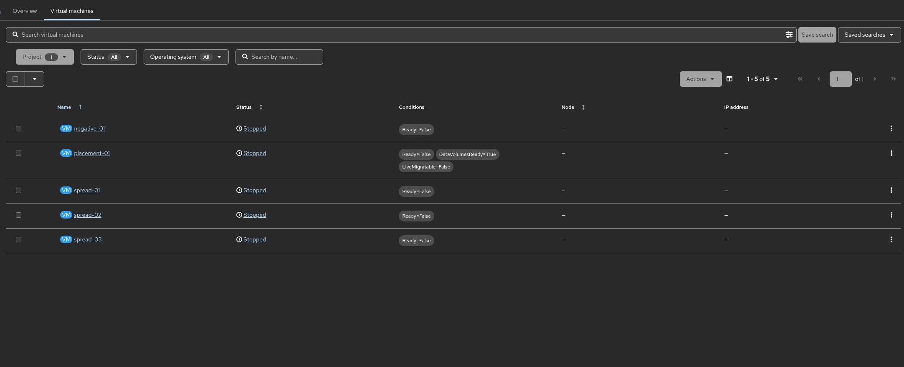

<details>
<summary>Read-only CLI disk checks</summary>

~~~sh
oc get dv,pvc -n "$NS"
~~~

For **Immediate** binding only:

~~~sh
for vm in $LAB_VMS; do
  oc wait dv/"$vm"-rootdisk -n "$NS" --for=condition=Ready --timeout=30m
done
~~~

For **WaitForFirstConsumer**, wait per VM after it is started, for example:

~~~sh
oc wait dv/placement-01-rootdisk -n "$NS" --for=condition=Ready --timeout=30m
~~~

</details>

<a id="running-vm-checks"></a>

## 3–6. Customer tests

Return to the [customer walkthrough](RUNBOOK.md) for placement, spreading,
the impossible rule and the requested (manual) migration. Keep the administrator
session below available for the descheduler checkpoints.

After placement-01 starts, confirm its actual running state before migration:

~~~sh
oc get vmi placement-01 -n "$NS" -o jsonpath='{range .status.conditions[*]}{.type}={.status}{"\n"}{end}'
oc get pods -n "$NS" -l vm.kubevirt.io/name=placement-01 --field-selector=status.phase=Running \
  -o custom-columns=NAME:.metadata.name,PRIORITY:.spec.priority,CLASS:.spec.priorityClassName
~~~

Require Ready, LiveMigratable and AgentConnected True, priority -1000000000,
and class virt-scheduling-lab-evictable. Record VM and running-instance UIDs
before the policy test using section 7.8. If checking the guest account,
the POC cloud-user must not have passwordless sudo.

For a first-boot check, open **placement-01 → Console**, choose **Serial console** from the console dropdown, click inside the terminal and press **Enter**. Allow cloud-init a few minutes to finish. The prepared guest logs in as **cloud-user**. Run `id` to confirm the user; `sudo -n -l` must not grant passwordless privileges. A password-required or not-allowed result is expected. Stop if it grants passwordless access.

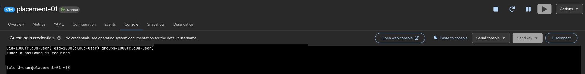

## 7. Administrator checkpoints for automatic migration

The VM's node stops being eligible; the running VM is not moved by the label
change itself. `AffinityAndTaints` (`RemovePodsViolatingNodeAffinity`) finds
the violation and evicts the launcher pod; OpenShift Virtualization answers
the eviction with 429 and live-migrates instead; the scheduler picks an
eligible node.

<a id="descheduler-prepare"></a>

### 7.1 Who else edits it, and pausing them

```sh
oc get kubedescheduler cluster -n $DS_NS -o jsonpath='{.metadata.uid}{"\n"}{.metadata.annotations}{"\n"}{.metadata.labels}{"\n"}'
oc get kubedescheduler cluster -n $DS_NS --show-managed-fields \
  -o jsonpath='{range .metadata.managedFields[*]}{.manager}{" "}{.operation}{" "}{.time}{"\n"}{end}'
```

If GitOps, ACM or another team can write it, agree a pause and window with
the owner. Do not proceed while another writer is active; never `oc apply` /
`oc replace` the whole object, never delete or re-create an existing one. An
existing object that is Degraded only because a profile needs PSI does not
block this test (the lab profiles do not need PSI).

### 7.2 Snapshot - or create if absent

Existing object (normal case):

```sh
oc get kubedescheduler cluster -n $DS_NS -o json > "$LAB_EVIDENCE/kubedescheduler-snapshot.json"
jq '.spec | {mode, deschedulingIntervalSeconds, profiles, profileCustomizations, evictionLimits}' "$LAB_EVIDENCE/kubedescheduler-snapshot.json"
RV0=$(jq -r .metadata.resourceVersion "$LAB_EVIDENCE/kubedescheduler-snapshot.json")
```

Console: **Ecosystem → Installed Operators** (or **Operators → Installed Operators**). Select project **openshift-kube-descheduler-operator**; turn on **Show default projects** in the project selector if it is hidden. Open **Kube Descheduler Operator → Kube Descheduler → cluster → YAML → Download**. Keep the download private.

No object (NotFound): create it with the lab values and record its UID; then
skip 7.4's patch (but **not** 7.4's verification):

```sh
oc create -f descheduler/05e-create-if-absent.yaml
oc get kubedescheduler cluster -n $DS_NS -o jsonpath='{.metadata.uid}{"\n"}' | tee "$LAB_EVIDENCE/kubedescheduler-created-uid.txt"
```

### 7.3 Starting state

Use this administrator terminal to read SOURCE and choose TARGET. Do not
depend on variables from the customer's terminal:

~~~sh
SOURCE=$(oc get vmi placement-01 -n "$NS" -o jsonpath='{.status.nodeName}')
case "$SOURCE" in
  "$NODE_A") TARGET="$NODE_B" ;;
  "$NODE_B") TARGET="$NODE_A" ;;
  *) TARGET="" ;;
esac
if [ -n "$SOURCE" ] && [ -n "$TARGET" ]; then printf 'SOURCE=%s TARGET=%s\n' "$SOURCE" "$TARGET"; else echo "STOP: unexpected source worker '$SOURCE'. Do not change labels."; fi
~~~

On `STOP`, leave every label as it is and find out where the VM is running.
The terminal stays open with its values. Confirm the customer will use this
same pair in test 5C. Both must be agreed
workers, Ready and with target capacity and CPU compatibility for migration.

- placement-01 is Running and LiveMigratable.
- Only SOURCE and TARGET may carry eligible. Remove it from the third
  approved node if present. A non-approved node with the label is a stop.
- Spread VMs and negative-01 are halted; no migration is in progress.
- Record VM UID, VMI UID, node, boot ID and uptime using section 7.8.

### 7.4 Lab configuration in Predictive + verification

Patch (skip if you created the object in 7.2):

```sh
jq --arg rv "$RV0" '.[0].value = $rv' descheduler/05a-lab-predictive.patch.json > "$LAB_EVIDENCE/05a.json"
oc patch kubedescheduler cluster -n $DS_NS --type=json --patch-file="$LAB_EVIDENCE/05a.json"
```

The patch applies only if the object is still exactly the version saved in the
7.2 snapshot. If it reports that the test failed, someone changed the object
after the snapshot and nothing was written. Stop, find out who changed it, then
take a fresh 7.2 snapshot (it is now the true original) and repeat 7.4. Never
edit the guard to make it pass.

Console alternative: in the `cluster` YAML editor set only these five fields,
leaving everything else, and **Save** (the console refuses if the object
changed since opened):

```yaml
spec:
  mode: Predictive
  deschedulingIntervalSeconds: 30
  profiles: [AffinityAndTaints, LongLifecycle, EvictPodsWithLocalStorage, EvictPodsWithPVC]
  profileCustomizations:
    devEnableEvictionsInBackground: true
    thresholdPriority: -999999999
    namespaces:
      included: [virt-scheduling-lab]
  evictionLimits: {node: 1, total: 1}
```

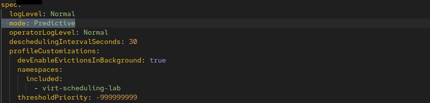

After **Save**, click **Reload** and read the fields again. A success banner confirms a save, but the field values and the checks below confirm what is running. Keep this YAML page available so you can return to Predictive promptly.

Verify what the operator generated (always, also after 05e):

```sh
oc get kubedescheduler cluster -n $DS_NS -o jsonpath='{range .status.conditions[*]}{.type}={.status} {.reason}{"\n"}{end}'
oc rollout status deploy/descheduler -n $DS_NS --timeout=180s
oc get deploy descheduler -n $DS_NS -o jsonpath='{.spec.template.spec.containers[0].args}{"\n"}' | tee "$LAB_EVIDENCE/args-predictive.txt"
oc get configmap cluster -n $DS_NS -o jsonpath='{.data.policy\.yaml}' > "$LAB_EVIDENCE/policy-predictive.yaml"
grep -c 'name: DefaultEvictor' "$LAB_EVIDENCE/policy-predictive.yaml"
grep -n -A2 'priorityThreshold' "$LAB_EVIDENCE/policy-predictive.yaml"
grep -n -E 'RemovePodsViolatingNodeAffinity|LowNodeUtilization|virt-scheduling-lab|maxNoOfPodsToEvict' "$LAB_EVIDENCE/policy-predictive.yaml"
```

HCO health (console: **Observe > Metrics**, query
`kubevirt_hco_misconfigured_descheduler`; **Observe > Alerting**, search
`HCOMisconfiguredDescheduler`):

```sh
# Read-only Prometheus queries using the existing monitoring pod.
# Requires permission to exec into this namespace; no token is printed or passed to curl.
oc exec -n openshift-monitoring prometheus-k8s-0 -c prometheus -- \
  promtool query instant http://localhost:9090 kubevirt_hco_misconfigured_descheduler
oc exec -n openshift-monitoring prometheus-k8s-0 -c prometheus -- \
  promtool query instant http://localhost:9090 'ALERTS{alertname="HCOMisconfiguredDescheduler"}'
```

If monitoring access is restricted, have the monitoring owner run the queries
or use the console Metrics page. Do not change monitoring RBAC for this test.

Expected - stop if any item fails:

- no condition `Degraded=True`, and no PSI error (`can only be used when PSI
  metrics are enabled`); `status.readyReplicas` on the CR can be stale - trust
  the Deployment rollout;
- args contain `--dry-run=true`, `--descheduling-interval=30s` and the
  `EvictionsInBackground=true` feature gate;
- **every** DefaultEvictor block has `priorityThreshold` with value
  `-999999999` (the `priorityThreshold` count equals the DefaultEvictor
  count);
- `RemovePodsViolatingNodeAffinity` is present and limited to
  `virt-scheduling-lab`; `LowNodeUtilization` is present (its namespace scope
  is the protected-namespace exclusion, as expected - priority is the guard);
  eviction limits 1 per node and 1 total;
- metric value `0` (it can take a minute to update); `ALERTS` result empty.

### 7.5 Trigger and dry run

1. The customer changes the labels in walkthrough test 5C (TARGET gets the
   label, then SOURCE loses it). Do not change them again here; only check:
   ```sh
   oc get nodes -l scheduling-lab.example.com/eligible=true -o name
   ```
   Expected: TARGET only. If SOURCE still has it or TARGET lacks it, ask the
   customer to finish 5C. The 5C commands are safe to repeat.
2. Watch at least two intervals:
   ```sh
   oc logs deploy/descheduler -n $DS_NS --since=5m | tee "$LAB_EVIDENCE/predictive-log.txt" \
     | grep -i -E 'evict|RemovePodsViolatingNodeAffinity|LowNodeUtilization'
   oc get vmi placement-01 -n $NS -o wide
   oc get vmim -n $NS
   ```
   Console: **Workloads > Pods** > `descheduler-...` > **Logs**; VM Overview Node unchanged.

Expected: a dry-run eviction candidate for `virt-launcher-placement-01-...`
attributed to `RemovePodsViolatingNodeAffinity`; VMI still on SOURCE; no new
migration. **Stop** if any other pod appears as a candidate. A candidate from
`LowNodeUtilization` alone does not count. No candidate after 5 minutes: 7.7.

<a id="activate"></a>

### 7.6 Automatic (explicit step)

Immediately before: repeat **1.6** (pod priority inventory) and re-check the
lab pods; both must still be clean:

```sh
oc get pods -n $NS -o json | jq -r '.items[]
  | "\(.metadata.name) priority=\(.spec.priority) class=\(.spec.priorityClassName // "-") evict-annotation=\((.metadata.annotations // {}) | has("descheduler.alpha.kubernetes.io/evict"))"'
```

Expected: only placement-01's launcher has `priority=-1000000000
class=virt-scheduling-lab-evictable`; no lab pod has the evict annotation.

Also verify the reserved class still has its intended settings and identity:

~~~sh
oc get priorityclass "$PC" -o json | jq -e '
  .value == -1000000000 and .globalDefault != true and .preemptionPolicy == "Never"'
test "$(oc get priorityclass "$PC" -o jsonpath='{.metadata.uid}')" = \
     "$(cut -d' ' -f1 "$LAB_EVIDENCE/priorityclass-uid.txt")"
~~~

Require true and a successful identity comparison. Otherwise stop.

```sh
RV1=$(oc get kubedescheduler cluster -n $DS_NS -o jsonpath='{.metadata.resourceVersion}')
jq --arg rv "$RV1" '.[0].value = $rv' descheduler/05b-lab-automatic.patch.json > "$LAB_EVIDENCE/05b.json"
oc patch kubedescheduler cluster -n $DS_NS --type=json --patch-file="$LAB_EVIDENCE/05b.json"
date -u +%FT%TZ | tee "$LAB_EVIDENCE/automatic-start.txt"
oc rollout status deploy/descheduler -n $DS_NS --timeout=180s
oc get deploy descheduler -n $DS_NS -o jsonpath='{.spec.template.spec.containers[0].args}{"\n"}'
```

05b applies only if the resourceVersion is the one read on the line just
before it and all five fields are exactly the lab values (full
`profileCustomizations` including the background flag and threshold). Read the
version immediately before patching; do not reuse an older value. If the patch
fails, nothing changed: re-read the object and compare the five fields. If they
still match the lab values, run the block again once; otherwise stop and review
with the owner. Do not edit guards or guess server defaults. Console alternative: compare the
five fields with the 7.4 block first, then change only `mode` to `Automatic`.

Expected: args no longer contain `--dry-run=true`. Changing mode replaces the
operand pod. **Capture the new pod's log while Automatic is active**, in a
separate administrator terminal or console Logs tab. Returning to Predictive
can delete that pod and its log. Keep the capture running while you return to
Predictive; do not delay the return to collect evidence.

Use **three separate administrator terminals or tabs** for these commands.
Set the same `NS`, `DS_NS` and `LAB_EVIDENCE` values from the administrator
session in each terminal; use the same evidence directory. Each command keeps
running until you press **Ctrl+C**. Keep the controller's YAML page open in
the console so you can return to Predictive promptly. Stop the test after
five minutes if no migration succeeds.

**Terminal 1 — start log capture first**, after the new Automatic pod is ready:

```sh
oc logs -f deploy/descheduler -n $DS_NS --since=10m | tee "$LAB_EVIDENCE/automatic-log.txt" \
  | grep -i -E 'placement-01|evict|evacuation'
```

**Terminal 2 — watch the VM's worker:**

```sh
oc get vmi placement-01 -n $NS -o wide -w
```

**Terminal 3 — watch migration status:**

```sh
oc get vmim -n $NS -w
```

Expected: the log names the current `virt-launcher-placement-01-...` pod
under `RemovePodsViolatingNodeAffinity`, followed by a cluster-created
migration. With background evictions enabled, the log can report
`evictionRequests=1` and `evictedPods=0`: the VM migration is handled in
the background. Do not require an error/HTTP 429 log line. If a version does
log `Eviction triggered evacuation of VMI ...`, that response is expected.
A transient `EvictionRequested=True` might be too brief to observe.
The cluster-created migration (normally `kubevirt-evacuation-...`) reaches
`Succeeded`; VMI node = TARGET. Console: VM **Migrating** then Node = TARGET;
**Virtualization > Overview > Migrations** (or **Home > Search** >
`VirtualMachineInstanceMigration`) shows Succeeded.

Then **immediately** back to Predictive:

```sh
oc patch kubedescheduler cluster -n $DS_NS --type=json --patch-file=descheduler/05c-back-to-predictive.patch.json
oc rollout status deploy/descheduler -n $DS_NS --timeout=180s
oc get deploy descheduler -n $DS_NS -o jsonpath='{.spec.template.spec.containers[0].args}{"\n"}'   # --dry-run=true again
```

### 7.7 Timeout or anything unexpected

No migration within 5 minutes, a failed migration, a non-lab candidate, or a
move attributed only to `LowNodeUtilization`:

1. Apply 05c at once.
2. Diagnose without forcing: generated policy (7.4); launcher pod has the
   required nodeAffinity; TARGET labelled, Ready, untainted, headroom; VMI
   `LiveMigratable=True`; descheduler logs.
3. No node drain, no pod delete, no manual migration presented as a
   descheduler result. Record **blocked** or **failed** with evidence.

### 7.8 Guest continuity

Before (7.3) and after:

```sh
oc get vm placement-01 -n $NS -o jsonpath='{.metadata.uid}{"\n"}'
oc get vmi placement-01 -n $NS -o jsonpath='{.metadata.uid}{" "}{.status.nodeName}{"\n"}'
oc get vmi placement-01 -n $NS -o jsonpath='{.status.migrationState.sourceNode}{" -> "}{.status.migrationState.targetNode}{" completed="}{.status.migrationState.completed}{" failed="}{.status.migrationState.failed}{"\n"}'
oc get vmi placement-01 -n $NS -o jsonpath='{range .status.conditions[*]}{.type}={.status}{" "}{end}{"\n"}'
```

Guest (serial console; it reconnects after the move): `cat /proc/sys/kernel/random/boot_id`, `cut -d' ' -f1 /proc/uptime`.

**Pass** only if all hold: no migration created by you for this attempt; the
log attributes the eviction to `RemovePodsViolatingNodeAffinity`; migration
`Succeeded` SOURCE -> TARGET; VM UID and VMI UID unchanged; boot_id unchanged
and uptime increased by about the elapsed time; `Ready`, `LiveMigratable`,
`AgentConnected` all `True` afterwards.

<a id="restore"></a>

### 7.9 Restore

Existing object - after 05c:

```sh
CUR_RV=$(oc get kubedescheduler cluster -n $DS_NS -o jsonpath='{.metadata.resourceVersion}')
jq --arg rv "$CUR_RV" -f descheduler/05d-restore-touched-fields.jq \
  "$LAB_EVIDENCE/kubedescheduler-snapshot.json" > "$LAB_EVIDENCE/restore.patch.json"
cat "$LAB_EVIDENCE/restore.patch.json"       # review
oc patch kubedescheduler cluster -n $DS_NS --type=json --patch-file="$LAB_EVIDENCE/restore.patch.json"
F='.spec | {mode, deschedulingIntervalSeconds, profiles, profileCustomizations, evictionLimits}'
diff <(jq -S "$F" "$LAB_EVIDENCE/kubedescheduler-snapshot.json") \
     <(oc get kubedescheduler cluster -n $DS_NS -o json | jq -S "$F")      # expect no output
```

The restore patch first tests the resourceVersion **and** that all five fields
still hold exactly the lab Predictive values; any concurrent change makes it
fail with nothing written. Then only those five fields return to the
snapshot; metadata, status and other fields are untouched. On failure stop
and review with the owner.

Console alternative (no full-YAML paste): open the YAML; first compare the
five fields with the expected lab values (7.4 block, `mode: Predictive`) and
stop on any difference; then set only those five fields to their snapshot
values (delete a field the snapshot lacks); Save; run the `diff` above.

Created object (05e) - delete only if the UID matches:

```sh
test "$(oc get kubedescheduler cluster -n $DS_NS -o jsonpath='{.metadata.uid}')" = \
     "$(cat "$LAB_EVIDENCE/kubedescheduler-created-uid.txt")" \
  && oc delete kubedescheduler cluster -n $DS_NS || echo "UID MISMATCH - not deleting"
```

After restore: hand the object back to its owner and confirm their tool is in
sync. A configuration that was Degraded for PSI before returns to that state,
and the descheduler Deployment may be scaled to 0; HCO's metric/alert return
to whatever the original configuration produces. Operator-created
ServiceAccounts, RBAC, ConfigMaps and Services may remain: leave them; never
delete cluster RBAC or other operator-owned objects.

<a id="evidence"></a>

## 8. Evidence (read-only, private)

```sh
oc get nodes $(cat "$LAB_EVIDENCE/approved-nodes.txt") -L scheduling-lab.example.com/eligible,scheduling-lab.example.com/spread-pool > "$LAB_EVIDENCE/nodes.txt"
oc get vm,vmi,vmim,dv,pvc,pods -n $NS -o wide > "$LAB_EVIDENCE/lab-objects.txt"
oc get vmi -n $NS -o yaml > "$LAB_EVIDENCE/vmi.yaml"
oc get vmim -n $NS -o yaml > "$LAB_EVIDENCE/vmim.yaml"
oc get events -n $NS --sort-by=.lastTimestamp > "$LAB_EVIDENCE/events.txt"
oc get kubedescheduler cluster -n $DS_NS -o yaml > "$LAB_EVIDENCE/kubedescheduler-now.yaml"
```

Contains cluster names and UIDs: keep out of the public repository.

<a id="reset"></a>

## 9. Reset between test runs

Root disks are kept between runs (guest changes persist; boot_id changes on each start).

1. Descheduler in Predictive (7.6 last block) or restored (7.9).
2. Migrations: `oc get vmim -n $NS -o custom-columns=NAME:.metadata.name,VMI:.spec.vmiName,PHASE:.status.phase`.
   Any phase other than `Succeeded`/`Failed`: **stop and wait**; never delete an in-flight migration.
3. Halt the five named VMs and wait for their VMIs to go:
   ```sh
   for vm in $LAB_VMS; do
     oc get vm "$vm" -n $NS >/dev/null && oc patch vm "$vm" -n $NS --type merge -p '{"spec":{"runStrategy":"Halted"}}'
   done
   for vm in $LAB_VMS; do oc wait vmi/"$vm" -n $NS --for=delete --timeout=300s; done
   ```
   Console: open each named VM and use **Actions → Control → Stop**; wait for the list to show **Stopped**. Keep the disks.
4. Delete only finished migrations of the lab VMs:
   ```sh
   oc get vmim -n $NS -o json | jq -r '.items[]
     | select(.status.phase == "Succeeded" or .status.phase == "Failed")
     | select(.spec.vmiName as $v | ["placement-01","spread-01","spread-02","spread-03","negative-01"] | index($v))
     | .metadata.name' | while read -r m; do oc delete vmim "$m" -n $NS; done
   ```
5. Labels - only the recorded approved nodes:
   ```sh
   for n in $(cat "$LAB_EVIDENCE/approved-nodes.txt"); do
     oc label node "$n" scheduling-lab.example.com/eligible- scheduling-lab.example.com/spread-pool-
   done
   oc get nodes -l scheduling-lab.example.com/eligible; oc get nodes -l scheduling-lab.example.com/spread-pool
   ```
   A "not found" message for a label a node never had is harmless. If the
   cluster-wide checks still list a node, it is not yours: leave it and find out who set it.
6. Optional fresh disks: delete a halted VM (its DataVolume and PVC go with it,
   section 10 step 3) and re-create it from the edited YAML in `$LAB_EVIDENCE`; wait
   for the clone again (2.4).
7. Start again at step 3.

<a id="cleanup"></a>

## 10. Cleanup

1. Descheduler restored (7.9) and handed back, or the created one deleted with the UID guard.
2. Reset 9.2-9.4 (no in-flight migrations; VMs halted).
   Before deleting any disk, record its PV and reclaim policy:
   ```sh
   oc get pvc -n $NS -o custom-columns=CLAIM:.metadata.name,UID:.metadata.uid,PV:.spec.volumeName \
     | tee "$LAB_EVIDENCE/lab-claims-before-delete.txt"
   for pv in $(oc get pvc -n $NS -o jsonpath='{range .items[*]}{.spec.volumeName}{"\n"}{end}'); do
     oc get pv "$pv" -o jsonpath='{.metadata.name}{" claim="}{.spec.claimRef.namespace}{"/"}{.spec.claimRef.name}{" claimUID="}{.spec.claimRef.uid}{" reclaim="}{.spec.persistentVolumeReclaimPolicy}{"\n"}'
   done | tee "$LAB_EVIDENCE/lab-pv-policies-before-delete.txt"
   ```
   Console: open each lab PVC's volume link and inspect the PV's reclaim policy.
3. Delete the VMs; their DataVolumes and PVCs (test data) are owned by the VMs and must disappear:
   ```sh
   for vm in $LAB_VMS; do oc delete vm "$vm" -n $NS --ignore-not-found; done
   oc get dv,pvc -n $NS        # wait until empty
   ```
   Console: **Virtualization > VirtualMachines** > each VM > **Actions >
   Delete**. In the confirmation dialog, keep each listed test **DataVolume** selected, then click **Delete**; **Storage > PersistentVolumeClaims** is empty.

   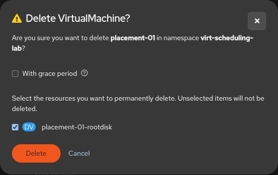

   If any `*-rootdisk` PVC remains, check its ownerReferences, then delete it by name.
   PVC API deletion does not by itself prove backend data erasure. Storage
   cleanup follows the PV reclaim policy and CSI provider. With `Delete`,
   verify each recorded lab PV and provider volume are removed as expected.
   With `Retain`, use the recorded namespace/claim UID to identify the exact
   residual lab PVs and hand them to the storage owner for approved cleanup.
   Do not delete unrelated Released PVs or remove storage finalizers.
4. Namespace - only if the UID matches and the inventory (1.5 loop) is complete and lab-only:
   ```sh
   test "$(oc get namespace $NS -o jsonpath='{.metadata.uid}')" = "$(cat "$LAB_EVIDENCE/namespace-uid.txt")" \
     && oc delete namespace $NS || echo "UID MISMATCH - not deleting"
   ```
   Run the 1.5 inventory loop first and continue only if it prints
   `inventory complete` and lists nothing but lab and automatic objects.
5. PriorityClass - only if the UID matches and no pod uses it:
   ```sh
   if oc get pods -A -o json > "$LAB_EVIDENCE/pods-before-pc-delete.json"; then
     jq -r --arg pc "$PC" '.items[] | select(.spec.priorityClassName == $pc) | "\(.metadata.namespace)/\(.metadata.name)"' "$LAB_EVIDENCE/pods-before-pc-delete.json"   # expect empty
   else echo "POD LIST FAILED - stop, do not delete the PriorityClass"; fi
   ```
   Continue only if the pod list succeeded and printed no pod. Then:
   ```sh
   test "$(oc get priorityclass $PC -o jsonpath='{.metadata.uid}')" = "$(cut -d' ' -f1 "$LAB_EVIDENCE/priorityclass-uid.txt")" \
     && oc delete priorityclass $PC || echo "UID MISMATCH - not deleting"
   ```
6. Node labels from the recorded approved nodes (9.5).
7. Console: project gone from **Home > Projects**; no `virt-scheduling-lab-evictable`
   in **Home > Search** > PriorityClass; approved nodes show no lab labels.

## 11. Client tailoring checklist

- [ ] Approved nodes, RWX StorageClass and capacity agreed with their owners.
- [ ] `rhel9` DataSource Ready (or the client's approved RHEL 9 source substituted in all four VM files).
- [ ] Label domain `scheduling-lab.example.com`, namespace and PriorityClass names acceptable (namespace also in the descheduler patches).
- [ ] Descheduler owner identified, pause window agreed, snapshot taken.
- [ ] Pod priority inventory clean; owner agrees not to use the reserved class or force-evict annotation during the window.
- [ ] Console RBAC for the lab namespace limited to the demo team.
- [ ] Preflight passed on the client version itself.

<a id="troubleshooting"></a>

## 12. Troubleshooting

| Symptom | Likely cause |
|---|---|
| DataVolume stuck `CloneScheduled`/`Pending` | StorageClass name, capacity, clone permission, or WaitForFirstConsumer (start the VM) |
| `LiveMigratable=False` | PVC not RWX, or another non-migratable device |
| launcher pod rejected: priority class not found | 2.2 skipped |
| HCO metric `1` / alert firing | profiles/customizations not exactly the lab set; AffinityAndTaints with background evictions alone is not accepted |
| Descheduler never names placement-01 | include not applied, operand not rolled out, VM without required nodeAffinity, local-storage/PVC profiles missing, or priority not below threshold |
| `readyReplicas: 0` on the CR | can be stale; check conditions and the Deployment |
| Serial console asks for login | cloud-init still running on first boot |

<a id="reference-map"></a>

## Reference map for older YAML comments

Comments that say “RUNBOOK section …” use the earlier numbering.
Use this table to find the matching administrator section:

| Earlier reference | Read now |
| --- | --- |
| 0 / 1 | Administrator session / preflight in this guide |
| Namespace YAML comment “RUNBOOK 1.4” | Section **1.5** here: new namespace and PriorityClass checks. That older comment used the wrong subsection; 1.4 is node readiness. |
| 2.2 / 2.3 / 2.4 | PriorityClass / VM creation / disk-clone checks in this guide |
| 3 / 4 / 5 / 6 | Customer walkthrough tests 1 / 2 / 3 / 4 |
| 7.1–7.9 | Descheduler checkpoints in this guide |
| 8 / 9 / 10 / 11 / 12 | Evidence / reset / cleanup / tailoring / troubleshooting in this guide |

## Configuration notes

LongLifecycle and background evictions provide the documented no-PSI path
used by this test. AffinityAndTaints supplies the node-affinity correction.
LongLifecycle's LowNodeUtilization strategy does not honor namespace inclusion,
so the priority threshold is essential. Force-eviction annotations bypass the
priority filter, which is why the complete inventory is repeated before Automatic.

Only placement-01 uses the reserved class. Scheduling rules, descheduler
patches, snapshot/restore guards, 1/1 eviction limits and test stop conditions
are unchanged. New-VM disk defaults now use **vxflexos / Block / ReadWriteMany
(RWX)**. CPU-load-aware balancing remains a separate optional topic.

## References


- HCOMisconfiguredDescheduler alert runbook:
  <https://github.com/openshift/runbooks/blob/master/alerts/openshift-virtualization-operator/HCOMisconfiguredDescheduler.md>
- OpenShift 4.21 Nodes - controlling pod placement (affinity, descheduler profiles, `thresholdPriority`, Predictive mode):
  <https://docs.redhat.com/en/documentation/openshift_container_platform/4.21/html/nodes/controlling-pod-placement-onto-nodes-scheduling>
- OpenShift 4.21 Virtualization - live migration:
  <https://docs.redhat.com/en/documentation/openshift_container_platform/4.21/html/virtualization/live-migration>
- OpenShift 4.21 Virtualization - storage:
  <https://docs.redhat.com/en/documentation/openshift_container_platform/4.21/html/virtualization/storage>
- OpenShift 4.21 Virtualization (PDF; descheduler for VMs, section 9.18.13.2):
  <https://docs.redhat.com/en/documentation/openshift_container_platform/4.21/pdf/virtualization/OpenShift_Container_Platform-4.21-Virtualization-en-US.pdf>

- OpenShift 4.21 Virtualization — managing VMs and console access:
  <https://docs.redhat.com/en/documentation/openshift_container_platform/4.21/html/virtualization/managing-vms>
- OpenShift 4.22 Virtualization — managing VMs and console access:
  <https://docs.redhat.com/en/documentation/openshift_container_platform/4.22/html/virtualization/managing-vms>

- Dell PowerFlex CSI features — raw-block access modes:
  <https://dell.github.io/csm-docs/v3/csidriver/features/powerflex/>
- OpenShift 4.22 Virtualization — volume and access modes:
  <https://docs.redhat.com/en/documentation/openshift_container_platform/4.22/html/virtualization/installing>
