# Customer walkthrough: VM placement and migration

**Goal:** see how OpenShift places VMs, keeps them apart, and moves a running VM when a placement rule changes.

| Test | What you will demonstrate | VMware comparison |
| --- | --- | --- |
| 1 | Start a VM on an approved worker | VM-to-host rule |
| 2 | Keep three VMs on different workers | VM anti-affinity |
| 3 | Refuse a rule that no worker can satisfy | An impossible "must run" rule |
| 4 — optional | Move a running VM yourself | Manual vMotion |
| 5 | Move a running VM automatically after a rule changes | Automated rule correction |

## Before you start

The administrator must complete [preparation and setup](ADMIN-GUIDE.md#prepare). Your starting screen should show **five Stopped VMs** in project **virt-scheduling-lab**, with their disks ready. On storage that waits for the first consumer, the administrator will explain when cloning finishes.

Ask the administrator to identify **Worker A, Worker B, and Worker C**. Use only those workers.

Use the **web console or the equivalent CLI** for each change, not both. The CLI sections are collapsed so you can follow the web console without reading commands. Verification commands can run after a console action. Menu wording can vary by OpenShift version. If a welcome dialog appears, close it to continue.

The screenshots show the controls to use. Black boxes cover environment-specific values, including node names and guest output. These pictures show where to look; record and compare the unredacted values in your own console.

Using the CLI? Set your worker names once

Run from the case directory in your cloned repository:

~~~sh
cd test-cases/01-scheduling-and-migration
export NS=virt-scheduling-lab
export DS_NS=openshift-kube-descheduler-operator
export NODE_A='worker-a'
export NODE_B='worker-b'
export NODE_C='worker-c'
~~~

Replace the three worker names with the values agreed with your administrator. Keep this terminal open.

## 1. Start a VM on an approved worker

**What this shows:** a VM starts only on a worker that matches its placement rule.

**In the web console**

1. Open **Compute → Nodes → Worker A → Actions → Edit labels**.
2. Type **scheduling-lab.example.com/eligible=true** in the label entry box. Press **Enter** so it becomes a label, then click **Save**. Leave all existing labels unchanged.

   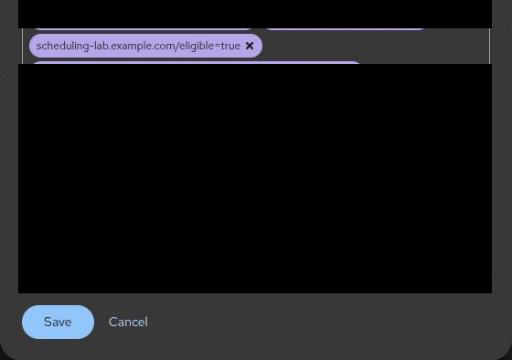

3. Open **Virtualization → VirtualMachines** in project **virt-scheduling-lab**, then choose the **Virtual machines** tab if the Overview opens. If the project filter is disabled and the wrong project is shown, open **Workloads → Pods**, select **virt-scheduling-lab** in the project selector, then return here.
4. Open **placement-01 → Actions → Control → Start**. Some versions call this **Start VirtualMachine**.

   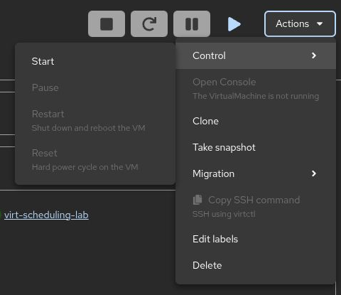

**Check the result:** the VM becomes **Running** and its **Node** is **Worker A**. If it remains Pending or starts elsewhere, stop and ask the administrator.

Equivalent CLI and checks

~~~sh
oc label node "$NODE_A" scheduling-lab.example.com/eligible=true
oc patch vm placement-01 -n "$NS" --type=merge -p '{"spec":{"runStrategy":"Always"}}'
oc wait vmi/placement-01 -n "$NS" --for=condition=Ready --timeout=10m
oc get vmi placement-01 -n "$NS" -o wide
~~~

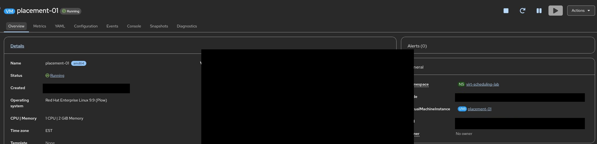

**Show the rule:** open **Configuration → Scheduling → 1 Affinity rules**. In the Node Affinity row, open the three-dot menu and choose **Edit** to inspect the existing rule. Confirm **Required during scheduling**, key **scheduling-lab.example.com/eligible**, operator **In**, and value **true**. Click **Cancel** in both dialogs; do not save or apply changes.

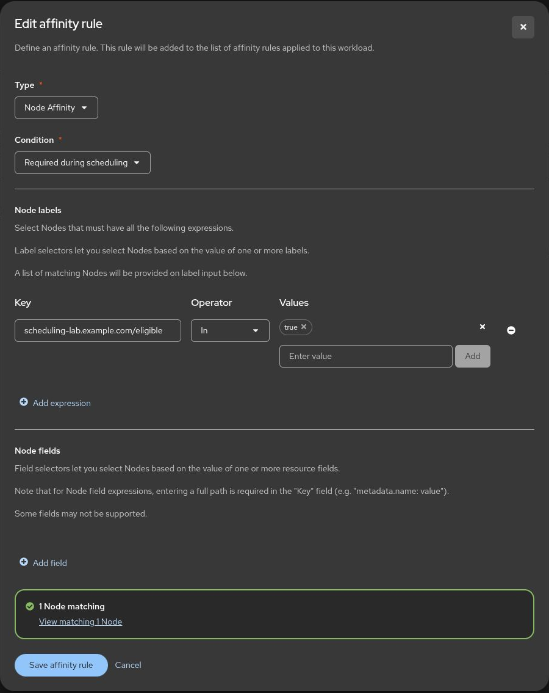

Before any migration, have the administrator confirm the guest agent, live-migration eligibility and actual launcher priority using the [administrator checks](ADMIN-GUIDE.md#running-vm-checks).

## 2. Keep three VMs on separate workers

**What this shows:** a hard anti-affinity rule prevents the three related VMs from sharing a worker.

**In the web console**

1. Add **scheduling-lab.example.com/spread-pool=true** to **Workers A, B and C**.
2. Open each of **spread-01**, **spread-02** and **spread-03**, then use **Actions → Control → Start**.
3. Return to the VM list and compare their **Node** values.

**Check the result:** the three VMs are Running on **three different approved workers**. The assignment of each VM can vary.

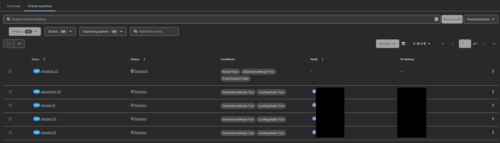

Equivalent CLI and checks

~~~sh
oc label node "$NODE_A" "$NODE_B" "$NODE_C" scheduling-lab.example.com/spread-pool=true
for vm in spread-01 spread-02 spread-03; do
  oc patch vm "$vm" -n "$NS" --type=merge -p '{"spec":{"runStrategy":"Always"}}'
done
oc wait vmi/spread-01 vmi/spread-02 vmi/spread-03 -n "$NS" --for=condition=Ready --timeout=10m
oc get vmi -n "$NS" -l cohort=spread -o custom-columns=VM:.metadata.name,NODE:.status.nodeName,STATUS:.status.phase
~~~

**Before continuing:** open each spread VM and choose **Actions → Control → Stop**. Wait until all three show **Stopped**. Keep their disks.

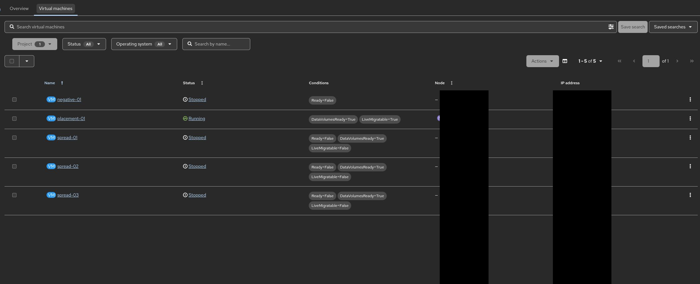

CLI: stop the spread VMs

~~~sh
for vm in spread-01 spread-02 spread-03; do
  oc patch vm "$vm" -n "$NS" --type=merge -p '{"spec":{"runStrategy":"Halted"}}'
done
for vm in spread-01 spread-02 spread-03; do
  oc wait vmi/"$vm" -n "$NS" --for=delete --timeout=300s
done
~~~

## 3. Try an impossible placement rule

**What this shows:** OpenShift refuses an unsatisfiable hard rule instead of ignoring it.

**In the web console**

1. Open **negative-01 → YAML**. Its rule requires the label **scheduling-lab.example.com/unsatisfiable=true**.
2. Start the VM. Do not add that label to any worker.
3. In the VM's **Overview**, find **General → Pod** and click the **virt-launcher-negative-01-…** link.
4. On the **Pod** page, open **Events**. VM Events can show only creation messages.

   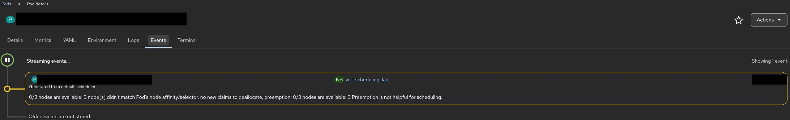

**Check the result:** the VM does **not** become Running. The Pod stays **Pending** and its scheduling event reports a node affinity or selector mismatch (**FailedScheduling**). The VM may show **ErrorUnschedulable**. This is the expected result of this test.

Equivalent CLI and checks

~~~sh
oc patch vm negative-01 -n "$NS" --type=merge -p '{"spec":{"runStrategy":"Always"}}'
oc get pods -n "$NS" -l vm.kubevirt.io/name=negative-01
oc get events -n "$NS" --field-selector reason=FailedScheduling
~~~

Look for the new event associated with negative-01; earlier events can remain in the list.

**Before continuing:** return to **negative-01** and choose **Actions → Control → Stop**. Wait for **Stopped**.

CLI: stop the negative-test VM

~~~sh
oc patch vm negative-01 -n "$NS" --type=merge -p '{"spec":{"runStrategy":"Halted"}}'
oc wait vmi/negative-01 -n "$NS" --for=delete --timeout=300s
~~~

## 4. Move a running VM yourself — optional

**What this shows:** a person can request live migration, similar to manual vMotion. This is separate from the automatic test.

**In the web console**

1. Add **scheduling-lab.example.com/eligible=true** to **Worker B**.
2. Before the move, record the guest boot ID and uptime using the [serial-console steps below](#b-record-the-running-vms-identity). Keep them private.
3. Open **placement-01 → Actions → Migration → Compute**. Some versions call the menu **Migrate**.
4. Leave **Automatically selected Node** selected and click **Migrate VirtualMachine**. Worker B is the only other eligible worker.

   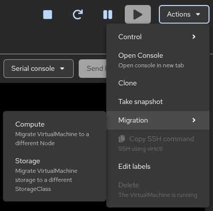

   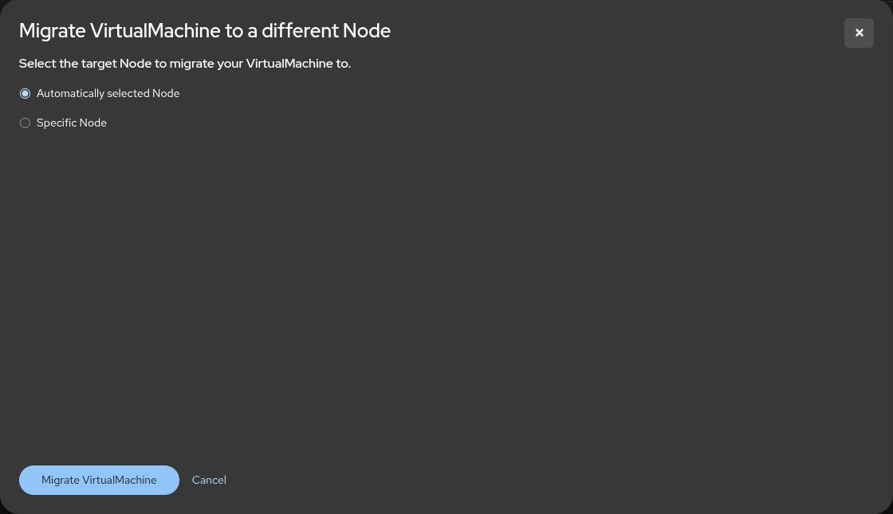

**Check the result:** the VM briefly shows **Migrating**, then **Running on Worker B**. Its migration record shows **Succeeded**. To find it, open **Virtualization → VirtualMachines → Overview → Migration statuses → View all** in the test project. Compare **Source**, **Target** and **Status**. Reconnect to the serial console and run the same two commands. The boot ID must match and uptime must increase. Wait for completion before continuing.

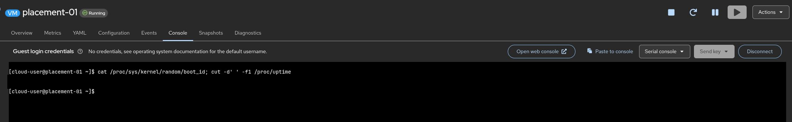

Equivalent CLI and checks

~~~sh
oc label node "$NODE_B" scheduling-lab.example.com/eligible=true
oc create -f actions/04-manual-migration.yaml
oc get vmim -n "$NS"
oc get vmi placement-01 -n "$NS" -o wide
~~~

The migration object name must be new. For a repeat take, ask the administrator to perform the [reset](ADMIN-GUIDE.md#reset).

## 5. Let OpenShift correct a placement-rule violation

**What this shows:** changing a worker label does not move a running VM by itself. The descheduler detects the violation and requests live migration.

This test is **rule correction**, not CPU-load balancing.

### A. Administrator prepares Predictive mode

**Required handoff:** the administrator must complete [descheduler preparation and health checks](ADMIN-GUIDE.md#descheduler-prepare). This includes the original configuration snapshot, background evictions, priority isolation and generated-policy checks.

In the console, open **Ecosystem → Installed Operators** (called **Operators → Installed Operators** in some versions). Select project **openshift-kube-descheduler-operator**; enable **Show default projects** in the project selector if needed. Open **Kube Descheduler Operator → Kube Descheduler → cluster → YAML**. The mode should be **Predictive**. In this mode, it reports proposed moves and does not perform them.

Do not continue until the administrator confirms the checkpoint passed. The [administrator CLI procedure](ADMIN-GUIDE.md#descheduler-prepare) provides the matching guarded commands.

### B. Record the running VM's identity

1. Open **Workloads → Pods** and select project **virt-scheduling-lab**. This switches back from the operator project.
2. Open **Virtualization → VirtualMachines → Virtual machines**.
3. Open **placement-01 → Console**. Use the **VNC console** dropdown to choose **Serial console**. Wait for it to connect, click inside the black terminal area, and press **Enter**.

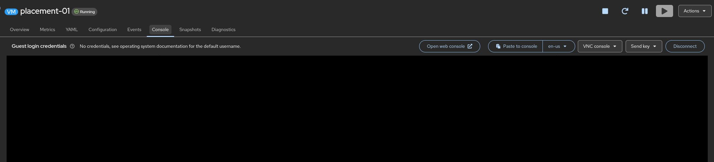

The prepared POC guest logs in as **cloud-user**. First boot can take a few minutes.

Run these commands **inside the guest** and record their output:

~~~sh
cat /proc/sys/kernel/random/boot_id
cut -d' ' -f1 /proc/uptime
~~~

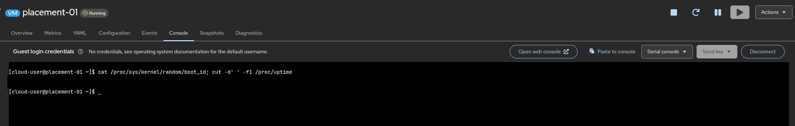

The first value identifies this boot. The second is uptime in seconds. The administrator also records the VM and running-instance IDs for the final comparison.

CLI: connect to the guest and record the running-instance ID

~~~sh
BEFORE_VMI_UID=$(oc get vmi placement-01 -n "$NS" -o jsonpath='{.metadata.uid}')
virtctl console placement-01 -n "$NS"
~~~

Run the guest commands above. Press **Ctrl+]** to leave the CLI console.

### C. Change which worker is approved

Read the VM's current **Node**; call it **SOURCE**. Choose the other worker as **TARGET**:

| Did you perform test 4? | Expected SOURCE | TARGET |
| --- | --- | --- |
| Yes | Worker B | Worker A |
| No | Worker A | Worker B |

**In the web console**

1. Confirm TARGET has **scheduling-lab.example.com/eligible=true**. Add it first if absent.
2. On SOURCE, open **Actions → Edit labels**. Click the **×** on **scheduling-lab.example.com/eligible=true**, then **Save**. Leave every other label unchanged.
3. Return to placement-01.

**Check the result:** the VM keeps running on SOURCE for now. The rule uses **IgnoredDuringExecution**; the label change alone does not relocate it.

Equivalent CLI and checks

~~~sh
SOURCE=$(oc get vmi placement-01 -n "$NS" -o jsonpath='{.status.nodeName}')
if [ "$SOURCE" = "$NODE_A" ]; then TARGET="$NODE_B"; else TARGET="$NODE_A"; fi
printf 'SOURCE=%s TARGET=%s\n' "$SOURCE" "$TARGET"
~~~

Compare these names with the table above. Stop if SOURCE is unexpected; do not change labels on another worker.

~~~sh
oc label node "$TARGET" scheduling-lab.example.com/eligible=true --overwrite
oc label node "$SOURCE" scheduling-lab.example.com/eligible-
oc get vmi placement-01 -n "$NS" -o wide
~~~

### D. Show the proposed move

1. Open **Workloads → Deployments**.
2. Select project **openshift-kube-descheduler-operator**. Enable **Show default projects** in the project selector if needed.
3. Open **descheduler → Pods**, click the **Running descheduler-… pod**, then open **Logs**.

Allow two 30-second intervals. Look for **placement-01**, **RemovePodsViolatingNodeAffinity**, and a dry-run eviction message. Use **Search logs** to find **placement-01**; searching pauses the stream, so click **Resume stream** when finished.

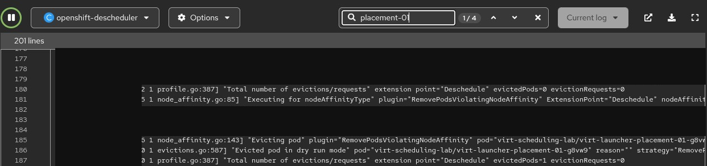

**Check the result:** the VM remains on SOURCE, and no new automatic migration appears. A completed manual migration from test 4 can still be listed.

**Stop:** if no node-affinity candidate appears within five minutes, another pod is a candidate, or the move is attributed only to LowNodeUtilization, ask the administrator to investigate. Do not enable Automatic.

Equivalent CLI and checks

~~~sh
oc logs deploy/descheduler -n "$DS_NS" --since=5m | grep -E 'placement-01|RemovePodsViolatingNodeAffinity|dry run'
oc get vmi placement-01 -n "$NS" -o wide
oc get vmim -n "$NS"
~~~

### E. Enable the automatic move

**Required handoff:** immediately before enabling Automatic, the administrator repeats the [isolation and activation checks](ADMIN-GUIDE.md#activate). A clean check from earlier in the session is not enough.

After confirmation, the administrator changes only **mode: Predictive → Automatic** in the cluster YAML, clicks **Save**, then **Reload**, and confirms **mode: Automatic**. The [guarded CLI alternative](ADMIN-GUIDE.md#activate) is also available.

Watch placement-01. It should show **Migrating**, then **Running on TARGET**. In the migration list, a new cluster-created migration should reach **Succeeded**. Do not request a manual migration in this part of the test.

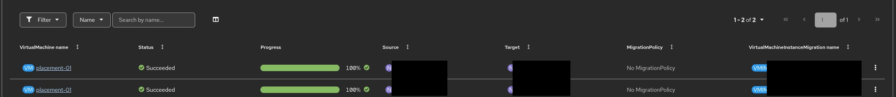

CLI: watch the result

~~~sh
oc get vmim -n "$NS" -o wide
oc get vmi placement-01 -n "$NS" -o wide
oc logs deploy/descheduler -n "$DS_NS" --since=5m
~~~

The eviction must be attributed to **RemovePodsViolatingNodeAffinity**. A move triggered only by LowNodeUtilization does not pass this test.

**Immediately after success, return to Predictive before checking the guest.** In the same YAML page, change only **mode: Automatic → Predictive**, click **Save**, then **Reload** and confirm **mode: Predictive**. Have the administrator confirm **--dry-run=true** using the check below. If no migration succeeds within five minutes, one fails, or another pod becomes an eviction candidate, return to Predictive in the same way and ask the administrator to investigate.

CLI: return to Predictive and verify it

~~~sh
oc patch kubedescheduler cluster -n "$DS_NS" --type=json --patch-file=descheduler/05c-back-to-predictive.patch.json
oc rollout status deploy/descheduler -n "$DS_NS" --timeout=180s
oc get deploy descheduler -n "$DS_NS" -o jsonpath='{.spec.template.spec.containers[0].args}'
~~~

The arguments must include **--dry-run=true** again.

### F. Confirm the guest did not restart

Reconnect to the guest Serial console using the dropdown in part B. A console reconnection alone does not mean the guest restarted. Run the same boot-ID and uptime commands.

**Pass when all are true:**

- The automatic migration succeeded and the VM is on TARGET.
- The boot ID is unchanged and uptime increased.
- The administrator confirms the running-instance ID is unchanged and Ready, LiveMigratable and AgentConnected are True.
- The eviction log names the node-affinity strategy and this VM.

Equivalent CLI and checks

~~~sh
virtctl console placement-01 -n "$NS"
~~~

Run the guest commands; exit with Ctrl+]. Then, in the same host terminal that recorded BEFORE_VMI_UID in part B:

~~~sh
AFTER_VMI_UID=$(oc get vmi placement-01 -n "$NS" -o jsonpath='{.metadata.uid}')
test "$BEFORE_VMI_UID" = "$AFTER_VMI_UID" && echo "Running-instance ID unchanged"
oc get vmi placement-01 -n "$NS" -o jsonpath='{range .status.conditions[*]}{.type}={.status}{"\n"}{end}'
~~~

## Finish

Record each test in [RESULTS-TEMPLATE.md](RESULTS-TEMPLATE.md), including whether the presenter verified it in the web console.

The administrator must [restore the original shared configuration](ADMIN-GUIDE.md#restore), then choose:

- [Reset for another take](ADMIN-GUIDE.md#reset): keep VM disks.
- [Remove the lab](ADMIN-GUIDE.md#cleanup): delete only this lab's resources and handle retained storage with its owner.

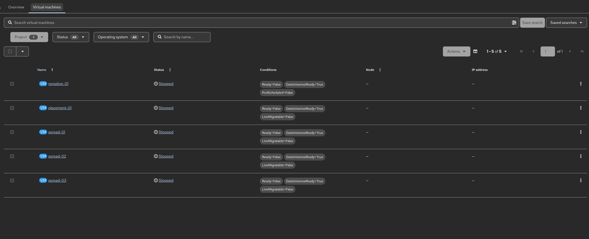

For recording, use the short [video outline](VIDEO-OUTLINE.md). For older numbered references in YAML comments, use the [administrator reference map](ADMIN-GUIDE.md#reference-map).
