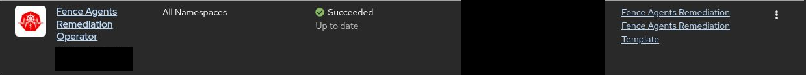
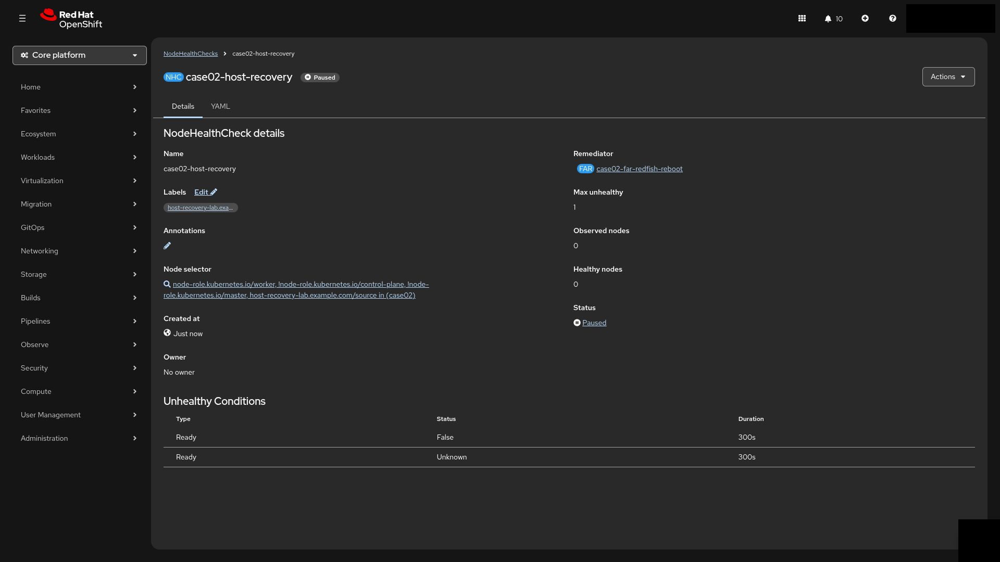
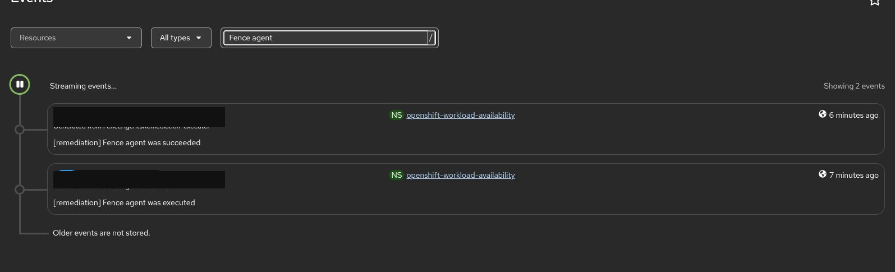

# Administrator guide: source-only host recovery

> **Status: automatic recovery verified on 4.22.** Redfish fencing, a new VM
> instance on a healthy destination, its guest login prompt and source-node
> recovery were exercised. Cleanup was held for review. The 4.21 procedure was
> documentation-reviewed; **vxflexos / Block / RWX provisioning remains unverified**.

Reference for commands and safety detail. The step-by-step flow is the
[runbook](RUNBOOK.md); this guide does not repeat it. This case **really
power-cycles a server**; you own approval, the abort rule and escalation.

## Prepare

~~~sh
export OPNS=openshift-workload-availability   # operator project
# VM project and name: demo defaults for the new example. For a reused VM,
# set both to that VM's own project and name.
export VMNS=host-recovery-lab VM=recovery-vm
# Cleanup ownership: set to true only after you create the example VM.
export CREATED_VM=false
export SOURCE='REPLACE_SOURCE_NODE' TARGET='REPLACE_TARGET_NODE'
export SOURCE_IP="$(oc get node "$SOURCE" -o jsonpath='{.status.addresses[?(@.type=="InternalIP")].address}')"
~~~

For SSH, use SOURCE's **InternalIP** from **Compute → Nodes → SOURCE → Details**
and the approved SSH key for that host. Verify a new host-key prompt against
the administrator's known fingerprint before accepting it.

### Design (source-only)

- NodeHealthCheck selects **exactly one** approved non-control-plane SOURCE
  worker: `worker` Exists, `control-plane` and `master` DoesNotExist, and the
  dedicated label `host-recovery-lab.example.com/source=case02` (SOURCE only).
- TARGET is a separate healthy virtualization host **outside** the selector. It
  is never labelled, fenced, faulted, or given a BMC credential here.
- TARGET is a readiness candidate. The scheduler can choose another approved
  healthy destination with shared storage access and capacity. Record the
  actual destination; it must differ from SOURCE and stay outside the selector.
- `maxUnhealthy: 1` (accepted by server dry-run; the Red Hat 4.21
  Workload Availability documentation describes it). It is mutually exclusive
  with `minHealthy`, which is not set. It is safe only because exactly one node
  is selected, so verify the selection every time.
- FAR template: `fence_redfish`, action `reboot`, `OutOfServiceTaint`, mapping
  for SOURCE only. The Secret holds `--username` and `--password`; those keys
  are not repeated in `sharedparameters`.
- Client VM storage: **vxflexos, Block, ReadWriteMany**.
- The selected VM (`VMNS`/`VM`) restarts automatically: run strategy **Always** or
  **RerunOnFailure**. **Manual** does not restart, so it is ineligible.

### Artifact files

Apply only the file a step names; never the folder.

| Artifact | Use |
| --- | --- |
| `manifests/00-namespace.yaml` | Only for the new example, if its project does not exist |
| `manifests/00a-subscription-fence-agents-remediation.yaml` | Only if FAR is missing |
| `manifests/00b-subscription-node-health-check.yaml` | Only if NHC is missing |
| `manifests/01-far-template.yaml` | Fill SOURCE node, BMC host, Systems id |
| `manifests/02-nhc-paused.yaml` | Ships paused, `maxUnhealthy: 1` |
| `manifests/03-recovery-vm.yaml` | Only if no existing VM fits; ships Halted |

### Operator check

Reuse existing installs, namespace and OperatorGroup; modify nothing that exists.

~~~sh
oc get csv -n "$OPNS" | grep -Ei 'fence-agents|node-healthcheck'
oc get operatorgroup,subscription -n "$OPNS"
~~~

Installed Operators view (preparation only; it does not show that fencing works):

If **one** operator is missing, create only its Subscription, then approve only
the intended InstallPlan and wait for `Succeeded`:

~~~sh
oc create -f manifests/00a-subscription-fence-agents-remediation.yaml   # only if FAR is missing
oc create -f manifests/00b-subscription-node-health-check.yaml          # only if NHC is missing
oc get installplan -n "$OPNS" -o custom-columns=NAME:.metadata.name,CSV:.spec.clusterServiceVersionNames,APPROVED:.spec.approved
oc patch installplan REPLACE_INSTALLPLAN_NAME -n "$OPNS" --type=merge -p '{"spec":{"approved":true}}'
~~~

### Schema check

~~~sh
oc explain fenceagentsremediationtemplate.spec.template.spec
oc explain nodehealthcheck.spec
~~~

Confirm FAR `agent`, `remediationStrategy`, `retrycount`, `retryinterval`,
`timeout`, `sharedparameters`, `nodeparameters`, `nodeSecretNames`; and NHC
`selector`, `maxUnhealthy`, `minHealthy`, `unhealthyConditions`, `pauseRequests`,
`remediationTemplate`. A missing or renamed field means **stop and adapt**.

### Ownership and controller checks

Read full selectors. Change nothing that exists.

~~~sh
oc get nodehealthcheck -o jsonpath='{range .items[*]}{.metadata.name}{" selector="}{.spec.selector}{"\n"}{end}'
oc get machinehealthcheck -A -o jsonpath='{range .items[*]}{.metadata.namespace}/{.metadata.name}{" selector="}{.spec.selector}{"\n"}{end}'
oc get fenceagentsremediationtemplate -A
oc get selfnoderemediationtemplate -A    # only if that CRD is installed
oc get nodes --show-labels | grep 'host-recovery-lab.example.com/source'   # none before you label SOURCE
oc get node "$SOURCE" "$TARGET" -o jsonpath='{range .items[*]}{.metadata.name}{" unschedulable="}{.spec.unschedulable}{" taints="}{.spec.taints}{"\n"}{end}'
oc get nodes
oc get pods -n "$OPNS" -o wide
~~~

**Stop** if any other NodeHealthCheck, MachineHealthCheck, Machine
auto-remediation or controller could act on SOURCE or TARGET, if SOURCE is
already unschedulable, or if the label already exists. A custom MachineHealthCheck also
disables NHC. Do not edit existing controllers without a locally approved design.

Every node other than SOURCE must be Ready, TARGET must have room for the VM,
the shared storage must stay reachable from TARGET, and a Ready NHC controller
and a Ready FAR controller must run on a node **other than SOURCE**. Check the
installed operator's supported placement; do not patch its Deployment ad hoc.
If SOURCE hosts the only controller replica, stop.

Also review SOURCE's pods: all must be disposable and approved, since the
fence affects everything on it.

~~~sh
oc get pods -A --field-selector spec.nodeName="$SOURCE" -o wide
~~~

### Selected VM checks

Run before the fault, with `VMNS` and `VM` set. They only read the selected VM;
other VMs in the project are not inspected. For a reused VM, a failed check
means choose another VM or the disposable example. Never patch the VM.

~~~sh
oc get vm "$VM" -n "$VMNS" -o jsonpath='{.spec.runStrategy}{" running="}{.spec.running}{"\n"}'
oc get vmi "$VM" -n "$VMNS" -o jsonpath='{.status.nodeName}{"\n"}'
oc get vm "$VM" -n "$VMNS" -o jsonpath='{range .spec.template.spec.volumes[*]}{.name}{" pvc="}{.persistentVolumeClaim.claimName}{" dv="}{.dataVolume.name}{"\n"}{end}'
oc get pvc -n "$VMNS" REPLACE_CLAIM_NAME -o custom-columns=NAME:.metadata.name,CLASS:.spec.storageClassName,MODE:.spec.volumeMode,ACCESS:.spec.accessModes
~~~

Run the last command once per claim name listed (a DataVolume uses a claim of
the same name; the cloud-init disk has no claim and is allowed). Pass when: the
node is SOURCE; every claim is `vxflexos`,
`Block`, `ReadWriteMany`; and the run strategy is `Always` or `RerunOnFailure`
(`Manual` fails; an empty strategy with only `running` is not assumed eligible).
The new example is the one exception to the node and strategy rows **before** its
Start: it is Halted with no VMI. Start it from the console, then run the checks;
the strategy should now read `Always`.

### Private directory and CA

Do the credential steps in this order, in **one terminal**: Private directory and
CA, BMC mapping, Fencing Secret, BMC certificate trust. `PRIV` exists only in the
shell that ran the first step. If a later block says the private folder is
missing, return here; it has not touched any credential.

Outside the checkout and not shared. Copy the BMC CA bundle (PEM) there.

~~~sh
umask 077; PRIV=$(mktemp -d)
cp /PRIVATE/PATH/TO/APPROVED-BMC-CA.pem "$PRIV/bmc-ca.pem"
~~~

### BMC mapping

Needs the previous step. Read-only `GET`s; nothing is reset. `curl` prompts for
the password. Never use `-k`. Paste the whole block; it runs nothing unless the
private folder and CA are present.

~~~sh
if [ -n "${PRIV:-}" ] && [ -d "$PRIV" ] && [ -O "$PRIV" ] && [ -s "$PRIV/bmc-ca.pem" ]; then
  read -r -p 'BMC username: ' BMC_USER
  curl --user "$BMC_USER" --cacert "$PRIV/bmc-ca.pem" --fail --silent --show-error \
    https://REPLACE_SOURCE_BMC_HOST/redfish/v1/Systems
  curl --user "$BMC_USER" --cacert "$PRIV/bmc-ca.pem" --fail --silent --show-error \
    https://REPLACE_SOURCE_BMC_HOST/redfish/v1/Systems/REPLACE_SOURCE_SYSTEM_ID | jq '{UUID, SerialNumber, PowerState, HostName}'
  oc get node "$SOURCE" -o jsonpath='{.status.nodeInfo.systemUUID}{"\n"}'
else
  echo 'Stop: no private folder or CA. Run "Private directory and CA" first.' >&2
fi
~~~

**Critical gate:** the Redfish `UUID` (and a serial or asset tag you trust)
matches the `systemUUID` of SOURCE, and the Systems id is the one in the
template. A swapped mapping power-cycles the wrong server. If it cannot be
matched, confirm by a second independent method or **stop**.

### Fencing Secret

SOURCE only; never create or reference a TARGET credential. Values never go in
the repository or argv. The name must not already exist.

Needs [Private directory and CA](#private-directory-and-ca) first. Paste the
whole block at once. If the private folder (`PRIV`) is unset, missing, not yours,
not owner-only (mode 700) or has no CA, the block prints one line and reads or
writes nothing. Otherwise every step is chained, so a failure stops the rest.

~~~sh
if [ -n "${PRIV:-}" ] && [ -d "$PRIV" ] && [ -O "$PRIV" ] \
   && [ "$(stat -c %a "$PRIV")" = 700 ] && [ -s "$PRIV/bmc-ca.pem" ]; then
  umask 077
  read -r -p 'BMC username: ' u && printf '%s' "$u" > "$PRIV/source.user" &&
  read -r -s -p 'BMC password: ' p && printf '%s' "$p" > "$PRIV/source.pass" && echo &&
  oc create secret generic case02-bmc-source -n "$OPNS" \
    --from-file=--username="$PRIV/source.user" --from-file=--password="$PRIV/source.pass" &&
  oc label secret case02-bmc-source -n "$OPNS" host-recovery-lab.example.com/case=02
  unset u p
else
  echo 'Stop: no valid private folder. Run "Private directory and CA" first.' >&2
fi
~~~

Use a least-privilege BMC account allowed to read power state and reset. Keep
`$PRIV` until the trust check is done, then securely remove it.

### BMC certificate trust

`fence_redfish` verifies TLS unless `--ssl-insecure` is passed, so trust comes
from the FAR image. Run a read-only `status` from a **Ready FAR manager pod on a
node other than SOURCE**, with credentials on stdin. Record that pod and use it
for later log capture.

~~~sh
POD=$(oc get pods -n "$OPNS" -o json | jq -r --arg source "$SOURCE" '
  [.items[]
   | select(.metadata.name | startswith("fence-agents-remediation-controller-manager-"))
   | select(.spec.nodeName != $source)
   | select(any(.status.conditions[]?; .type == "Ready" and .status == "True"))]
  | first | .metadata.name // empty')
oc get pod "$POD" -n "$OPNS" -o wide
oc exec -n "$OPNS" "$POD" -c manager -- fence_redfish -o metadata | grep -Ei 'systems-uri|ssl|action'
if [ -n "${PRIV:-}" ] && [ -s "$PRIV/source.user" ] && [ -s "$PRIV/source.pass" ]; then
  printf 'ip=%s\nusername=%s\npassword=%s\nsystems-uri=/redfish/v1/Systems/%s\naction=status\n' \
    REPLACE_SOURCE_BMC_HOST "$(cat "$PRIV/source.user")" "$(cat "$PRIV/source.pass")" REPLACE_SOURCE_SYSTEM_ID \
    | oc exec -i -n "$OPNS" "$POD" -c manager -- fence_redfish
else
  echo 'Stop: Fencing Secret step not done; no credential files.' >&2
fi
~~~

Expected `Status: ON`. An empty `$POD` means **stop**. A TLS error means the
image does not trust the BMC CA: **stop**. `--ssl-insecure` is never the default;
an exception is a separate, written, host-specific owner decision, documented
outside this procedure, using only options in the installed metadata.

### Dry-run

Run after filling placeholders. Server dry-runs check admission; they do not
prove BMC connectivity or storage availability.

~~~sh
oc apply --dry-run=server -f manifests/01-far-template.yaml
oc apply --dry-run=server -f manifests/02-nhc-paused.yaml
oc apply --dry-run=server -f manifests/03-recovery-vm.yaml    # only if creating the VM
~~~

### Create

Each name must return **NotFound** first; an authorization error is not proof of
absence. If anything exists, review its ownership instead of overwriting.

~~~sh
oc get fenceagentsremediationtemplate case02-far-redfish-reboot -n "$OPNS"
oc get nodehealthcheck case02-host-recovery
oc create -f manifests/01-far-template.yaml
oc create -f manifests/02-nhc-paused.yaml
~~~

While paused NHC reports observed/healthy 0/0; do not use counts. Confirm
`pauseRequests` holds `case02-setup-hold` and the Disabled condition is False.

## Evidence capture

The remediation object is created and deleted by NHC and may be gone before
anyone looks. Start before the fault, three terminals, saving to a private
directory outside the checkout.

~~~sh
mkdir -p "$HOME/.local/state" && EVID=$(mktemp -d "$HOME/.local/state/case02-evidence.XXXXXX") && echo "$EVID"
# terminal A (export OPNS EVID first)
oc get fenceagentsremediation -n "$OPNS" --watch --output-watch-events -o json > "$EVID/far.json"
# terminal B (export VMNS VM EVID first; watches only the selected VM)
oc get vmi -n "$VMNS" --field-selector metadata.name="$VM" --watch --output-watch-events -o json > "$EVID/vmi.json"
# terminal C
oc get nodes -l host-recovery-lab.example.com/source=case02 --watch --output-watch-events -o json > "$EVID/nodes.json"
~~~

Corroborate with the BMC event/lifecycle log (power-cycle time) and SOURCE's
node boot ID. Fence-before-restart ordering: the remediation's
`FenceAgentActionSucceeded=True` `lastTransitionTime` should be earlier than the
new VMI's `creationTimestamp`.

~~~sh
jq -r 'select(.object.status.conditions != null) | .object.status.conditions[] | select(.type=="FenceAgentActionSucceeded" and .status=="True") | .lastTransitionTime' "$EVID/far.json" | sort -u | head -n 1
jq -r 'select(.type=="ADDED") | .object.metadata.uid + " " + .object.metadata.creationTimestamp' "$EVID/vmi.json"
~~~

Missing or tied fence evidence is **Blocked**, not Pass, unless the BMC log
clearly shows the reset before the new instance was created.

## The fault and what to watch

Fault: `sudo systemctl stop kubelet` over native SSH as `core` on SOURCE, after
verifying the service is enabled and active:

~~~sh
# Refresh the address after reboot; DHCP may assign a different one.
export SOURCE_IP="$(oc get node "$SOURCE" -o jsonpath='{.status.addresses[?(@.type=="InternalIP")].address}')"
ssh core@"$SOURCE_IP" 'systemctl is-enabled kubelet; systemctl is-active kubelet'
~~~

Do not use `oc debug` as a recovery path afterwards; the kubelet is down. The
guest keeps running until the power-cycle, which is why fencing must precede
the restart. Typical sequence: node Unknown, NHC unhealthy after 300 s
(`Remediating`, observed 1, healthy 0), a remediation for SOURCE, FAR taints the
node and runs the agent (up to 3 tries of up to 60 s), then the out-of-service
taint, then the VM restarts elsewhere. No outage time is promised. If no
remediation follows by the agreed limit, abort and escalate.

~~~sh
oc logs -n "$OPNS" "$POD" -c manager --since=30m
oc get events -n "$OPNS" | grep -i remediation
~~~

**Back-out:** only before a remediation exists, `sudo systemctl start kubelet`
over SSH or the BMC console. Never force-delete the VMI, node or finalizers, and
never reboot by hand as an automatic pass.

## Abort and pause

Pausing stops **new** remediations. It does not cancel one in flight, and while
paused NHC skips cleanup of remediation objects for healthy nodes, so pausing
too early can leave the object and taints in place.

- **Normal end:** wait for the object to be gone, SOURCE Ready and taints
  cleared, **then** pause.
- **Abort before a remediation exists:** pause, then back out the fault.
- **Abort with a remediation in flight:** escalate to the owner at the budget
  limit. The owner decides whether to remove the pause so cleanup can finish or
  to restore the host through the BMC console. Manual recovery is **Fail**.
- Before any deletion, confirm controllers are quiet and the BMC reports `On`.

## Cordon ownership

You cordon SOURCE in the runbook, so you own that cordon. Uncordon when SOURCE is
healthy, and only if no one else has cordoned it since.

If the temporary remediation object is already gone, use **Home → Events**,
select **openshift-workload-availability**, and filter **Fence agent**. Save the
event promptly. Use the native watch capture for fence-before-restart timestamps.

## Cleanup

After the remediation is complete and NHC is paused again. Remove only what you
created and recorded.

| Object | Action |
| --- | --- |
| NodeHealthCheck `case02-host-recovery`, FAR template `case02-far-redfish-reboot` | Delete once no remediation object exists |
| Secret `case02-bmc-source` | Delete the test-created Secret only |
| Selected VM (`VM` in `VMNS`) | Delete only if you created it as the example; a reused VM, its disks and project stay unchanged |
| Node label `host-recovery-lab.example.com/source` | Remove from SOURCE |
| Cordon on SOURCE | Uncordon when healthy, only if you own it |
| Evidence and `$PRIV` | Keep evidence private; securely remove `$PRIV` |
| Operators, `openshift-workload-availability`, OperatorGroup | **Keep** (shared) |

~~~sh
oc delete nodehealthcheck case02-host-recovery
oc delete fenceagentsremediationtemplate case02-far-redfish-reboot -n "$OPNS"
oc delete secret case02-bmc-source -n "$OPNS"
if [ "${CREATED_VM:-false}" = true ]; then oc delete vm "$VM" -n "$VMNS"; fi   # skipped for a reused VM
oc label node "$SOURCE" host-recovery-lab.example.com/source-
~~~

## Reference sources

| Component | Reference |
| --- | --- |
| Red Hat docs (4.21) | [Fence Agents Remediation](https://docs.redhat.com/en/documentation/workload_availability_for_red_hat_openshift/4.21-0/html/remediation_fencing_and_maintenance/fence-agents-remediation-operator-remediate-nodes), [Node Health Check](https://docs.redhat.com/en/documentation/workload_availability_for_red_hat_openshift/4.21-0/html/remediation_fencing_and_maintenance/node-health-check-operator) |
| Upstream | [NHC v0.12.0](https://github.com/medik8s/node-healthcheck-operator/tree/v0.12.0), [FAR v0.8.0](https://github.com/medik8s/fence-agents-remediation/tree/v0.8.0) (reference versions only; installed versions govern) |
