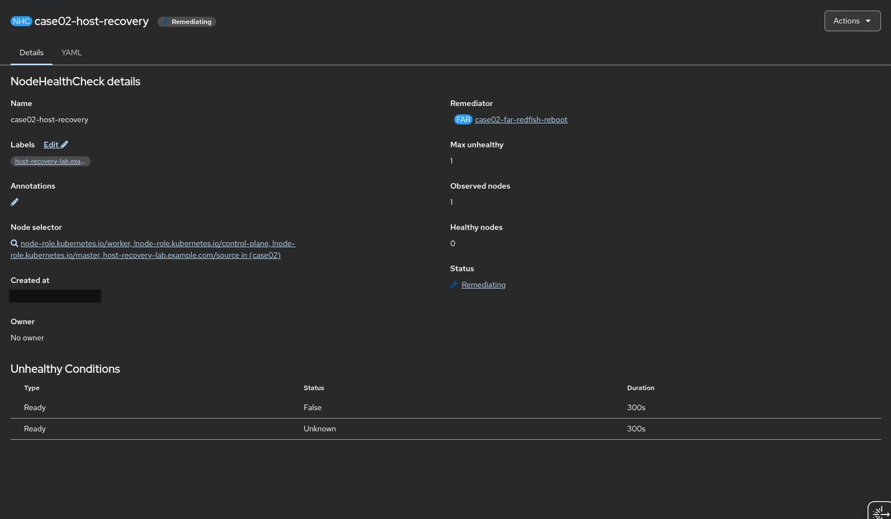
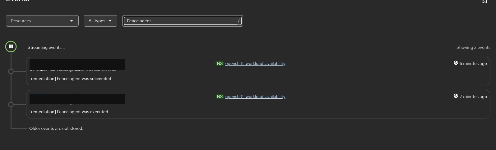
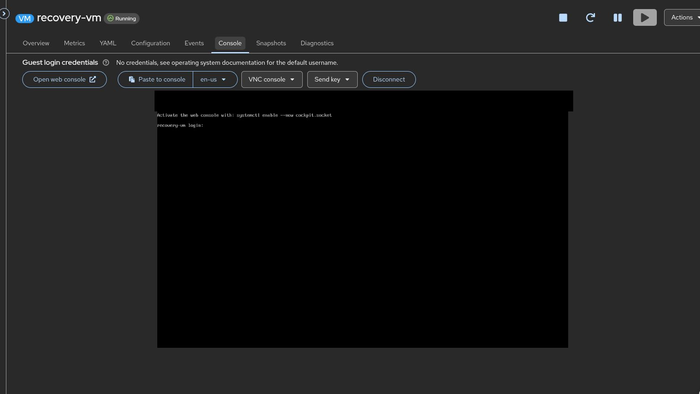
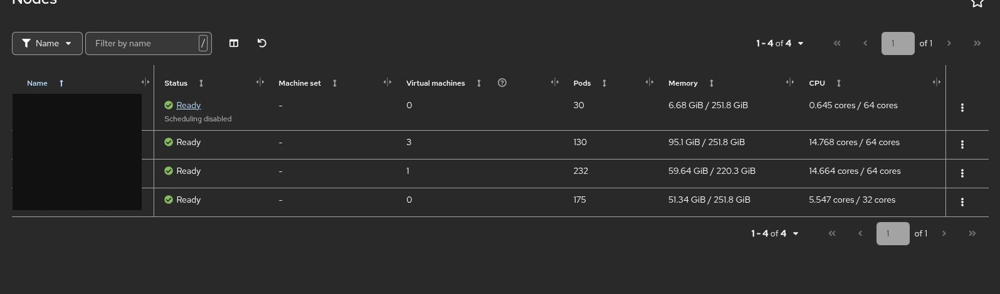
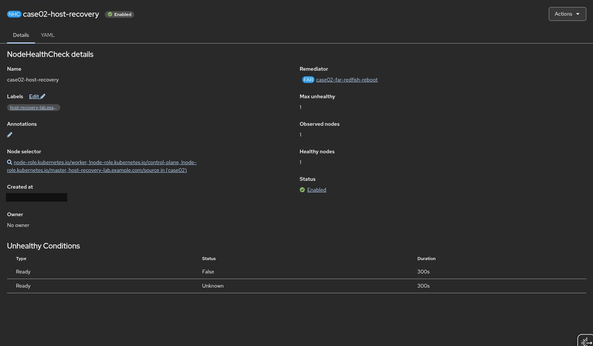

# Runbook: VM restart after a source worker stops responding

> **Status: automatic recovery verified on 4.22.** Redfish fencing, a new VM
> instance on a healthy destination, its guest login prompt and source-node
> recovery were exercised. Cleanup was held for review. The 4.21 procedure was
> documentation-reviewed; **vxflexos / Block / RWX provisioning remains unverified**.

**Goal:** see a running VM interrupted and restarted on a separate healthy host
(the destination) after the cluster automatically power-cycles the one approved worker
(SOURCE) through its BMC (Redfish).

**What this is not:** not live migration, not zero downtime, not proof of full
hardware failure (the fault is a stopped kubelet, the node's agent). No outage
time is promised. Two results are recorded separately:

- **Node recovery:** SOURCE is power-cycled and returns Ready.
- **VM restart:** a new VM instance (VMI) starts on another healthy host.

**This really power-cycles a server.** Everything is source-only: the health
check selects exactly one node, and TARGET is never power-cycled or faulted.

Terms: **BMC** is the server's remote-management controller; **FAR** is the
Fence Agents Remediation operator (it power-cycles the node); **NHC** is the Node
Health Check operator (it decides when to ask FAR); **PVC** is a persistent disk claim.

Flow: **A. Prepare → B. Readiness check → C. Test and results → D. Stop and clean up.**

Use the web console or the CLI for each change, never both. Console menu names
are version dependent; use **Search** or **Import YAML** if one differs. Command
detail and safety reasoning are in the [administrator guide](ADMIN-GUIDE.md).

CLI: set values once

~~~sh
cd test-cases/02-host-failure-recovery
# The VM's project and name. These defaults are for the new example VM.
# Reusing a VM? Replace both with that VM's own project and name.
export VMNS=host-recovery-lab
export VM=recovery-vm
# Cleanup ownership: stays false unless you create the example VM in A3.
export CREATED_VM=false
# Operator project (a different thing from the VM's project)
export OPNS=openshift-workload-availability
export SOURCE='REPLACE_SOURCE_NODE'
export TARGET='REPLACE_TARGET_NODE'
export SOURCE_IP="$(oc get node "$SOURCE" -o jsonpath='{.status.addresses[?(@.type=="InternalIP")].address}')"
~~~

## A. Prepare

You need:

- the approved **SOURCE** worker (not control plane; everything on it disposable)
- a separate healthy host, **TARGET**, with spare capacity
- shared **vxflexos / Block / ReadWriteMany** storage reachable from both
- the FAR and NHC operators installed
- SOURCE's BMC address and an account for it
- a written **abort rule and escalation contact** from the owner (put them on the
  results sheet)

TARGET is the healthy destination we check ahead of time. The scheduler may
pick another approved healthy host with the same storage access and capacity;
record the actual destination afterwards. Do not pin the VM to SOURCE.

**A1. Check for overlap and controller placement.** Confirm no other
NodeHealthCheck, MachineHealthCheck or remediation can act on SOURCE or TARGET,
and that the NHC and FAR controller pods run on nodes **other than SOURCE**.
Commands: [ownership and controller checks](ADMIN-GUIDE.md#ownership-and-controller-checks).
If anything overlaps, **stop**.

**A2. Label SOURCE only.** Console: **Compute → Nodes → SOURCE → Details →
Labels → Edit**, add `host-recovery-lab.example.com/source=case02`. Do **not**
label TARGET. Type the label, press **Enter** so it becomes a label chip, then
click **Save**. Keep the other labels.

CLI

~~~sh
oc label node "$SOURCE" host-recovery-lab.example.com/source=case02
oc get nodes -l host-recovery-lab.example.com/source=case02 -o name   # exactly one
~~~

**A3. Choose the VM.** Every later check, watch and cleanup uses only this one
VM. The operator project `OPNS` is separate. Decide first:

*Option 1: use an existing VM.* Use it only if **all** of these are already
true, and leave it unchanged:

- It is Running on SOURCE.
- Every persistent (PVC) disk is **vxflexos / Block / ReadWriteMany**, so another
  host can attach it. Console: **VM → Configuration → Storage**. The small
  cloud-init disk is not a PVC and is fine.
- Its run strategy restarts it automatically: **Always** or **RerunOnFailure**.
  **Manual** never restarts it, so that VM is not eligible. If it only shows
  the older `running` setting, ask the administrator to confirm its restart
  behavior, or choose another VM or the example.

If it passes, set `VMNS` and `VM` in the CLI block to its project and name. If
any item fails, do not edit the VM; pick another or use Option 2. Commands:
[selected VM checks](ADMIN-GUIDE.md#selected-vm-checks).

*Option 2: create the disposable example.* Follow these steps in order.

1. **Reset the values.** If you tried an existing VM first, put the defaults
   back and keep ownership false:
   `export VMNS=host-recovery-lab VM=recovery-vm CREATED_VM=false`
2. **Create or confirm the project `host-recovery-lab`.** Console: **Quick
   create (+) → Import YAML**, paste [`manifests/00-namespace.yaml`](manifests/00-namespace.yaml),
   then **Create**. CLI: `oc create -f manifests/00-namespace.yaml`. If the
   project already exists, use it only if it is unused or yours.
3. **Select the project.** Only now, in the console: **Virtualization →
   VirtualMachines**, then project **host-recovery-lab**.
4. **Create the VM.** Fill [`manifests/03-recovery-vm.yaml`](manifests/03-recovery-vm.yaml).
   Click the arrow beside **Create → With YAML** (some versions say **From YAML**),
   click in the editor, press **Ctrl+A** and paste the filled file. Click **Create**.
   **Expected:** the VM appears and shows **Stopped**.

   

5. **Record ownership.** Only after step 4 succeeds: `export CREATED_VM=true`.
   Never set it for an existing VM.
6. **Start it.** The example is Stopped on purpose (run strategy **Halted**).
   **Actions → Control → Start** changes the strategy to **Always**.
   **Expected:** the VM reaches **Running**.

**A4. Create the BMC Secret (SOURCE only).** Private values, never in the
repository. Follow these four steps **in this order**, in one terminal:

1. [Private directory and CA](ADMIN-GUIDE.md#private-directory-and-ca): creates
   the private folder (`PRIV`) and copies in the BMC CA. Start here.
2. [BMC mapping](ADMIN-GUIDE.md#bmc-mapping): confirm the BMC is SOURCE's.
3. [Fencing Secret](ADMIN-GUIDE.md#fencing-secret): needs step 1. It does nothing
   and says why if the private folder is missing.
4. [BMC certificate trust](ADMIN-GUIDE.md#bmc-certificate-trust): needs step 3.

**A5. Create the FAR template and the paused health check.** Fill the
`REPLACE_*` values, then create
[`01-far-template.yaml`](manifests/01-far-template.yaml) and
[`02-nhc-paused.yaml`](manifests/02-nhc-paused.yaml) (console: **Quick create (+) →
Import YAML**, paste each filled file, then **Create**). The health check uses
`maxUnhealthy: 1` (no `minHealthy`) and ships **Paused**. Optional server
dry-runs: [dry-run](ADMIN-GUIDE.md#dry-run).

While paused, **Observed nodes** and **Healthy nodes** show zero. Check the
one-node count after activating it in C3.

## B. Readiness check (all must be yes)

Run this with the health check still paused. Any **no** means **stop**.

| # | Must be true | Where to look |
| --- | --- | --- |
| 1 | Exactly **one** node matches the health check selector, and it is SOURCE | **Compute → Nodes**, filter by label `host-recovery-lab.example.com/source=case02` |
| 2 | SOURCE and TARGET are **Ready**; every other node is Ready | **Compute → Nodes** |
| 3 | TARGET has no label and is not in the FAR template | Node labels; template YAML |
| 4 | The selected VM is **Running on SOURCE** and its run strategy is **Always** or **RerunOnFailure** | VM **Overview**; **YAML** `runStrategy` |
| 5 | NHC and FAR controller pods are Ready on nodes **other than SOURCE** | **Workloads → Pods**, project `openshift-workload-availability`, Node column |
| 6 | Health check shows `pauseRequests`; its Disabled condition is False | NodeHealthCheck YAML |
| 7 | `kubelet` on SOURCE is enabled and active | CLI below |

CLI (one block)

~~~sh
oc get nodes -l host-recovery-lab.example.com/source=case02,node-role.kubernetes.io/worker,'!node-role.kubernetes.io/control-plane','!node-role.kubernetes.io/master'
oc get nodes
oc get node "$TARGET" --show-labels | grep -c 'host-recovery-lab.example.com/source' || true
oc get vmi "$VM" -n "$VMNS" -o wide
oc get vm "$VM" -n "$VMNS" -o jsonpath='{.spec.runStrategy}{"\n"}'
oc get pods -n "$OPNS" -o wide
oc get nodehealthcheck case02-host-recovery -o jsonpath='{.spec.pauseRequests} {.status.conditions}{"\n"}'
ssh core@"$SOURCE_IP" 'systemctl is-enabled kubelet; systemctl is-active kubelet'
~~~

Expected: one node listed, all nodes Ready, the TARGET count line is `0`, the
selected VMI on SOURCE, `Always` or `RerunOnFailure`, controllers off SOURCE, pause present, `enabled` and `active`.

## C. Test and results

### C1. Record "before" evidence

Write on the results sheet: VM **Node**, VMI **UID**, SOURCE **boot ID**. Confirm
the guest works: **VM → Console** shows a login prompt or desktop (or
`virtctl console`). Optional persistence note, run once in the guest:
`date > ~/case02-note.txt`.

~~~sh
oc get vmi "$VM" -n "$VMNS" -o jsonpath='{.status.nodeName} {.metadata.uid}{"\n"}'
oc get node "$SOURCE" -o jsonpath='{.status.nodeInfo.bootID}{"\n"}'
~~~

### C2. Cordon SOURCE

A cordon, **not** a drain: the VM stays put but cannot return to SOURCE after
the restart. Console: **Compute → Nodes → SOURCE → Actions → Mark as
unschedulable** (CLI: `oc adm cordon "$SOURCE"`).

### C3. Activate the health check

> **HANDOFF → administrator.** From here a real fence can happen.

Open the health check's **Actions → Unpause NodeHealthCheck**. Confirm the only
pause reason is `case02-setup-hold`, then click **Unpause**. If another pause
reason is present, stop and ask its owner. Do not clear someone else's hold.
CLI alternative:

~~~sh
oc patch nodehealthcheck case02-host-recovery --type=merge -p '{"spec":{"pauseRequests":null}}'
oc get nodehealthcheck case02-host-recovery -o jsonpath='{.status.phase} observed={.status.observedNodes} healthy={.status.healthyNodes}{"\n"}'
~~~

**Expected before any fault:** `Enabled`, **observed 1, healthy 1** (allow a
minute). If not, pause again ([abort and pause](ADMIN-GUIDE.md#abort-and-pause))
and **do not run the fault**.

### C4. Start the evidence capture

> **HANDOFF → administrator.** The remediation object is short-lived. Start the
> [evidence capture](ADMIN-GUIDE.md#evidence-capture) first and keep it running
> until D1.

### C5. Cause the fault

> **HANDOFF → administrator, separate terminal.** No console equivalent. Do not
> use `oc debug` for recovery afterwards.

~~~sh
ssh core@"$SOURCE_IP" 'sudo systemctl stop kubelet'
~~~

Note the time. Do **not** reboot the node by hand and do not edit or delete the
node, VMI or finalizers. Back-out is possible only **before** a remediation
exists (start kubelet over SSH or the BMC console).

### C6. Watch

Keep **Compute → Nodes**, **Compute → NodeHealthChecks → case02-host-recovery**
and **Virtualization → VirtualMachines** open. Expect, with no promised timing:

1. SOURCE turns **Not Ready**.
2. After the 300-second unhealthy duration the health check shows
   **Remediating** (observed 1, healthy 0) and a remediation for SOURCE appears.
3. SOURCE is **automatically power-cycled**; its node boot ID changes.
4. The VM is interrupted, then restarts on an **approved healthy destination**
   as a **new VMI** and is Running.
5. SOURCE returns **Ready** (still cordoned).

If the agreed abort rule is reached first, follow [abort and pause](ADMIN-GUIDE.md#abort-and-pause).
Manual recovery is a **Fail**.

If the temporary remediation has already disappeared, open **Home → Events**,
select project **openshift-workload-availability**, and filter by **Fence agent**.
Keep the administrator's captured remediation conditions to compare times; the
event alone does not show the restart order. Events expire, so save them promptly.

### C7. Record "after" evidence and the two results

| Check | Pass when |
| --- | --- |
| VM node | An approved healthy destination, different from SOURCE and outside the fencing selector; record its actual name |
| VMI UID | **Different** from before |
| VM state | Running, guest console works |
| Optional note | `cat ~/case02-note.txt` still shows the text |
| Duplicate | Only one VMI for the selected VM at any time |
| Fence | Captured remediation shows fence success; BMC event log shows the power-cycle |
| SOURCE boot ID | **Different** from before |

- **Node recovery:** SOURCE Ready, remediation object gone, remediation and out-of-service taints cleared (D1).
- **VM restart:** every row above passes. Missing fence evidence is **Blocked**, not Pass.
- If you ran this after [Case 06](../06-cim-worker-expansion/RUNBOOK.md), do not
  collect expansion evidence now; it was recorded there (C6).

## D. Stop and clean up

**Review first:** cleanup was held in the latest verification run. Complete
steps 1–3 to finish evidence capture and pause the policy safely. Keep SOURCE
cordoned and retain the VM, disks and other test resources. Continue with
steps 4–6 only when the owner is ready for cleanup.

1. Wait until SOURCE is **Ready**, the remediation object is **gone** and the
   remediation taints are cleared. Never delete the object, VMI, node or finalizer by hand.
   ~~~sh
   oc get fenceagentsremediation -n "$OPNS"
   oc get node "$SOURCE" -o jsonpath='{.status.conditions[?(@.type=="Ready")].status} {.spec.taints}{"\n"}'
   ~~~
2. Stop the capture terminals (**Ctrl+C**). Keep the evidence privately.
3. **Pause** the health check again: **Actions → Pause NodeHealthCheck**, enter
   `case02-setup-hold` as the reason, then **Pause**. CLI alternative:
   ~~~sh
   oc patch nodehealthcheck case02-host-recovery --type=merge -p '{"spec":{"pauseRequests":["case02-setup-hold"]}}'
   ~~~
4. Uncordon SOURCE when healthy (**Actions → Mark as
   schedulable**, or `oc adm uncordon "$SOURCE"`), only if you own the cordon.
   Keep the worker installed for the next agreed test.
5. Remove only what you created: [cleanup](ADMIN-GUIDE.md#cleanup). For the
   disposable example (only if you created it), use **Actions → Control → Stop**,
   wait for **Stopped**, then **Actions → Delete**. Keep its test DataVolume
   selected in the confirmation and click **Delete**. A reused VM, its disks and
   its project stay intact; do not delete the project.
6. Fill in the [results sheet](RESULTS-TEMPLATE.md).
