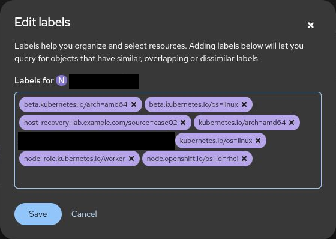
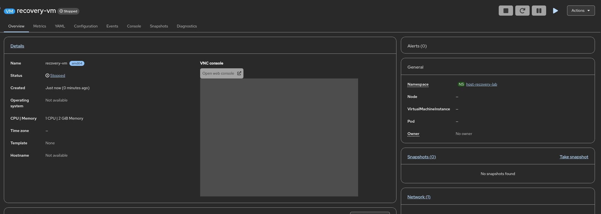
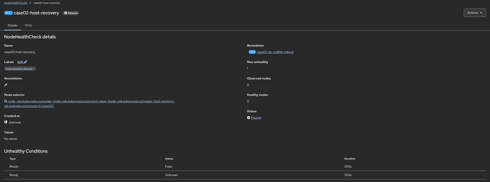
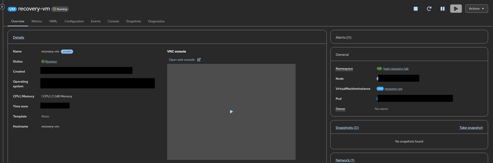
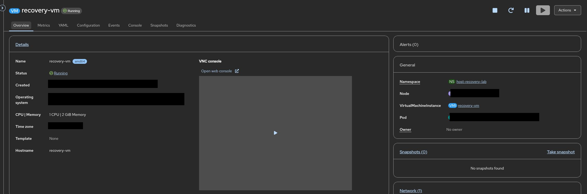
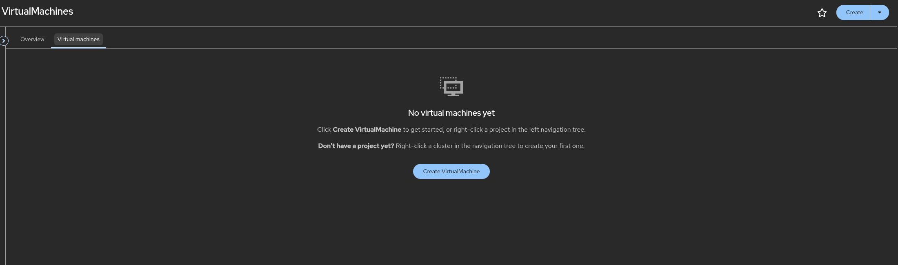

# Runbook: VM restart after a source worker stops responding

> **Status: recovery and cleanup verified on 4.22.** Automatic Redfish fencing,
> a new VM instance on a healthy destination, source-node recovery and fixture
> cleanup were exercised. The 4.21 procedure was documentation-reviewed;
> **vxflexos / Block / RWX provisioning remains unverified**.

**Goal:** see a running VM interrupted and restarted on a separate healthy host
(the destination) after the cluster automatically power-cycles the one approved worker
(SOURCE) through its BMC (Redfish).

**What this is not:** not live migration, not zero downtime, not proof of full
hardware failure (the fault is a stopped kubelet). **Node recovery** (SOURCE is
fenced and returns Ready) and **VM restart** (a new VMI starts on another healthy host) are
judged separately. No outage time is promised.

**This really power-cycles a server.** Everything is source-only: the health
check selects exactly one node, and TARGET is never fenced or faulted.

Flow: **A. Prepare → B. Readiness check (once) → C. Test and results → D. Stop and clean up.**

Use the web console or the CLI for each change, never both. Console menu names
are version dependent; use **Search** or **Import YAML** if one differs. Command
detail and safety reasoning are in the [administrator guide](ADMIN-GUIDE.md).

CLI: set values once

~~~sh
cd test-cases/02-host-failure-recovery
export NS=host-recovery-lab
export OPNS=openshift-workload-availability
export SOURCE='REPLACE_SOURCE_NODE'
export TARGET='REPLACE_TARGET_NODE'
export SOURCE_IP="$(oc get node "$SOURCE" -o jsonpath='{.status.addresses[?(@.type=="InternalIP")].address}')"
~~~

## A. Prepare

You need: the approved **SOURCE** worker (not control plane, everything on it
disposable), a separate healthy **TARGET** virtualization host with spare
capacity, shared **vxflexos / Block / ReadWriteMany** storage reachable from both,
the installed Fence Agents Remediation and Node Health Check operators, SOURCE's
BMC address and an account for it, and a written **abort rule and escalation
contact** from the owner (write them on the results sheet).

Record the approved destination hosts with shared storage access and enough
surviving capacity. **TARGET** is one suitable candidate for the readiness
check. The scheduler may choose another approved healthy host; record the
actual destination after recovery. Do not pin the VM to SOURCE.

**A1. Check for overlap and controller placement.** Confirm no other
NodeHealthCheck, MachineHealthCheck or remediation can act on SOURCE or TARGET,
and that the NHC and FAR controller pods run on nodes **other than SOURCE**.
Commands: [ownership and controller checks](ADMIN-GUIDE.md#ownership-and-controller-checks).
If anything overlaps, **stop**.

**A2. Label SOURCE only.** Console: **Compute → Nodes → SOURCE → Details →
Labels → Edit**, add `host-recovery-lab.example.com/source=case02`. Do **not**
label TARGET. Type the label, press **Enter** so it becomes a label chip, then
click **Save**. Keep the other labels.

CLI

~~~sh
oc label node "$SOURCE" host-recovery-lab.example.com/source=case02
oc get nodes -l host-recovery-lab.example.com/source=case02 -o name   # exactly one
~~~

**A3. Choose the VM.** If an existing approved VM already fits and is running on
SOURCE, reuse it **unchanged** and skip creation (it then also needs
**vxflexos / Block / RWX** storage so TARGET can attach it). Otherwise create the
disposable VM: console **Virtualization → VirtualMachines**, select project
**host-recovery-lab**, then use the **Create** dropdown **→ With YAML** (some
versions say **From YAML**),
paste [`manifests/03-recovery-vm.yaml`](manifests/03-recovery-vm.yaml) (project
**host-recovery-lab**, created from
[`00-namespace.yaml`](manifests/00-namespace.yaml) if missing). It stays **Stopped**.

Start it (**Actions → Control → Start**) and wait for **Running**. A reused VM must
already be Running.

**A4. Create the BMC Secret (SOURCE only).** Private values, never in the
repository. Steps: [fencing Secret](ADMIN-GUIDE.md#fencing-secret). Then confirm
the node-to-BMC mapping and TLS trust: [BMC mapping](ADMIN-GUIDE.md#bmc-mapping)
and [BMC certificate trust](ADMIN-GUIDE.md#bmc-certificate-trust).

**A5. Create the FAR template and the paused health check.** Fill the
`REPLACE_*` values, then create
[`01-far-template.yaml`](manifests/01-far-template.yaml) and
[`02-nhc-paused.yaml`](manifests/02-nhc-paused.yaml) (console: **Quick create (+) →
Import YAML**, paste each filled file, then **Create**). The health check uses
`maxUnhealthy: 1` (no `minHealthy`) and ships **Paused**. Optional server
dry-runs: [dry-run](ADMIN-GUIDE.md#dry-run).

While paused, **Observed nodes** and **Healthy nodes** show zero. Check the
one-node count after activating it in C3.

## B. Readiness check (one check, all must be yes)

Run this once, with the health check still paused. Any **no** means **stop**.

| # | Must be true | Where to look |
| --- | --- | --- |
| 1 | Exactly **one** node matches the health check selector, and it is SOURCE | **Compute → Nodes**, filter by label `host-recovery-lab.example.com/source=case02` |
| 2 | SOURCE and TARGET are **Ready**; every other node is Ready | **Compute → Nodes** |
| 3 | TARGET has no label and is not in the FAR template | Node labels; template YAML |
| 4 | The VM is **Running on SOURCE** | VM **Overview** |
| 5 | NHC and FAR controller pods are Ready on nodes **other than SOURCE** | **Workloads → Pods**, project `openshift-workload-availability`, Node column |
| 6 | Health check shows `pauseRequests`; its Disabled condition is False | NodeHealthCheck YAML |
| 7 | `kubelet` on SOURCE is enabled and active | CLI below |

CLI (one block)

~~~sh
oc get nodes -l host-recovery-lab.example.com/source=case02,node-role.kubernetes.io/worker,'!node-role.kubernetes.io/control-plane','!node-role.kubernetes.io/master'
oc get nodes
oc get node "$TARGET" --show-labels | grep -c 'host-recovery-lab.example.com/source' || true
oc get vmi -n "$NS" -o wide
oc get pods -n "$OPNS" -o wide
oc get nodehealthcheck case02-host-recovery -o jsonpath='{.spec.pauseRequests} {.status.conditions}{"\n"}'
ssh core@"$SOURCE_IP" 'systemctl is-enabled kubelet; systemctl is-active kubelet'
~~~

Expected: one node listed, all nodes Ready, the TARGET count line is `0`, VMI
on SOURCE, controllers off SOURCE, pause present, `enabled` and `active`.

## C. Test and results

### C1. Record "before" evidence

Write on the results sheet: VM **Node**, VMI **UID**, SOURCE **boot ID**. Confirm
the guest works: **VM → Console** shows a login prompt or desktop (or
`virtctl console`). Optional persistence note, run once in the guest:
`date > ~/case02-note.txt`.

~~~sh
oc get vmi recovery-vm -n "$NS" -o jsonpath='{.status.nodeName} {.metadata.uid}{"\n"}'
oc get node "$SOURCE" -o jsonpath='{.status.nodeInfo.bootID}{"\n"}'
~~~

### C2. Cordon SOURCE

A cordon, **not** a drain: the VM stays put but cannot return to SOURCE after
the restart. Console: **Compute → Nodes → SOURCE → Actions → Mark as
unschedulable** (CLI: `oc adm cordon "$SOURCE"`).

### C3. Activate the health check

> **HANDOFF → administrator.** From here a real fence can happen.

Open the health check's **Actions → Unpause NodeHealthCheck**. Confirm the only
pause reason is `case02-setup-hold`, then click **Unpause**. If another pause
reason is present, stop and ask its owner. Do not clear someone else's hold.
CLI alternative:

~~~sh
oc patch nodehealthcheck case02-host-recovery --type=merge -p '{"spec":{"pauseRequests":null}}'
oc get nodehealthcheck case02-host-recovery -o jsonpath='{.status.phase} observed={.status.observedNodes} healthy={.status.healthyNodes}{"\n"}'
~~~

**Expected before any fault:** `Enabled`, **observed 1, healthy 1** (allow a
minute). If not, pause again ([abort and pause](ADMIN-GUIDE.md#abort-and-pause))
and **do not run the fault**.

### C4. Start the evidence capture

> **HANDOFF → administrator.** The remediation object is short-lived. Start the
> [evidence capture](ADMIN-GUIDE.md#evidence-capture) first and keep it running
> until D1.

### C5. Cause the fault

> **HANDOFF → administrator, separate terminal.** No console equivalent. Do not
> use `oc debug` for recovery afterwards.

~~~sh
ssh core@"$SOURCE_IP" 'sudo systemctl stop kubelet'
~~~

Note the time. Do **not** reboot the node by hand and do not edit or delete the
node, VMI or finalizers. Back-out is possible only **before** a remediation
exists (start kubelet over SSH or the BMC console).

### C6. Watch

Keep **Compute → Nodes**, **Compute → NodeHealthChecks → case02-host-recovery**
and **Virtualization → VirtualMachines** open. Expect, with no promised timing:

1. SOURCE turns **Not Ready**.
2. After the 300-second unhealthy duration the health check shows
   **Remediating** (observed 1, healthy 0) and a remediation for SOURCE appears.
3. SOURCE is **automatically power-cycled**; its node boot ID changes.
4. The VM is interrupted, then restarts on an **approved healthy destination**
   as a **new VMI** and is Running.
5. SOURCE returns **Ready** (still cordoned).

If the agreed abort rule is reached first, follow [abort and pause](ADMIN-GUIDE.md#abort-and-pause).
Manual recovery is a **Fail**.

### C7. Record "after" evidence and judge two results

| Check | Pass when |
| --- | --- |
| VM node | An approved healthy destination, different from SOURCE and outside the fencing selector; record its actual name |
| VMI UID | **Different** from before |
| VM state | Running, guest console works |
| Optional note | `cat ~/case02-note.txt` still shows the text |
| Duplicate | Only one VMI at any time |
| Fence | Captured remediation shows fence success; BMC event log shows the power-cycle |
| SOURCE boot ID | **Different** from before |

- **Node recovery:** SOURCE Ready, remediation object gone, remediation and out-of-service taints cleared (D1).
- **VM restart:** every row above passes. Missing fence evidence is **Blocked**, not Pass.

## D. Stop and clean up

1. Wait until SOURCE is **Ready**, the remediation object is **gone** and the
   remediation taints are cleared. Never delete the object, VMI, node or finalizer by hand.
   ~~~sh
   oc get fenceagentsremediation -n "$OPNS"
   oc get node "$SOURCE" -o jsonpath='{.status.conditions[?(@.type=="Ready")].status} {.spec.taints}{"\n"}'
   ~~~
2. Stop the capture terminals (**Ctrl+C**). Keep the evidence privately.
3. **Pause** the health check again: **Actions → Pause NodeHealthCheck**, enter
   `case02-setup-hold` as the reason, then **Pause**. CLI alternative:
   ~~~sh
   oc patch nodehealthcheck case02-host-recovery --type=merge -p '{"spec":{"pauseRequests":["case02-setup-hold"]}}'
   ~~~
4. Uncordon SOURCE when healthy (**Actions → Mark as
   schedulable**, or `oc adm uncordon "$SOURCE"`), only if you own the cordon.
   Keep the worker installed for the next agreed test.
5. Remove only what you created: [cleanup](ADMIN-GUIDE.md#cleanup). For the
   disposable VM, use **Actions → Control → Stop**, wait for **Stopped**, then
   **Actions → Delete**. Keep its test DataVolume selected in the confirmation
   and click **Delete**. A reused VM and its disks stay intact.
6. Fill in the [results sheet](RESULTS-TEMPLATE.md).

