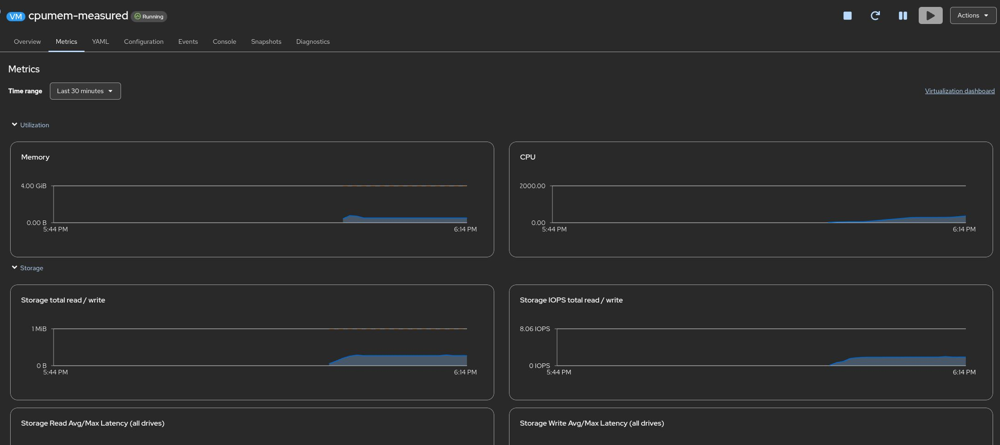
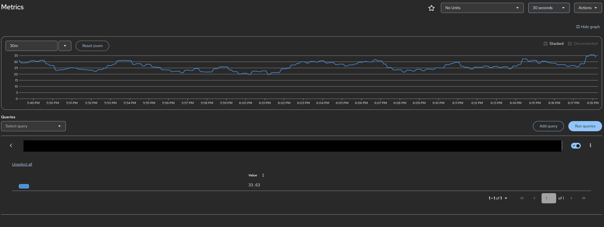
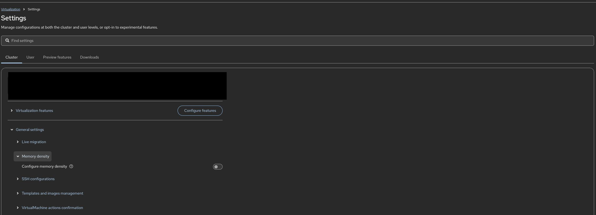

# Administrator guide: CPU and memory oversubscription

> **Client validation pending.** Target: OpenShift **4.21.31**. Check the client’s
> installed APIs, console paths, metric series and guest packages before the session.
> Procedures are checked against the official 4.21 and 4.22 references; no
> production capacity ratio is implied.


The customer follows the [walkthrough](RUNBOOK.md). This guide holds everything
complex: approvals, capacity maths, tools, isolation, metrics, memory prerequisites, reset.

<a id="prepare"></a>

## Preparation checklist

- [ ] [Approvals](#approvals) recorded (ratios, window, owner).
- [ ] [Preflight](#preflight) read-only checks done and recorded.
- [ ] **Path A first:** [existing VMs checked and tools added](#path-a). Only if none suit: Path B below.
- [ ] Path B only: [tool image](#tools) built; [test host isolated](#isolate); [lab created](#create).
- [ ] Capacity recorded and [competitor count](#capacity) derived and approved.
- [ ] [Metrics](#metrics) queries verified against installed series.
- [ ] [Memory prerequisites](#memory-gate) ticked **or** memory phase marked Blocked.
- [ ] Optional [HammerDB](#hammerdb) ready.

<a id="approvals"></a>

## 1. Approvals first

- **Red Hat and the client owner approve the target ratios and competitor
  count in writing before anything starts.** There is no universal safe
  ratio. Record who approved what on the results sheet.
- **Never overcommit by default.** The default plan is competitors whose total
  fits inside the host's allocatable CPU and memory *requests*. Any plan that
  goes beyond that is a deliberate, approved choice.
- Use dedicated workers with no other workloads, a change window, an abort
  rule (for example "stop if any non-lab VM or node shows trouble") and a named
  contact.
- Scheduling allocation ratios are **not utilization**. Record both, per host,
  never as cluster averages.

<a id="preflight"></a>

## 2. Read-only preflight

Console: **Administration → Cluster Settings** (version), **Operators →
Installed Operators** (Virtualization **Succeeded**), **Virtualization →
Overview**.

~~~sh
oc get clusterversion version -o jsonpath='{.status.desired.version}{"\n"}'
R=hyperconvergeds.v1beta1.hco.kubevirt.io   # pinned API version; see MEMORY-DENSITY.md Step 0
oc get $R kubevirt-hyperconverged -n openshift-cnv -o yaml > "$HOME/hco-before.yaml"   # private copy
oc get $R kubevirt-hyperconverged -n openshift-cnv \
  -o jsonpath='cpuRatio={.spec.resourceRequirements.vmiCPUAllocationRatio}{"\n"}density={.spec.higherWorkloadDensity}{"\n"}'
~~~

Record both values here. Leave the CPU allocation ratio unchanged. Change memory
density only through the approved [memory procedure](MEMORY-DENSITY.md).
The CPU allocation ratio decides how little CPU request a vCPU creates, which
is what lets the scheduler admit more vCPUs than cores. A memory-density
setting, when present, decides how much the memory *request* is reduced
relative to guest RAM. The resource is served in more than one API version and the
field path depends on the version: use the version-pinned name above, and read
[MEMORY-DENSITY.md](MEMORY-DENSITY.md) Step 0 before any change. Sources: [REFERENCES.md](REFERENCES.md).

Also record: nodes **Ready**, `rhel9` or equivalent boot source exists, the
StorageClass (and its access modes and binding mode) to use.

<a id="path-a"></a>

## 3. Path A (preferred): use existing VMs, unchanged

Use VMs that already exist. **Nothing is applied, moved, resized or restarted.**
Path B (new lab VMs from the manifests) is a fallback for when no existing VM suits.

### 3.1 Suitability checklist (all must be yes)

| Check | How |
| --- | --- |
| Owner permission, non-critical approved window | Written, with abort rule and contact |
| Linux guest (RHEL-like). **Windows is not assumed compatible**: the guest helper scripts and the commands in the walkthrough are Linux/RHEL only | **Virtualization → VirtualMachines →** VM **→ Overview** (OS) |
| Tools present, or may be added by the owner in the guest (see 3.3), and a console or guest access you are allowed to use | `sysbench --version`, `stress-ng --version` in the guest |
| Resources fixed during the test | Record vCPU (sockets × cores × threads) and memory from **Configuration → Details**; no resize or hot-plug in the window |
| Placement | **Overview → Node** (or `oc get vmi -A -o wide`): measured VM and competitors on the **same worker**; record the mapping. Prefer picking VMs already together over moving any |
| Capacity, isolation | The worker has headroom and no important neighbours; the owner accepts load on it. See [capacity](#capacity) |
| Memory phase | Only with the [memory density appendix](MEMORY-DENSITY.md) complete, or Blocked |

If all pass: **no changes are required** beyond optional guest tools. Record the
current VM sizes and placement on the sheet; do not rewrite them.

### 3.2 Competitors from existing VMs

Pick VMs the owner agrees may be loaded (tests, idle or spare). The competitor count
is the number of such VMs on the test worker that fit the approved plan
(see [capacity](#capacity), using their recorded sizes). Do **not** move or
resize VMs to reach a number: use fewer competitors, or Path B.

### 3.3 Tools and access: smallest reversible change first

| Missing | Smallest change | Disruption |
| --- | --- | --- |
| helper commands | Copy `poc-sysbench`, `poc-load` and `poc-stats` from `guest-tools/` into `~/poc-bin` of the ordinary guest account (steps below). Write "helpers in `~/poc-bin`" on the sheet so participants set the path at each login | Guest-only; **no VM restart**. Undo: remove only the copied helper files |
| sysbench / stress-ng | Install through the **owner's approved** package route | Guest-only install. Record what was installed; undo with the package manager |
| console / guest access | Use access the owner already gives you; do not create new users or keys | none |

**Copy the helpers into one guest** (as the ordinary guest user, in the VM's
serial console). First make the folder:

```sh
mkdir -p ~/poc-bin
ls ~/poc-bin
```

The list must not already contain `poc-sysbench`, `poc-load` or `poc-stats`. If it
does, stop: they are someone else's files. Then, for each of the three files: type `cat > ~/poc-bin/poc-sysbench` (use the
file's name), press **Enter**, paste that file's full contents from `guest-tools/`,
press **Enter**, then **Ctrl+D**. If SSH access to the guest already exists, you can
copy the files with `scp` instead; do not enable SSH just for this. Then:

```sh
chmod 0755 ~/poc-bin/poc-sysbench ~/poc-bin/poc-load ~/poc-bin/poc-stats
export PATH="$HOME/poc-bin:$PATH"
command -v poc-sysbench poc-load poc-stats
poc-stats
```

**Expected:** three paths under `~/poc-bin`, then a short CPU and memory summary.
The `export` line lasts only for this login. Participants repeat it at every new
login (walkthrough step 1).

Never replace the VM's cloud-init, users or storage, never delete guest data, and
do not restart workloads to add tools. Changes that need a **VM restart or
configuration edit** (a disposable VM only) are in [3.5](#adapt).

To confirm console access before the session, open the VM's **Console** tab and choose **Serial console** in the dropdown:


### 3.4 Network path and application load

- Reuse existing reachable addresses first (case 04). Services or extra interfaces only if no path exists.
- An existing application can serve as the *approved representative workload*.
  Freeze its **dataset, version and concurrency** and run it identically in every
  phase. Keep the synthetic tools as the reproducible reference.

<a id="adapt"></a>

### 3.5 Last resort: adapt one stopped, disposable existing VM

Only when no suitable unchanged VM exists, the owner agrees, and a copy of the VM's
current definition is saved privately. Console: **Virtualization → VirtualMachines →
VM → YAML** (copy it out), then stop the VM (**Actions → Control → Stop**: **this is a restart-class
change; the VM is down**), edit under **Configuration**/**YAML**, save, start.
Touch **only** the fields below, write the old value for each, and restore only those:

| Field (under `spec.template.spec`) | Why | Note |
| --- | --- | --- |
| `domain.cpu` / `domain.memory.guest` | only to match the sheet's agreed size | Resizing changes the VM; prefer a different VM |

Do not edit existing placement rules for this test: choose a VM already on the
required worker or use the optional new VMs. Adding a node-affinity selector term
can broaden an existing rule because terms are alternatives.

Do **not** add an explicit memory request; it overrides density-derived requests.
Do not add resource limits for this test. Rollback:
stop the VM, put back the saved values (editing those fields only; never paste the whole saved copy
over the object), start it, and record that the restart happened.

<a id="tools"></a>

## 4. Path B: tool image (sysbench, stress-ng, optional database)

The guests only **call** these tools. The cloud-init in the manifests is minimal
(Kubernetes limits `cloudInitNoCloud.userData` to **2048 bytes**), installs nothing, and sets no
password; the helper commands are **not** embedded. `guest-tools/` is the single source of
the helper commands. Put them in the approved image, as root during the image build:
`install -m 0755 guest-tools/poc-* /usr/local/bin/`. Choose one authorized path and record it:

1. **Preferred: approved tool image.** Build one VM from the stock RHEL 9
   source using the client's authorized method (for example a temporary
   administrator-only cloud-init with an approved SSH public key, over a
   subscription, Satellite or mirror the client permits). Install the tools.
   **Before sealing**, if you added temporary access to the guest, remove it
   inside the guest: delete the temporary key line from that user's
   `~/.ssh/authorized_keys` (or delete the temporary user). Then run
   `sudo cloud-init clean --logs`, stop the VM, and publish its disk as a
   DataSource (console: **Virtualization → Bootable volumes → Add volume**, or
   a DataVolume cloned from its PVC). Put that DataSource's name and namespace
   in the manifests. Removing the cloud-init setting from the source VM later
   does not change disks already copied from the image, so the cleanup must
   happen inside the guest first. Check one new VM from the image has no
   temporary key. If no temporary access was added, skip this.
   (Alternative to a baked image: copy the files into one guest at a time as in 3.3, using an
   existing root session the owner already approves; no secret reference is needed.)
2. **Install in each guest** through the same authorized route, reviewed by the
   client, then remove any temporary access. Slower, easy to leave
   inconsistent: use only for a very small lab.

Packages: `sysbench` and `stress-ng` may not be in the Red Hat repositories
for RHEL 9; if they come from a community repository (such as EPEL) or a
vendor build, the client must approve that source. Record package versions.

Verify inside a test VM from the image (as the console user):

~~~sh
sysbench --version; sysbench cpu help | head -5
stress-ng --version; stress-ng --help | grep -E 'vm-keep|vm-hang|metrics-brief'
poc-stats         # present only after the VM was created from these manifests
~~~

**Stop** if any is missing or the `--vm-keep` / `--metrics-brief` options are
absent: the scripts use them. The memory phase also needs `--vm-hang`; its `0` value
(hold until the timeout) must be verified on the installed build, see the
[appendix](MEMORY-DENSITY.md#step-9-the-memory-ramp-administrator). Competitor tools are bounded (`--timeout`,
memory capped at 70% of free), but a wrong tool build is still a risk.

<a id="isolate"></a>

## 5. Path B: isolate one test host

1. Choose one worker with no other workloads, labels or taints you cannot
   explain. Check **Compute → Nodes → the node → Pods** is empty of
   non-system workloads.
2. Verify: Ready; not control plane; no one else's VMs (`oc get vmi -A -o wide`
   filtered by node).
3. Apply the label (nothing is labelled automatically):
   console **Compute → Nodes → the node → Actions → Edit labels** →
   `perf-lab.example.com/cpumem-host=true`, or
   `oc label node WORKER perf-lab.example.com/cpumem-host=true`.
4. Verify `oc get nodes -l perf-lab.example.com/cpumem-host=true` returns
   **exactly one** node. To test another host later, move the label while all
   lab VMs are Stopped (the affinity is checked only at scheduling).

Record the original `perf-lab.example.com/cpumem-host` label value (or absence)
on each selected node before changing it; restore only that value at cleanup.

<a id="capacity"></a>

## 6. Record capacity and derive the competitor count

Record **for the test host** (not averages), before and after each phase:

| Item | How to read it | Notes |
| --- | --- | --- |
| Logical CPUs | `lscpu` via an approved node shell, or console **Compute → Nodes → node**; metric `machine_cpu_cores` if present | Hardware threads (SMT/Hyper-Threading) count here |
| Physical cores, sockets, threads per core | `lscpu` (*Core(s) per socket*, *Thread(s) per core*) | Record both; SMT siblings are not full cores |
| Allocatable CPU / memory | **Node → Details**, or `oc get node N -o jsonpath='{.status.allocatable}'` | |
| vCPU allocated | sum of running VMs' sockets × cores × threads on this node | **Per host.** Competitor VMs here = 2 vCPU each |
| vCPU : logical CPU, vCPU : physical core | allocated vCPU ÷ the two values above | Report both ratios |
| Pod CPU / memory *requests* | **Node → Details → Allocated resources**, or `oc describe node N` | This is what the scheduler counts |
| Guest configured RAM | sum of `domain.memory.guest` of running VMs | 4 GiB each here |
| Guest usable RAM, active working set | in guest `poc-stats`: MemTotal, MemAvailable; working set ≈ MemTotal − MemAvailable | |
| Swap pressure | host swap-in/out rates (section 9) and guest `pswpin/pswpout` | |

Keep *configured RAM*, *pod memory request* (guest RAM plus overhead, possibly
reduced if a density setting is on) and *active working set* as three separate
columns; never merge them.

**Competitor count:** with an **approved target** `R` (vCPU ÷ logical CPUs):

    competitors = ceil( (R × logical_CPUs − measured_vCPU − other_allocated_vCPU) ÷ vCPU_per_competitor )

and check, for the default no-overcommit plan, that the sum of **pod memory
requests** (measured plus competitors) stays below node allocatable memory
with margin. Example only: 16 logical CPUs, R = 2, measured 2 vCPU,
nothing else: ceil((32 − 2) ÷ 2) = 15 competitors, which would need 60 GiB of
guest RAM, so memory, not CPU, may cap the count. Write the result and the
approver on the sheet. If it exceeds the two shipped competitor manifests, make more
([next section](#create)).

<a id="create"></a>

## 7. Path B: create the lab

After creation, record the name and `metadata.uid` of each VM, DataVolume, PVC and case Service
privately (**VM → YAML**, or `oc get vm,dv,pvc -n perf-cpumem-lab -o yaml`).
Keep this record for cleanup. Do not reuse a pre-existing object as a new one.

Replace the remaining `REPLACE_*` values (tool DataSource name and namespace).
New disks default to **vxflexos / Block / ReadWriteMany**. In **Storage →
StorageClasses**, open **vxflexos**; check its StorageProfile supports this
combination and ask the storage administrator to confirm the image can be copied
or cloned into it. Check the DataSource is Ready and fits the disk size (40 GiB
measured, 30 GiB each competitor). After population, open each PVC and verify
**Bound**, **vxflexos**, **Block**, and **ReadWriteMany**. Stop on unsupported
storage or clone errors. This optional path does not require changing existing VMs.

Fill private copies outside the checkout, then create them in order from the
case directory (console alternative: **+ → Import YAML**). `oc create` refuses
an object that already exists, so nothing existing is changed:

~~~sh
P="$HOME/poc-private/case03"; mkdir -p "$P" && chmod 700 "$P"
cp manifests/00-namespace.yaml manifests/01-measured-vm.yaml manifests/02-competitor-vm-0*.yaml "$P/"
# fill REPLACE_* in the copies, then:
oc create -f "$P/00-namespace.yaml"
oc create -f "$P/01-measured-vm.yaml"
oc create -f "$P/02-competitor-vm-01.yaml" -f "$P/02-competitor-vm-02.yaml"
~~~

If a create reports *already exists*, stop: that object is not yours.

Need more competitors? Each extra VM needs a **unique** name everywhere
(VM, its DataVolume, hostname, `kubevirt.io/domain` and
`perf-lab.example.com/vm` labels). Generate it so none is missed:

~~~sh
bash scripts/render-competitor.sh 03 > "$HOME/poc-private/case03/cpumem-load-03.yaml"   # then fill REPLACE_*; repeat 04, 05…
~~~

The VM sizes (2 vCPU, 4 GiB) and the **absence** of an explicit memory request
or limit are deliberate: an explicit request would bypass any
higher-workload-density setting the client enables. Do not add one without
discussing it with Red Hat.

Verify: `oc get vm,dv -n perf-cpumem-lab` shows all VMs `Stopped`/`Halted` and
all DataVolumes `Succeeded` (with *WaitForFirstConsumer* storage, disks clone on
first start: start each VM once and stop it before the session). Confirm the
console user is unprivileged (`id` has no sudo) and `poc-stats` runs.
Also confirm the project can open consoles only for the people intended.

### Boot readiness: Running is not ready

Check these as **separate statuses** and record each on the sheet. Do not assume
**Running** means the guest is usable.

1. **Disk first.** The DataVolume must be **Succeeded** (console **Storage →
   PersistentVolumeClaims**, or `oc get dv -n NAMESPACE`). With `WaitForFirstConsumer`
   storage the clone only starts when the VM first starts: wait for it. Snapshot- or
   clone-based sources need a compatible image (the VM's UEFI boot, a disk at least as
   large as the source) and a StorageClass whose clone strategy is supported; confirm with
   the storage owner before any workload.
2. **Boots to a login.** Open the **Console** tab: a login prompt, then the auto-login shell.
3. **Guest agent** shows as connected on the VM **Overview** (separate from Running). Missing
   agent is a note, not a blocker, unless the plan needs it.
4. **Tools present** (`command -v` for each, below) and **firewall** as described for the case.
5. **Block on storage errors.** If **VM events** or the console show I/O errors or the VM
   is **Paused** with a storage reason, stop. Do **not** keep resuming or restarting it, and do
   not proceed to measuring: hand it to the storage owner.


<a id="hammerdb"></a>

## 8. Optional representative database workload (HammerDB)

A synthetic CPU test does not show how a database behaves. If agreed, add
this to **cpumem-measured only**, keeping it identical in every phase:

- [ ] Client approves HammerDB (licence, download source) and the PostgreSQL
      package source. Record versions.
- [ ] Install PostgreSQL server and HammerDB in the tool image or the measured VM
      by the authorized route (section 3.3 or 4). Database listens on localhost only.
- [ ] Create database `tpcc` and a test user; passwords come from the client's
      secret store, never from the repository or shell history.
- [ ] Build the schema with the agreed warehouse count (template: 10) and
      confirm size fits memory the way the client wants (cached vs not).
- [ ] Copy `hammerdb/tprocc-run.tcl`, replace every `REPLACE_*`, and check
      parameter names with `print dict` in the installed version.
- [ ] Create the wrapper `/usr/local/bin/poc-db-run` that runs
      `hammerdbcli auto /path/tprocc-run.tcl` and saves output under `/var/tmp`.
- [ ] Do one dry run: it must report NOPM and finish in the agreed time.
- [ ] Agree what is recorded: NOPM/TPM; p95/p99 response times **only if the
      installed HammerDB reports them** (otherwise write *not reported*).

The database and HammerDB driver share the 2 vCPUs of the measured VM; that is
the same in every phase, so comparisons hold, but absolute numbers are not a
production figure.

<a id="metrics"></a>

## 9. Metrics: console route and queries

In **Observe → Metrics**, set **Refresh → 30 seconds** while watching a run.
Choose a time span that includes baseline, load and recovery. Keep the exact
UTC windows on the results sheet; a live chart is not a saved result.


**Console route (customer-friendly):** VM **Metrics** tab; **Observe →
Dashboards** (*Kubernetes / Compute Resources / Node (Pods)*, *Node Exporter /
Nodes*, *Node Exporter / USE Method / Node*). Choose the test node and the run's
UTC window. Dashboard names are **pending verification**.

Example of a VM **Metrics** tab (a sample VM; open the measured VM's own tab):



**Queries** in **Observe → Metrics**. Series below are *commonly present*;
**verify each exists on the installed version** (type the prefix in the query
box) and write "not available" instead of substituting. Replace `NODE` with the
node name. For node-exporter metrics, discover its scrape `instance` using
`node_uname_info{nodename="NODE"}`; substitute that exact value for `INSTANCE`
and filter the other host series to that same instance. Never average all hosts.

| Need | Candidate series (verify) |
| --- | --- |
| Host CPU busy (%) | `100 * (1 - avg(rate(node_cpu_seconds_total{mode="idle",instance="INSTANCE"}[1m])))` |
| Host CPU pressure (PSI) | `rate(node_pressure_cpu_waiting_seconds_total{instance="INSTANCE"}[1m])` (**only if PSI is enabled**; do not enable it just for this test) |
| CPU throttling | `container_cpu_cfs_throttled_periods_total` on `virt-launcher` pods (only meaningful if the launcher compute container has a CPU limit; inspect it) |
| Guest vCPU delay / I/O wait | `rate(kubevirt_vmi_vcpu_delay_seconds_total[1m])` measures scheduler delay/steal; `kubevirt_vmi_vcpu_wait_seconds_total` is I/O wait. Filter by VM and project. Scheduler statistics may be absent; do not change node kernel arguments for this test |
| Guest steal and load | guest `poc-stats` (`cpu_steal_ticks`, `loadavg`) |
| Scheduler CPU requests on node | `sum(kube_pod_container_resource_requests{resource="cpu",node="NODE"})` vs `kube_node_status_allocatable{resource="cpu",node="NODE"}` |
| Host memory | `node_memory_MemTotal_bytes{instance="INSTANCE"}`, `node_memory_MemAvailable_bytes{instance="INSTANCE"}` |
| Host memory used estimate (%) | `100 * (1 - sum(node_memory_MemAvailable_bytes{instance="INSTANCE"}) / sum(node_memory_MemTotal_bytes{instance="INSTANCE"}))` |
| Memory pressure | `rate(node_pressure_memory_waiting_seconds_total{instance="INSTANCE"}[1m])` (PSI only, as above) |
| Host swap use and I/O (swap-in/out rates below are pages/sec) | `node_memory_SwapTotal_bytes{instance="INSTANCE"}`, `node_memory_SwapFree_bytes{instance="INSTANCE"}`, `rate(node_vmstat_pswpin{instance="INSTANCE"}[1m])`, `rate(node_vmstat_pswpout{instance="INSTANCE"}[1m])` |
| Major faults, OOM | `rate(node_vmstat_pgmajfault{instance="INSTANCE"}[1m])`, `node_vmstat_oom_kill{instance="INSTANCE"}` |
| Guest memory / swap | `kubevirt_vmi_memory_available_bytes`, `kubevirt_vmi_memory_usable_bytes`, `kubevirt_vmi_memory_swap_in_traffic_bytes`, `kubevirt_vmi_memory_swap_out_traffic_bytes` (guest swap, not host swap; inspect the exported type before calculating changes) |
| Evictions, OOM kills | `kube_pod_status_reason{reason="Evicted"}`, `kube_pod_container_status_last_terminated_reason{reason="OOMKilled"}` |
| Migrations | **Virtualization → Migrations / events**, or `oc get vmim -A`; metric prefix `kubevirt_vmi_migration` |

A run with an unexpected **migration, eviction, OOM kill or restart** is
invalid: record it, then repeat after the cause is understood.

**Windows:** the same warm-up, measure time and repeats in every phase
(proposal 5 min / 15 min / 3; use what was negotiated). Record every start and
end in **UTC** (the scripts print it) and read metrics for exactly those
windows.

<a id="memory-gate"></a>




## 10. Memory prerequisites (do not skip)

The memory phase needs memory density **and** swap on the test worker. The full
step-by-step procedure (pin the API, back up, isolate, approve swap storage, add swap, enable
in the console, verify, ramp, restore) is in the **[memory density appendix](MEMORY-DENSITY.md)**.
Do that, then tick. The memory branch has not been run; the procedure is source-based until
the results sheet holds evidence. In the newer console the **Memory density** control sits under
**Virtualization → Settings → Cluster → General settings** (shown here switched off; do not
change it outside the appendix):



Record three things separately on the sheet (details in the appendix): *admission* (total running
guest RAM above physical RAM, a measured ratio, not the HCO percentage), *host paging*
(swap-out counters rising **and** swap above zero on at least one launcher `compute`
container), and *workload performance*. Small RSS or guest-pressure checks are
administrator-only; participants need only the one readiness line.

- [ ] Memory density already on **(reused, unchanged)** *or* enabled by the appendix, with
      the cluster owner's approval of its **cluster-wide** effect (HCO setting and `wasp-agent`).
- [ ] The test node's real MachineConfigPool membership recorded (not the `worker` label
      alone), worker-only, no control plane. An existing pool is used only if exclusive and approved.
- [ ] Backing disk for `/var/tmp/swapfile` approved by the storage owner (fast root filesystem;
      capacity plus headroom; no SD/removable media; no formatting or partitioning). Swap is
      present, either reused or added by the optional MachineConfig for that pool only.
- [ ] The new rendered MachineConfig and the node running it were confirmed, not just `Updated=True`.
- [ ] Launcher pod of a VM started after density was enabled: actual QoS class, requests, reduced
      guest-memory component, overhead, allocatable and cgroup swap allowance recorded (appendix Step 8).
- [ ] `stress-ng --vm-hang 0` behaviour verified on the installed build (appendix Step 9), and
      guest swap recorded as found (not changed on existing VMs).
- [ ] Original values, taints, cordons and labels saved privately and the restoration owner named.
- [ ] Guest sizes, hold bytes, hold durations (settle + all repeats + margin) and stop thresholds
      written on the sheet by the approver.
- [ ] Competitor count derived from node allocatable memory and **actual** admitted requests (section 6).

If any box cannot be ticked (no worker-only node, feature or schema missing, no approved
swap storage, approval missing), the memory phase is **Blocked**: record it, run CPU only.
This case never selects control-plane nodes.

<a id="memory-fixtures"></a>

### Memory fixture VMs

Prefer **existing eligible VMs, unchanged** (Path A rules); reuse one only if it is already
eligible and running on the test node. Do not resize or move the CPU fixture. If no existing VM
can hold the sheet's guest RAM, or the memory test needs another worker, create memory-only VMs
from [`manifests/03-memory-fixture.template.yaml`](manifests/03-memory-fixture.template.yaml): a
**different, new namespace** (create it once with `oc create namespace`; the template holds no
Namespace), disks on `vxflexos` / Block / ReadWriteMany, `domain.memory.guest` only (no explicit
memory request), `evictionStrategy: None`, and `stress-ng` in the image. Fill a private copy
per VM, with whole placeholders replaced, and use `oc create` only. Record each created object's
name and `metadata.uid`; cleanup (section 11) deletes only those.

- **Placement.** During the test the node is cordoned. Only these new fixtures carry the explicit
  `node.kubernetes.io/unschedulable` toleration plus the required `memory-host` label affinity, so
  they alone bypass your test cordon. Existing VMs are unchanged. See
  [Step 4](MEMORY-DENSITY.md#step-4-choose-and-isolate-the-node-no-control-plane).
- **Image.** Prefer an already authorized prepared image. The VM names **both** the name and the
  namespace of an existing DataSource.
- **Own baseline.** Fixtures on a different worker than the CPU reference need their own memory
  baseline, loaded and recovery runs on the same VM. Do not combine them with CPU results from
  another VM.
- **Ready before the window.** All new DataVolumes `Succeeded` and PVCs `Bound` before the memory window.

**If the VM cannot create its disk (`Unauthorized` on the DataVolume).** A DataSource being
`Ready` is not enough: the VM controller creates the disk as the **target** project's `default`
service account, which may not be allowed to clone from the source namespace. Official
cross-namespace cloning steps: OpenShift Virtualization
[4.21](https://docs.redhat.com/en/documentation/openshift_container_platform/4.21/html/virtualization/storage)
and [4.22](https://docs.redhat.com/en/documentation/openshift_container_platform/4.22/html/virtualization/storage)
(*cloning a data volume into another namespace*); this procedure adds no Role framework.
**Administrator only.** Do not create Roles or role bindings automatically and do not copy
tokens. As a cluster administrator, check `oc auth can-i create datavolumes/source -n SOURCE_NAMESPACE`
(expect `yes`), then create the VM's own matching standalone DataVolume yourself. Only for **your
own new fixture** whose DataVolume and PVC do not exist yet; if either exists, stop and inspect it,
and never delete, recreate or overwrite it. Use one private file per VM, never overwriting a saved one:

~~~sh
P="$HOME/poc-private/case03"; mkdir -p "$P" && chmod 700 "$P"
VM=REPLACE_VM_NAME; TEST_PROJECT=REPLACE_NAMESPACE      # from the sheet
oc get vm "$VM" -n "$TEST_PROJECT" -o json | jq '{apiVersion:"cdi.kubevirt.io/v1beta1",kind:"DataVolume",metadata:{name:.spec.dataVolumeTemplates[0].metadata.name,namespace:.metadata.namespace,ownerReferences:[{apiVersion:"kubevirt.io/v1",kind:"VirtualMachine",name:.metadata.name,uid:.metadata.uid,controller:true,blockOwnerDeletion:true}]},spec:.spec.dataVolumeTemplates[0].spec}' > "$P/$VM-disk.json"
oc create -f "$P/$VM-disk.json"
~~~

The DataVolume then carries the VM as owner with the exact template name and spec. Wait for
`oc get dv,pvc -n "$TEST_PROJECT"` to show `Succeeded` and `Bound`. Console equivalent: only if
the installed console documents it; this guide does not claim one.

<a id="reset"></a>

## 11. Reset between takes and clean up

- **Between phases:** for CPU load, run `poc-load stop` inside each competitor and confirm
  `poc-load status` reports `NOT running`. Memory holds are separate foreground `stress-ng`
  commands that `poc-load` cannot see: in each hold's console let it finish or press **Ctrl+C**,
  and confirm the prompt returned. Leave existing VMs running.
  Wait five minutes before the recovery baseline. Stop only optional new lab VMs
  when doing an explicit reset, after stopping their loads. Record remaining
  host swap usage; it does not necessarily drain automatically.
- **Restore** memory density, swap and your node isolation using appendix Step 10 (headroom
  gate first, then roll back) and verify against your private backup. Do not uncordon or
  untaint anything you did not add. After the density restore, check that the `wasp-agent`
  DaemonSet matches its controller's desired state; do not delete it by hand. Deleting the
  swap MachineConfig leaves the swap file: remove only your own inactive file, as Step 10 says.
- **Memory fixture (if created):** delete only the VMs, disks and the namespace you created, after checking name and UID against the creation record, as for Path B below.
- **Path A (existing VMs):** remove only the exact helper files you copied for this
  case. Keep any pre-existing tools and other files in `~/poc-bin`. Ask the owner
  before removing packages. Confirm VM sizes and placement still match the sheet.
- **Path B (new VMs):** save results first. Use **Virtualization → VirtualMachines**,
  select project `perf-cpumem-lab`, and delete only the named VMs you created
  for this case. Check each name and UID against your private creation record
  (**VM → YAML → metadata.uid**); a project label alone does not prove you created it.
  Delete associated disks only after the storage owner agrees. A `Retain` PV
  keeps its data after PVC deletion; report it rather than deleting the PV yourself.

CLI alternative, one verified object at a time (replace `NAME`):

~~~sh
oc get vm NAME -n perf-cpumem-lab -o jsonpath='{.metadata.uid}{"\n"}'
oc delete vm NAME -n perf-cpumem-lab
oc get dv,pvc -n perf-cpumem-lab
~~~

If a DataVolume or PVC remains, verify its name and UID against the creation record,
then delete only that named object. Keep the project; its owner can check all
resource types before deciding whether to remove it. Never use `--all` for cleanup.
Restore node labels to the values recorded before setup, using **Compute → Nodes →
node → Actions → Edit labels**. Remove only labels this case added; preserve
pre-existing labels. Undo only firewall/NetworkPolicy changes made for this test.

<a id="sources"></a>

## Sources

- [REFERENCES.md](REFERENCES.md): source matrix for OpenShift 4.21 and 4.22 (chapter *Postinstallation configuration*, section *Configuring higher VM workload density*, and the networking, monitoring, managing-VMs chapters) and the differences that matter.
- [sysbench](https://github.com/akopytov/sysbench) (`sysbench cpu help`, `sysbench memory help`).
- [stress-ng](https://github.com/ColinIanKing/stress-ng) and its manual page (`man stress-ng`).
- [HammerDB documentation](https://www.hammerdb.com/docs/).
- [iperf3 manual](https://github.com/esnet/iperf/blob/master/src/iperf3.1) (used by case 04).
