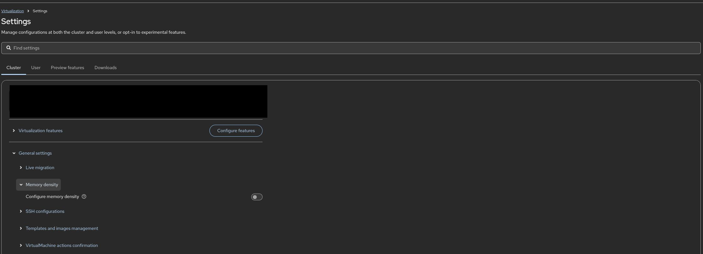
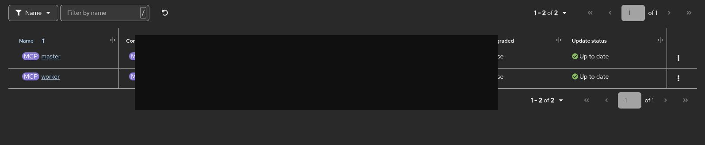
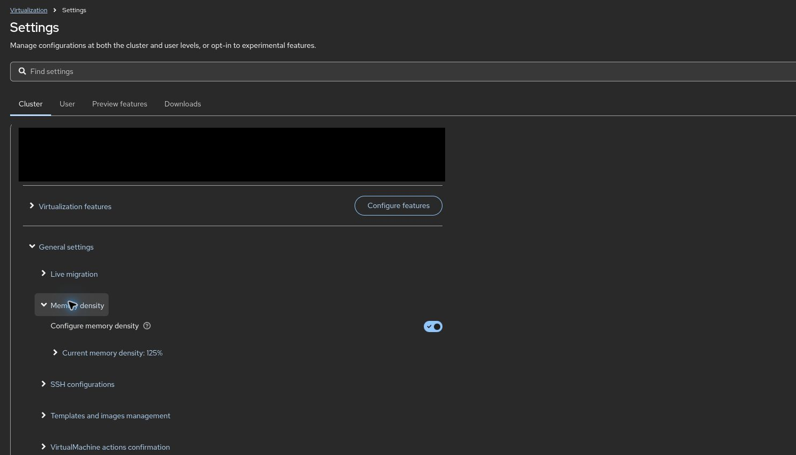
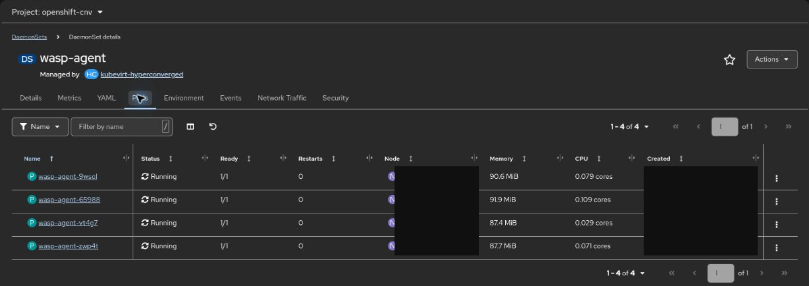
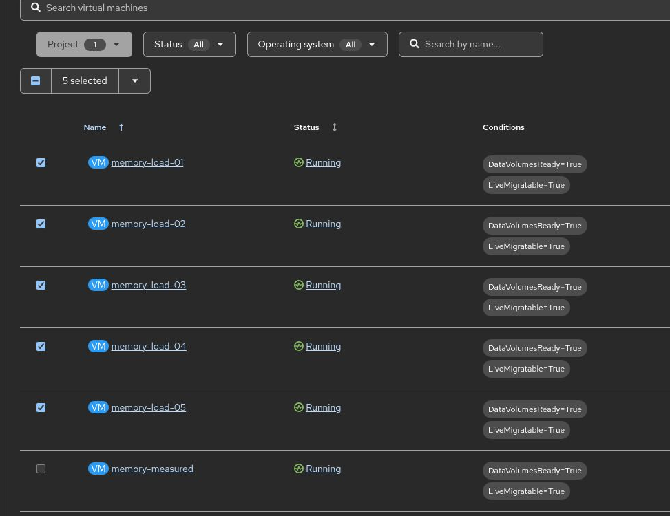
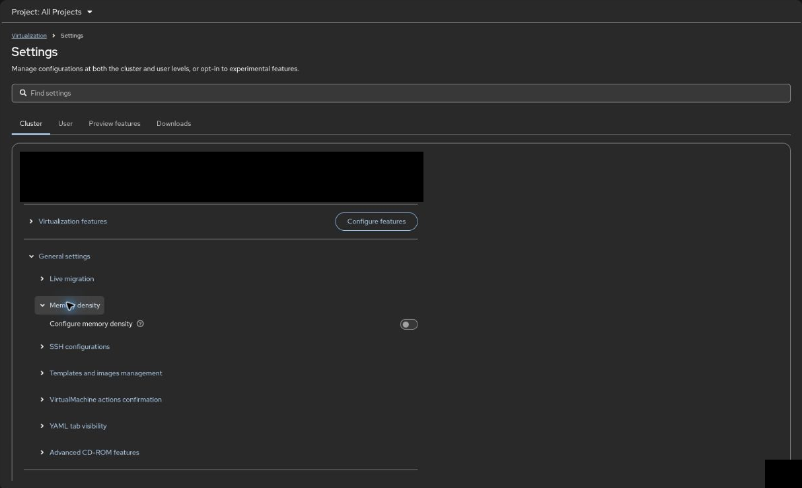

# Prepare and run the memory test

> **Administrator only.** The bounded 4.22 rehearsal observed host and VM paging,
> then was aborted when a stop limit was exceeded and the worker became unresponsive.
> Loaded and recovery benchmarks were not completed. See the
> [verification limits](README.md#walkthrough-verification).
> Participants continue only when their sheet says *Memory prerequisites approved*.
>
> This follows the OpenShift Virtualization 4.21/4.22 procedure *Configuring higher VM
> workload density* ([references](REFERENCES.md)). It uses worker swap and `wasp-agent`.
> The generic OpenShift 4.21 release notes separately list node swap as removed; do not use
> a generic node-swap recipe as a substitute. Check the Virtualization procedure for the
> installed release and ask Red Hat if its applicability is unclear.

Memory density reduces eligible VMs' scheduling requests, allowing their combined guest RAM
to exceed host RAM. In this procedure, host swap backs inactive VM pages when memory is tight.
Enabling swap alone does not change VM requests or prove memory contention.

## Three questions

Record each on its own line of the results sheet.

| Layer | Question | Evidence |
| --- | --- | --- |
| **Admission** | Is total *running guest RAM* larger than the node's physical RAM? | Sum of `domain.memory.guest` of running VMs on the node ÷ physical RAM. This is a measurement, not the HCO percentage (125 is a setting). Also record actual launcher pod requests and node allocatable |
| **Host paging** | Did the host actually page? | Node swap-out counters rising **and** swap usage above zero on at least one VM launcher's `compute` container (`container_memory_swap`, or `memory.swap.current` of its cgroup in an approved node shell) |
| **Workload performance** | Did the measured VM slow down? | The measured-VM results, compared with its baseline |

Admission alone does not prove host paging. Unchanged throughput is a valid observation;
record separately whether any VM memory was swapped.

## Two scopes

| Change | Scope | Disruptive? |
| --- | --- | --- |
| **Memory density** (`memoryOvercommitPercentage` in the HyperConverged resource) and the `wasp-agent` DaemonSet | **Cluster-wide.** It changes eligible VMs' memory requests when new launcher pods are created on any node, and `wasp-agent` is not limited to the test worker. VMs already running keep their pod until it is recreated | Not a reboot, but it changes how every eligible newly started VM is admitted |
| **Swap on nodes** (MachineConfig) | **One MachineConfigPool** (MCO pool): only the nodes the pool really contains | **Yes.** Each node of the pool drains and reboots, one at a time |

Get the cluster owner's written approval for the cluster-wide part as well as the pool part.
Do it in a change window.

**Mark the memory phase *Blocked*** (not skipped, not passed) if any of these is true: no
worker-only pool or node can be approved; the feature or API is missing on the installed
version; approval is missing; no approved swap storage exists
(Step 5); or any selected node is control plane. This case ships no change for control-plane nodes.

## Step 0. Pin the API version before any backup or command

Use the API named in the 4.21 and 4.22 Virtualization procedure:
`hyperconvergeds.v1beta1.hco.kubevirt.io`. Check that the installed cluster serves it
and exposes the setting:

~~~sh
oc get crd hyperconvergeds.hco.kubevirt.io \
  -o jsonpath='{range .spec.versions[*]}{.name}{" served="}{.served}{"\n"}{end}'
oc explain hyperconverged.spec.higherWorkloadDensity.memoryOvercommitPercentage \
  --api-version=hco.kubevirt.io/v1beta1
~~~

If `v1beta1` is not served or the field is missing, stop and check the installed
release's instructions with Red Hat. Keep this version-qualified resource name
for every `get` and `patch` below. For `oc explain`, keep the explicit `--api-version`
flag: the resource name alone does not pin its schema version. The short name `hco`
can select another API version with a different field path. The console remains
the preferred way to change the setting.

## Step 1. Back up first (private folder outside this repository)

Each run gets its own new folder, so a retry never overwrites the original record. Use the
API version pinned in Step 0 (`R` below):

~~~sh
R=hyperconvergeds.v1beta1.hco.kubevirt.io      # the version you pinned in Step 0
mkdir -p "$HOME/memdensity-backup"
if B=$(mktemp -d "$HOME/memdensity-backup/run-XXXXXX"); then
  echo "Backup folder: $B"
  oc get $R kubevirt-hyperconverged -n openshift-cnv -o yaml > "$B/hco.yaml"
  oc get mcp -o yaml > "$B/mcp.yaml"
  oc get mc -o name > "$B/mc-names.txt"
  oc get kubeletconfig -o yaml > "$B/kubeletconfig.yaml"
  oc get nodes --show-labels > "$B/nodes-labels.txt"
  oc get nodes -o custom-columns='NAME:.metadata.name,UNSCHEDULABLE:.spec.unschedulable,TAINTS:.spec.taints,CONFIG:.metadata.annotations.machineconfiguration\.openshift\.io/currentConfig' > "$B/nodes-state.txt"
  oc get ds -A | grep -i wasp > "$B/wasp-before.txt" || true
  oc debug node/TESTNODE -- chroot /host swapon --show > "$B/swap-before.txt"
else
  echo "STOP: could not create a new backup folder. Do not continue."
fi
~~~

If any backup command reports an error, stop before changing settings. Write the folder of the
**first** run on the results sheet; a repeat test restores from that first folder, which holds
the state before any change. `swap-before.txt` is empty when the node had no swap; otherwise it
lists the client's own swap, which stays in place. `nodes-state.txt` records who had cordoned or
tainted which node before you started.

Console equivalent: open each object's **YAML** tab and download it. Restore only the fields you
touched. Do not replace a whole shared object from these copies.

## Step 2. Record the original value of exactly this field

~~~sh
R=hyperconvergeds.v1beta1.hco.kubevirt.io
oc get $R kubevirt-hyperconverged -n openshift-cnv -o jsonpath='parent={.spec.higherWorkloadDensity}{"\n"}value={.spec.higherWorkloadDensity.memoryOvercommitPercentage}{"\n"}' | tee "$B/density-before.txt"
~~~

Write both lines on the results sheet (first run only). Cases: **parent empty** (absent),
**parent present, value empty** (other keys may exist), **value present** (reuse branch if
density is meant to stay).

## Step 3. Inspect the current state (console first)

1. Open **Virtualization → Settings → Cluster → General settings → Memory density** in the newer console. Earlier consoles can show **Virtualization → Overview → Settings → General settings → Memory density**. Write down whether **Configure memory density** is on and its value.
2. **Compute → MachineConfigPools:** every pool **Updated**, none **Degraded**.
3. **Compute → Nodes:** the test nodes are Ready.

**Branch: memory density is already on.** Record the value and *reuse it unchanged*: do not
change it or turn it off afterwards. Skip the setting change in Step 7 and the HCO restore
in Step 10, but still verify the agent on the test node. Check swap (Steps 5-6) and the
effective request (Step 8). If the value is
too low for the plan, stop and ask the owner.

## Step 4. Choose and isolate the node (no control plane)

The swap MachineConfig applies to **a MachineConfigPool**, so first learn which nodes each
pool actually contains. A node can carry the `worker` label and still belong to another pool
(mixed-role nodes exist). Record, for the test node and its pool:

~~~sh
oc get mcp -o custom-columns='POOL:.metadata.name,NODES:.status.machineCount,SELECTOR:.spec.machineConfigSelector,NODESEL:.spec.nodeSelector,RENDERED:.spec.configuration.name'
oc get nodes -o custom-columns='NAME:.metadata.name,CONFIG:.metadata.annotations.machineconfiguration\.openshift\.io/currentConfig'
oc get nodes -l node-role.kubernetes.io/master -o name           # the test node must not appear
oc get nodes -l node-role.kubernetes.io/control-plane -o name    # the test node must not appear
~~~

A node belongs to the pool whose rendered name prefix (`rendered-POOL-...`) is in its `CONFIG`.
Write the pool and its real node list on the sheet. **Stop** if any listed node is control
plane or is not approved for this test.

**Which pool to use**, in this order:

1. **An existing approved pool.** The existing generic `worker` pool is acceptable **only
   when all are verified and written down**: every node it really contains is an approved
   worker-only node, the owner approves swapping and rebooting all of them, and no other pool
   (for example a custom pool whose selector lists `worker`) inherits the worker MachineConfig
   you will add. If the test node is already isolated this way, **no new pool and no label
   move is needed**; use it as is.
2. **A new custom pool**, only with the owner's approval and only for one worker-only node, from
   [`optional/custom-pool.template.yaml`](optional/custom-pool.template.yaml). It lists `worker`
   and your new role, so it **inherits every worker MachineConfig**. Joining or leaving a pool
   can drain and reboot the node.
   1. Fill a private copy; `oc create --dry-run=server -f FILE`; then `oc create -f FILE`
      (console **Compute → MachineConfigPools → Create**). `create` refuses a pool that exists.
   2. Wait for the pool to show **Updated** with 0 nodes.
   3. Label exactly one worker-only node (**Compute → Nodes → node → Actions → Edit labels**).
   4. Wait until the pool shows 1 node and **Updated** again.
   5. Rollback later: remove that label, wait for the node to rejoin `worker`, then delete only the pool you created.

**Keep other VMs off that node (temporary test placement, not a production policy).** Record
first (Step 1, `nodes-state.txt`) the node's cordon, taints and labels; you restore only what you add.
Placement has two stages, because a taint of your own also keeps DaemonSet pods such as
`wasp-agent` off the node:

1. **While the swap MachineConfig rolls out (Step 6 only).** The pool must be able to converge,
   so the node is **uncordoned** during this stage. Protect other workloads with one owned
   taint and a label: `oc adm taint node TESTNODE perf-lab.example.com/memory-host=true:NoSchedule`
   and `oc label node TESTNODE perf-lab.example.com/memory-host=true`. If swap already exists
   (no rollout), skip this stage.
2. **For the test itself (Step 7 onward).** Cordon the node (`oc adm cordon TESTNODE`) and
   **remove your own taint before verifying `wasp-agent`** (Step 7):
   `oc adm taint node TESTNODE perf-lab.example.com/memory-host-`. Keep the label. DaemonSets
   normally tolerate a cordon, so `wasp-agent` can run on the cordoned node; a custom taint
   would exclude it. Do not add a broad `Exists` `NoExecute` toleration to anything.

The **new memory fixture VMs** bypass the cordon on purpose. They carry an explicit
`node.kubernetes.io/unschedulable` `Exists` `NoSchedule` toleration **and** a required node affinity
for the `memory-host` label (see
[`manifests/03-memory-fixture.template.yaml`](manifests/03-memory-fixture.template.yaml)). The cordon blocks ordinary new workloads; DaemonSets and
pods with explicit tolerations or node bindings can still run there. Existing VMs are not edited and keep their placement; reuse one only if it is
already eligible and running on the node.

- Cordon and taints do not move running VMs. Before pressure, check
  `oc get vmi -A -o wide` and `oc get pods -A --field-selector spec.nodeName=TESTNODE -o wide`.
  Confirm the node contains only the agreed test VMs and expected platform pods.
- The cluster default may live-migrate a VM to another node. That node may have no swap, so
  the template sets `evictionStrategy: None`. For an **existing** VM, record its strategy and
  do not edit it; if it can migrate, choose another VM or treat any migration as an invalid run.
- **Do not edit HyperConverged infrastructure placement or the `wasp-agent` DaemonSet** to
  work around placement. Do not rely on a pod that was already on the node surviving a taint:
  re-adding a taint does not repair what it excluded.
- The cluster owner's change window is still required. Rollout details are in Step 6.

Density and `wasp-agent` still act cluster-wide whatever you do here (scope table).

## Step 5. Check the disk behind the swap file

The template uses the documented `/var/tmp/swapfile` path. Before creating it, confirm
that `/var/tmp` is on the node's fast root filesystem and has room for the agreed swap
size plus headroom. The storage owner approves the backing disk and size. Do not use
SD cards or removable boot media for this paging test.

~~~sh
oc debug node/TESTNODE -- chroot /host sh -c 'findmnt -n -o TARGET,SOURCE,FSTYPE --target /var/tmp; lsblk -d -o NAME,MODEL,TRAN,SIZE; df -h /var/tmp; swapon --show; ls -l /var/tmp/swapfile 2>&1; ls /etc/openshift/kubelet.conf.d/ 2>&1; systemctl list-unit-files "perf-swap-*"'
oc get mc -o yaml | grep -n -e '90-swap.conf' -e '/var/tmp/swapfile' -e 'perf-swap-'
~~~

Expected: approved fast backing disk, enough free space, no existing swap file, no
`90-swap.conf`, and no `perf-swap-*` units or MachineConfig entries. Stop on a collision;
do not overwrite another configuration. Record the backing device, filesystem, free space,
swap size and approval on the sheet.

If swap already exists, record its configuration and have the administrator verify that it
meets the test requirements. Reuse it unchanged; do not add another swap file.

**Swap size.** The documented sizing formula is

    NODE_SWAP_SPACE = NODE_RAM × (MEMORY_OVER_COMMIT_PERCENT ÷ 100% − 1)

At 125% that is 25% of node RAM (about 63 GiB for a node with about 252 GiB). That is the
**fully configured** ratio. A smaller swap is a **bounded first-paging demonstration**: it can show
whether paging starts, but it does not show what the full configured ratio does. One rehearsal
used 14 GiB of swap with 125% density; that run was a bounded demonstration, not a sizing
recommendation, and 14 GiB is not enough for any other node by default. Record both numbers on
the sheet (swap configured and the formula value) and say which one the run used. Verify the
formula in the installed documentation.

This template does not format a disk, create a mount or move the operating system. If the
root disk is unsuitable, mark the phase **Blocked** until suitable storage has been prepared
under a separately reviewed procedure. Do not substitute an arbitrary mount path.

## Step 6. Add swap on the pool (disruptive; skip if swap already exists)

Do this with **all lab VMs stopped** and no other workloads on the test node. Use stage 1 of
Step 4: the node is **uncordoned** and carries only your temporary `memory-host` taint, so the pool
can drain, reboot and converge while other workloads stay away.

1. Copy [`optional/swap-machineconfig.template.yaml`](optional/swap-machineconfig.template.yaml).
   Replace `REPLACE_POOL_ROLE`, `REPLACE_SWAP_SIZE_MB` (value only; keep the variable name
   `SWAP_SIZE_MB`). Keep the documented `/var/tmp/swapfile` path.
   Diff it against the documentation section for the installed version; the page wins.
2. `oc create --dry-run=server -f FILE` must succeed. Console: **Compute → MachineConfigs →
   Create MachineConfig**.
3. Preflight again: pool **Updated** and not **Degraded**; Steps 4-5 still true; window open.
   Note the pool's current rendered name: `oc get mcp POOL -o jsonpath='{.spec.configuration.name}{"\n"}'`.
4. Create it: `oc create -f FILE` (refuses an existing MachineConfig of that name).
5. **Confirm the change really reached the node.** "Updated=True" can still describe the old
   rendering. All of these must hold:
   - the pool's `spec.configuration.name` is a **new** rendered name, different from step 3;
   - that rendered MachineConfig contains yours (`oc get mc NEWRENDERED -o jsonpath='{.spec.config.systemd.units[*].name}'` lists `perf-swap-*`);
   - the node's `currentConfig` annotation equals the new name and its
     `machineconfiguration.openshift.io/state` is `Done`;
   - then `oc wait mcp POOL --for condition=Updated=True --timeout=30m` returns.
6. Verify: `oc debug node/TESTNODE -- chroot /host sh -c 'free -m; swapon --show'` shows swap of about the agreed size at `/var/tmp/swapfile`.

7. **Re-cordon and remove your taint, then continue.** Only after step 5 holds (new rendered
   name, `current` = `desired`, state `Done`, node `Ready=True`, pool Updated): run
   `oc adm cordon TESTNODE`, then `oc adm taint node TESTNODE perf-lab.example.com/memory-host-`.
   Do this **before** Step 7. A cordoned pool can then show `READYMACHINECOUNT` 0 or
   **Updating**: that is the intentional unschedulable state, not a Degraded failure. It is only
   valid because step 5 was already verified. Do **not** create another MachineConfig while the pool is busy.

If the pool goes **Degraded** or a node stays NotReady: stop, add no more nodes, roll back
(Step 10), investigate.

## Step 7. Turn memory density on (console)

1. Open **Virtualization → Settings → Cluster → General settings → Memory density** (or the earlier-console path in Step 3).
2. Turn on **Configure memory density**; choose the **approved** percentage (the console offers
   100% to 400% in 25% steps). **Save.**

CLI equivalent, same API version as Steps 0-2. A **merge patch** creates the parent object if it
is absent and leaves every other field alone (125 is an example, not a recommendation):

~~~sh
oc patch $R kubevirt-hyperconverged -n openshift-cnv --type=merge \
  -p '{"spec":{"higherWorkloadDensity":{"memoryOvercommitPercentage":125}}}'
oc get $R kubevirt-hyperconverged -n openshift-cnv -o jsonpath='{.spec.higherWorkloadDensity}{"\n"}'
~~~

**Verify the agent.** In 4.21 and 4.22 the `wasp-agent` DaemonSet is in `openshift-cnv`:

~~~sh
oc get ds wasp-agent -n openshift-cnv
oc rollout status ds/wasp-agent -n openshift-cnv
oc get pods -n openshift-cnv -o wide | grep wasp-agent
~~~

A successful DaemonSet rollout does **not** prove the agent runs on the test node: the desired count
leaves out any node the DaemonSet cannot be scheduled on, so the rollout can succeed with no pod
on your worker. Check the node itself: the node must be cordoned, your own taint already
removed (Step 4), and a `wasp-agent` pod **Ready on TESTNODE**.

~~~sh
oc get pods -n openshift-cnv -o wide --field-selector spec.nodeName=TESTNODE | grep wasp-agent
~~~

Console: **Workloads → DaemonSets**, project `openshift-cnv`, filter *wasp*. A pod must be
Running on the test node. If the DaemonSet is not there, run `oc get ds -A | grep wasp`, record
where it is, and tell the owner.

## Step 8. Verify the effective request, QoS and cgroup swap on the launcher

A VM picks up the density-derived request when its launcher pod is created. Start new
fixtures **after** Step 7. An existing running VM can be reused unchanged if its actual
request and swap allowance already qualify. Do not restart an existing VM just to qualify it;
choose another VM or use a new fixture.

1. Start one fixture VM (**Actions → Control → Start**) and wait for **Running**. It schedules on
   the cordoned node only because of its explicit toleration and required label affinity.
   New fixture disks and cross-namespace clone permission: see
   [Memory fixture VMs](ADMIN-GUIDE.md#memory-fixtures); disks must be **Ready** before this window.

   

2. Read the launcher's QoS class and resources (console: **Workloads → Pods →** `virt-launcher-...` **→ YAML**):

~~~sh
oc get pod -n NAMESPACE -l kubevirt.io/domain=VM_NAME \
  -o jsonpath='{.items[0].status.qosClass}{"\n"}{.items[0].spec.containers[?(@.name=="compute")].resources}{"\n"}{.items[0].metadata.uid}{"\n"}'
~~~

3. Read the `compute` container's swap allowance. Use the launcher pod name shown on the
   VM's **Overview → Pod** link (replace `POD_NAME` below). This command only reads two files:

~~~sh
oc exec -n NAMESPACE POD_NAME -c compute -- \
  cat /sys/fs/cgroup/memory.swap.max /sys/fs/cgroup/memory.swap.current
~~~

   The first line is the allowance in bytes (or `max`); the second is current swap use.
   If either file is unavailable, ask the administrator to check the container's cgroup
   on the node. Missing output is not proof of an allowance.
4. **Record what you find:** the actual QoS class (check it live; do not assume Burstable),
   the actual request, and whether the cgroup swap
   allowance is non-zero (`memory.swap.max` not `0`). If the allowance is `0` for the
   `compute` container, swap cannot be used by that VM: stop; the memory phase is Blocked.
5. **Request check.** For a small VM, overhead can push the *total* request above the guest RAM,
   so do not compare the total with guest RAM alone. Record guest RAM, the density value, the
   actual total request, the reduced guest-memory component as the installed section describes
   it, and the **actual overhead** (total request minus that component). Where a same-size VM
   launched before density was enabled is running, compare its request. If the guest-memory
   component was not reduced, memory density is not in effect: stop; Blocked.
6. Record node **allocatable**. `free -m` on the node shows swap; host swap metrics respond
   (admin guide, metrics).

**Plan the guests from measured numbers.** Sum the *actual* admitted requests (**Compute →
Nodes → node → Details → Allocated resources**) and the guest RAM. A **candidate only** at
125%, from one agreed plan: five competitors of 56 GiB guest RAM plus a 4 GiB measured VM
(284 GiB of guest RAM). It is not a recommendation: it is valid only if the actual requests fit
allocatable on your node and the results sheet approves it.

## Step 9. The memory ramp (administrator)

The participant walkthrough holds memory in each guest with `stress-ng`
([RUNBOOK](RUNBOOK.md#4-add-memory-load)). You control the ramp. Every size, duration and
stop threshold comes from the **results sheet**; none is a universal value.

**How a hold works.** Each hold is one **foreground** `stress-ng` command in a guest serial
console. While it runs the prompt does not return. It ends when its `--timeout` passes, or when
someone presses **Ctrl+C** in that console. The CPU helper `poc-load` does not start, see or
stop these holds: `poc-load status` says nothing about them. Check the console to confirm the command is still running and the prompt has not returned.
A frozen or disconnected console is not proof that the hold is healthy.

**Hold duration.** The sheet's `SECONDS` must cover the whole step:

> settle time + (warm-up + measure) × repeats + margin

With the proposal values (300 s warm-up, 900 s measure, 3 repeats) the repeats alone take
3 × 1200 = 3600 s, so the hold needs more than that plus settle and margin. Compute it from
the sheet's real values; there is no universal number. A hold that ends before the last repeat
finishes makes that repeat invalid.

**Before the first hold:**

- Verify the installed `stress-ng` in a small test (a few hundred MiB): check that
  `--vm-hang 0` holds the memory until `--timeout` ends it, as the installed manual says.
  If it does not, the cold-hold method is **Blocked**.
- Record, for each guest, whether guest swap is on and its size. **Leave guest swap as found**:
  do not enable, disable or reconfigure it on an existing VM. Record it on the sheet.
- The abort path is ready: each guest console is open, and you know the names and UIDs of
  **only the VMs you created** for this test.
- Admission is computed (Step 8): total running guest RAM vs physical RAM.
- Graphs are open: node swap-out rate, node available memory, memory pressure and swap used on
  the launchers' `compute` containers.

**Which VM is measured.** If the memory phase uses new fixtures or a different worker than the CPU
phase, the measured VM of the memory phase needs **its own** baseline, loaded and recovery runs, all
on that same VM and worker. Do not present CPU and memory results from different fixtures as one
unchanged VM. The CPU fixture is not moved or resized. A memory baseline is valid with the
competitors Running but **idle** (no holds): it shows the configured admission ratio, not actual
memory pressure. If density was already set to 125 during preparation, do not call that baseline
"density 100"; record the density value that was in effect.

**Ramp, one guest at a time, starting conservative:**

1. Start with a hold well below what fits in RAM (sheet value). Confirm no host paging
   (counters flat; zero swap on every launcher).
2. Add **one** guest's hold at a time. Wait the sheet's settle time, then read the counters.
   Record admission (the ratio) and host paging.
   Watch while the hold fills, too: it can take minutes to touch all the requested memory.
   Near pressure, use small increases that leave enough headroom for the next allocation
   and the time needed to stop it. Available RAM alone does not predict when paging starts.
   Wait for memory use to level out before measuring; an active command may still be filling.
3. **Before each measured repeat, check that every hold of the step is still active** (all
   consoles still running the command, no prompt returned). Check again when the repeat ends.
   If any hold expired or stopped, **mark that repeat invalid** on the sheet and do not call it
   loaded. Restart the holds, wait the settle time, and run the repeat again.
4. **Stop adding load at the first attributable swap:** node swap-out counters rise **and**
   a launcher's `compute` container shows swap above zero. Hold there; that is the data point.
   Do not "push a little more".
5. Record the memory each guest actually touched (guest `free -m` used, and the launcher
   `compute` container working set or RSS), not only the `--vm-bytes` requested.

**Stop the test load** (abort) on any of: swap used above the sheet's limit; node available
memory under the sheet's floor; an OOM kill, eviction, VM restart or migration; a node
NotReady; or missing graphs. Abort order:

1. In each guest console press **Ctrl+C** and confirm the prompt returns: the foreground
   `stress-ng` stops only itself. Do this for **every** memory hold you own.
2. If a console is unreachable or Ctrl+C does not stop the hold, stop **only** the VMs you created (**Actions → Control →
   Stop**), after checking name and UID against your creation record.
   A stop request can remain pending on an unresponsive worker. Wait for **Stopped**;
   do not assume its memory was released. Use the owner's node-recovery procedure if needed.
3. Run the headroom gate (Step 10) before changing anything else.

Also stop for worker **MemoryPressure** or **DiskPressure**, sustained memory-pressure
stalls or device latency above the agreed limit, or a swap-rate surge approaching the installed
WASP eviction controls. Keep the available-memory floor above the node's actual eviction
threshold even while swap is growing. Record these limits before the run; do not tune them
during the test.

**Not allowed in this case:** forcing an OOM, changing eviction thresholds or kubelet
tuning, raising the density percentage mid-test, enabling swap inside a guest to hide host
pressure, or stressing the host itself.

## Step 10. After the test: stop, check headroom, restore, verify

Do these in order.

1. **Stop all test load.**
   - **Memory holds:** in each guest console, either let the hold finish or press **Ctrl+C**,
     and confirm the prompt returned. Do this for each hold you own. As a read-only
     double-check, `pgrep -a stress-ng` in the guest should print nothing.
   - **CPU helper:** `poc-load stop`, then `poc-load status` should say `NOT running`, in each
     competitor that ran CPU load. This does not touch memory holds.
   - Then stop only the **new fixture VMs you created**. Existing reused VMs stay running.
   Memory used by swap does **not** necessarily drain by itself: idle pages can stay in swap.
2. **Headroom gate.** Swapped-out pages must fit back in RAM if swap goes away:
   `MemAvailable` (`free -m`, "available") must exceed swap *used* with the sheet's margin.
   If it does not, stop **only the new fixture VMs you own** that are still running on that node
   and check again. Do not stop other workloads to make room. If headroom is still
   insufficient, do not remove swap: leave it in place and escalate to the cluster owner.
3. **Restore memory density** (skip if you reused an existing setting). Console: use the
   **Memory density** path in Step 3, first check it still shows the value you set, then set
   the recorded value, or turn it off if it was off. CLI, changing **only** the one field you
   touched, using the first run's Step 2 record. Each patch first tests that the field still
   holds the value you set (125 in these examples); replace 125 and 100 with your values:

   - *Value was present* (for example 100): set it back:
     `oc patch $R kubevirt-hyperconverged -n openshift-cnv --type=json -p '[{"op":"test","path":"/spec/higherWorkloadDensity/memoryOvercommitPercentage","value":125},{"op":"replace","path":"/spec/higherWorkloadDensity/memoryOvercommitPercentage","value":100}]'`
   - *Value was absent* (with or without its parent): remove only the value:
     `oc patch $R kubevirt-hyperconverged -n openshift-cnv --type=json -p '[{"op":"test","path":"/spec/higherWorkloadDensity/memoryOvercommitPercentage","value":125},{"op":"remove","path":"/spec/higherWorkloadDensity/memoryOvercommitPercentage"}]'`

   Other settings under `higherWorkloadDensity`, including any added by someone else since,
   stay as they are. Do not remove the parent object. If the patch reports that the test
   failed, someone changed the setting after you: nothing was written. Stop and ask the owner.
   The installed version may fill a default value back in after a removal; that is expected.
   Do not `oc replace` or `oc apply` the saved `hco.yaml`.

   

4. **Check the `wasp-agent` DaemonSet against its controller.** It is managed from the density
   setting. Do not delete it by hand. After the restore, wait, then compare
   `oc get ds -n openshift-cnv | grep wasp` with `wasp-before.txt`: it should be in the state
   the installed version defines for your restored setting (present or absent). If it is not,
   record what you see and ask the owner or Red Hat support. Do not delete or patch it.
5. **Remove the swap configuration you added**, if you added one. First protect the node again:
   add your temporary taint (`perf-lab.example.com/memory-host=true:NoSchedule`) and **uncordon**
   it so the pool can converge. Then delete **only** the
   MachineConfig you created (**Compute → MachineConfigs →** `90-...-perf-swap` **→ Delete**).
   The pool reboots node by node. Wait for **Updated**, and confirm the node's `currentConfig`
   is a rendering without your MachineConfig. If the client already provided swap (Step 5),
   skip this: their swap stays.
6. **Verify swap matches the start:** `oc debug node/TESTNODE -- chroot /host swapon --show`
   and compare with `swap-before.txt` from the first backup folder. No swap before means none
   now; the client's own swap before means the same devices, types, sizes and priorities.
   The **USED** amount can change during the test.
7. **The swap file stays on disk after the MachineConfig is deleted.** Deleting the
   MachineConfig removes the units but not the file. Delete the file only when all hold:
   this test created it (path recorded on the sheet); the node has rebooted into the restored
   configuration; `swapon --show` does not list it; the owner approves. Then remove that one
   path (`ls -l SWAPFILE`, then `rm SWAPFILE`; no wildcard, no directory, never a device). If
   any condition fails, leave the file and tell the storage owner.
8. **Undo only your isolation:** restore the node's recorded initial cordon state (re-cordon it only
   if it was cordoned before), remove the `perf-lab.example.com/memory-host` taint (if present) and label
   you added; if you moved a node into a pool you created, move it back and delete only that
   pool (Step 4 rollback). Do not uncordon or untaint anything else. Compare with
   `nodes-state.txt`: a cordon or taint that was already there, or that another administrator
   or the MachineConfig update set, is not yours to clear. Do not delete a pool you did not create.
9. **Verify against the first backup folder:** only the field you touched differed, and now
   matches `density-before.txt`; `oc get mc -o name` against `mc-names.txt`; node labels and
   state against `nodes-labels.txt` and `nodes-state.txt`; swap against `swap-before.txt`; pools Updated.
10. Record the restoration on the results sheet.

## Known cautions

- Memory overcommit can lower performance on heavily used systems; that is part of what is measured.
- The QoS class and cgroup swap allowance of a launcher are read live (Step 8), not assumed.
- Red Hat tracks issues with `wasp-agent` during upgrades and at very high ratios: do not run
  this during a cluster upgrade, and re-read the known issues for the installed version.
- The MachineConfig ships the kubelet drop-in from the documented sample. Compare it with the
  section for the installed version; this appendix ships no `KubeletConfig`.
