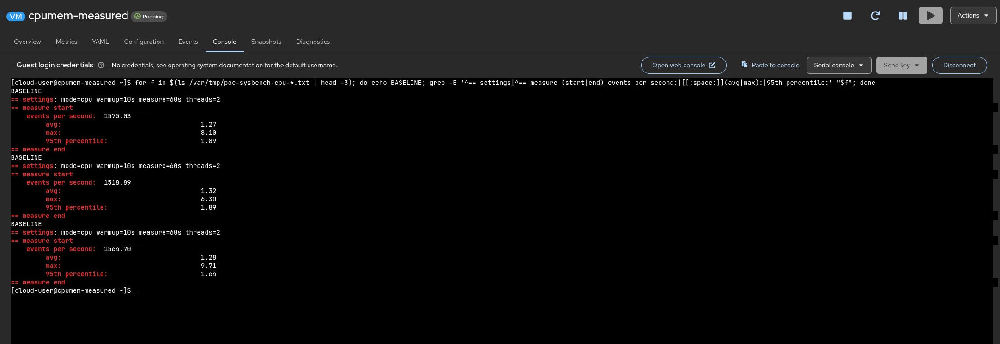
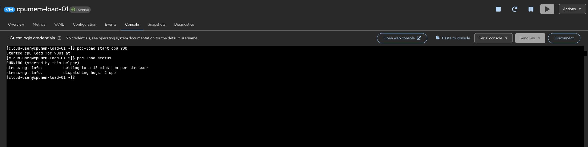

# CPU and memory sharing: customer walkthrough

**Goal:** compare the same workload with and without other VMs competing for the
host’s CPU and memory. More virtual resources than host capacity is called
*oversubscription*.

**Start with existing VMs.** No new VMs or configuration changes are needed if
[your VMs meet the requirements](ADMIN-GUIDE.md#path-a). Your sheet gives each VM
a role: the **measured VM** runs the workload you compare, and the **competitor
VMs** add the extra demand. Existing VMs keep their names, sizes and hosts; only
the role is new. The administrator
prepares the [results sheet](RESULTS-TEMPLATE.md), tools and graphs first.
[New test VMs](ADMIN-GUIDE.md#prepare) are a fallback.

The CPU console walkthrough has been rehearsed on OpenShift 4.22; the memory
phase and OpenShift 4.21 execution remain unverified. Complete your results sheet
before calling a test passed. A benchmark is not a production
capacity recommendation.

The pictures show the controls and reference output. Private values are covered
with black boxes. Use the VMs, addresses, directory and times on **your results
sheet**; the pictures are not results for your environment.

## 1. Open the VMs and graphs

1. Open **Workloads → Pods** and select the project on your sheet. Then open **Virtualization → VirtualMachines → Virtual machines**. This also works when the VM project filter is disabled.
2. Open the **measured VM**: this runs the workload you will compare. Check its
   **Node** matches the sheet. A node is the physical host running the VM.
3. Open **Console**, use the **VNC console** dropdown to select **Serial console**, wait for connection, click inside the terminal and press **Enter**. Log in with your existing guest account; the optional new test VMs log in automatically. Type commands inside the VM.
4. Open the VM’s **Metrics** tab in another browser tab. Keep the administrator’s
   host CPU, memory and swap graphs open too, filtered to the test node.

   

   

**Expected:** the VMs are Running, their consoles work, and graphs show data.
Keep existing VMs at their current size and location. Start optional new VMs
only when the administrator says they are ready.

Paste **one command at a time** into the guest console, press **Enter**, and wait for
its expected output before continuing. If the existing guest uses a different console,
use the working console the administrator lists on your sheet.

**Every time you log in to a guest** (the measured VM and each competitor), run this
first if your sheet says the helpers are in `~/poc-bin`:

```sh
export PATH="$HOME/poc-bin:$PATH"
command -v poc-sysbench poc-load poc-stats
```

**Expected:** three file paths. A new login does not remember the setting, so repeat it
after every new login. If a path is missing, stop and tell the administrator. VMs made
from the prepared image already have the helpers and need no setting.

## 2. Record a baseline

A baseline is the result before adding competing load. Use the measured command
on your sheet. The supplied reference commands are:

```sh
poc-sysbench cpu
poc-sysbench memory
```

Run the CPU command with no competing load. Run the memory command only if
the sheet says **Memory prerequisites approved**; otherwise keep that phase
**Blocked** and continue with CPU only. Run the commands **one at a time**. Each command discards
5 minutes of warm-up, then measures for 15 minutes. Repeat each three times.
For shorter agreed runs, use the same arguments throughout, for example
`poc-sysbench cpu 60 300` and `poc-sysbench memory 60 300`.

**Expected:** the command finishes and prints `Saved:`. Record the start/end
UTC times, throughput (CPU: events/sec; memory: MiB/sec), and average/95th
percentile/max latency. Higher throughput means more work completed. Lower
latency means less time per operation. Use the same application workload instead
if the sheet specifies one; keep its data size and users unchanged. Scroll up inside the terminal if the throughput
or latency summary is above the visible area.



## 3. Add CPU load

1. Check that the **competitor VMs** on your sheet are Running on the **same Node**
   as the measured VM. These VMs provide the extra demand.
2. Open each competitor’s **Serial console**, log in, set the helper path as in
   step 1 if your sheet says so, and run:

   ```sh
   poc-load start cpu 4500
   ```

3. After two minutes, run `poc-load status` in each competitor; expect `RUNNING`.
   Repeat the **CPU** measured command from step 2 three times. Before each repeat,
   check the competitors still report `RUNNING`; otherwise stop and tell the administrator.
   Record its results and the same graph time windows.

   

   

4. In each competitor console run `poc-load stop`.

   

**Expected:** `Started cpu load` when starting and `Stopped helper-started
processes` when stopping. The load also stops itself after 75 minutes. For each
approved higher load level, repeat this step using the competitors on the sheet.
The measured VM and its command stay unchanged.

## 4. Add memory load

**Only continue when the sheet says “Memory prerequisites approved”.** Otherwise
record **Blocked**. The administrator follows the complete
[memory setup and restore procedure](MEMORY-DENSITY.md); participants do not
change cluster settings. Guest swap alone does not satisfy the host-swap requirement.

1. With CPU load stopped, run this in each approved competitor’s console:

   ```sh
   poc-load start mem 4500 50
   ```

2. After two minutes, run `poc-load status` in each competitor; expect `RUNNING`.
   Repeat the **memory** measured command from step 2 three times. Before each repeat,
   check the competitors still report `RUNNING`; otherwise stop and tell the administrator.
   Watch host memory and swap graphs as well as the measured results.
3. Run `poc-load stop` in every competitor. Repeat for each approved load level.

**Expected:** `Started mem load`. The command repeatedly touches part of the
VM’s available memory; it also uses CPU. The administrator must confirm actual
host memory pressure. Allocating RAM alone does not demonstrate it. This
synthetic bandwidth test does not replace an application working-set test.

## 5. Check recovery and finish

1. Confirm every competitor reports `NOT running` after `poc-load status`.
2. Wait five minutes, then repeat the CPU command **three times** with the same settings. If the memory phase was approved and run, also repeat the memory command **three times**, one run at a time. Otherwise leave memory **Blocked**.
3. Record whether throughput and latency returned close to the baseline.

   

4. Leave existing VMs running. Give the sheet to the administrator for
   [cleanup and restoration](ADMIN-GUIDE.md#reset).

**Stop the load and contact the administrator** if you see `BLOCKED`, `FAILED`,
`RUN FAILED`, a VM restart, a paused VM, or missing graphs. Keep the error and
time; do not record failed numbers as a successful result. A smaller throughput
result by itself is an observation, not a reason to change the VM.
