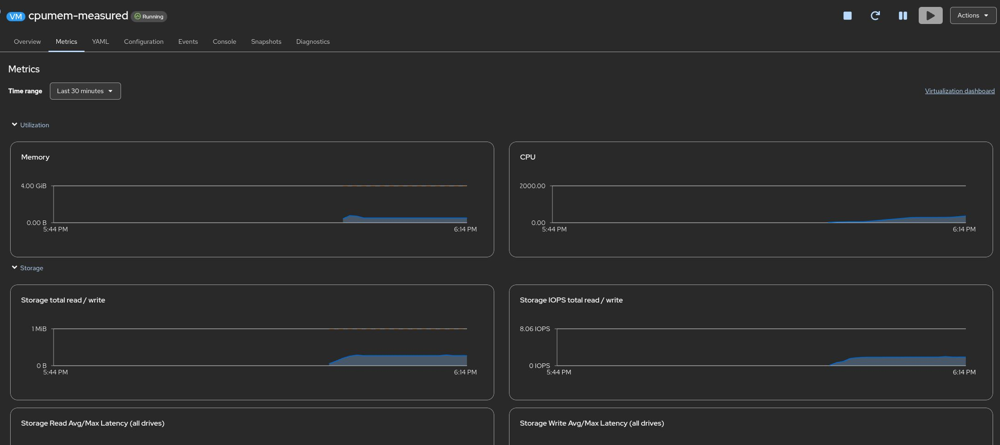
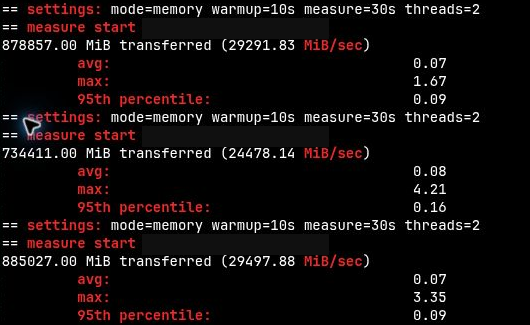
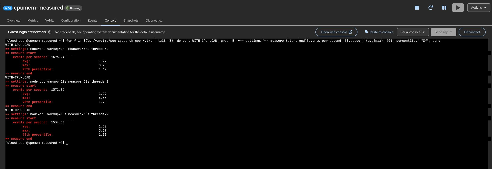
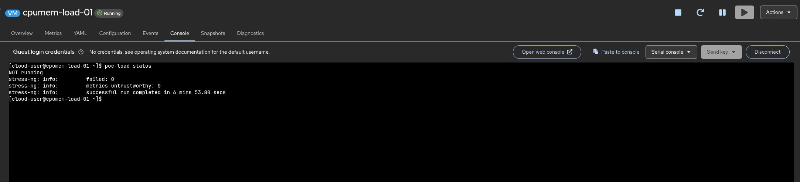
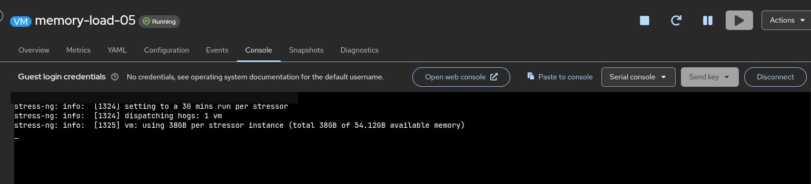
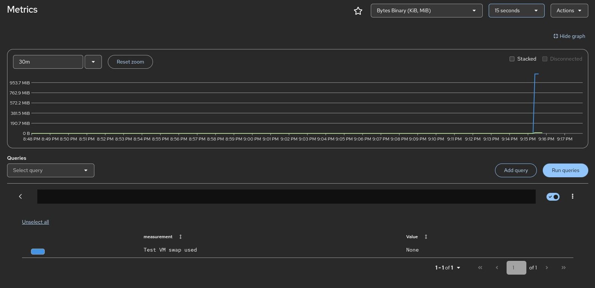
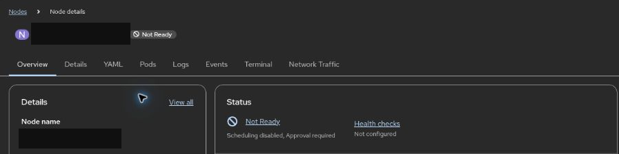
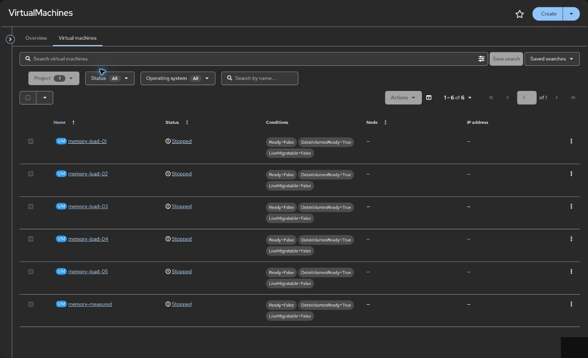

# CPU and memory sharing: customer walkthrough

**Goal:** compare the same workload with and without other VMs competing for the
host’s CPU and memory. More virtual resources than host capacity is called
*oversubscription*.

**Start with existing VMs.** No new VMs or configuration changes are needed if
[your VMs meet the requirements](ADMIN-GUIDE.md#path-a). Your sheet gives each VM
a role: the **measured VM** runs the workload you compare, and the **competitor
VMs** add the extra demand. Existing VMs keep their names, sizes and hosts; only
the role is new. The administrator
prepares the [results sheet](RESULTS-TEMPLATE.md), tools and graphs first.
[New test VMs](ADMIN-GUIDE.md#prepare) are a fallback.

The CPU console walkthrough has been rehearsed on OpenShift 4.22. The memory
rehearsal observed paging but was aborted before loaded and recovery measurements;
see [verification limits](README.md#walkthrough-verification). OpenShift 4.21 execution remains unverified. Complete your results sheet
before calling a test passed. A benchmark is not a production
capacity recommendation.

The pictures show the controls and reference output. Private values are covered
with black boxes. Use the VMs, addresses, directory and times on **your results
sheet**; the pictures are not results for your environment.

## 1. Open the VMs and graphs

1. Open **Workloads → Pods** and select the project on your sheet. Then open **Virtualization → VirtualMachines → Virtual machines**. This also works when the VM project filter is disabled.
2. Open the **measured VM**: this runs the workload you will compare. Check its
   **Node** matches the sheet. A node is the physical host running the VM.
3. Open **Console**, use the **VNC console** dropdown to select **Serial console**, wait for connection, click inside the terminal and press **Enter**. Log in with your existing guest account; the optional new test VMs log in automatically. Type commands inside the VM.
4. Open the VM’s **Metrics** tab in another browser tab. Keep the administrator’s
   host CPU, memory and swap graphs open too, filtered to the test node.

   

   

**Expected:** the VMs are Running, their consoles work, and graphs show data.
Keep existing VMs at their current size and location. Start optional new VMs
only when the administrator says they are ready.

Paste **one command at a time** into the guest console, press **Enter**, and wait for
its expected output before continuing. If the existing guest uses a different console,
use the working console the administrator lists on your sheet.

**Every time you log in to a guest** (the measured VM and each competitor), run this
first if your sheet says the helpers are in `~/poc-bin`:

```sh
export PATH="$HOME/poc-bin:$PATH"
command -v poc-sysbench poc-load poc-stats
```

**Expected:** three file paths. A new login does not remember the setting, so repeat it
after every new login. If a path is missing, stop and tell the administrator. VMs made
from the prepared image already have the helpers and need no setting.

## 2. Record a baseline

A baseline is the result before adding competing load. Use the measured command
on your sheet. The supplied reference commands are:

```sh
poc-sysbench cpu
poc-sysbench memory
```

Run the CPU command with no competing load. Run the memory command only if
the sheet says **Memory prerequisites approved**; otherwise keep that phase
**Blocked** and continue with CPU only. Run the commands **one at a time**. If the memory phase uses a different measured VM than the CPU phase, record a separate memory baseline on that VM first, and its own loaded and recovery runs. Each command discards
5 minutes of warm-up, then measures for 15 minutes. Repeat each three times.
For shorter agreed runs, use the same arguments throughout, for example
`poc-sysbench cpu 60 300` and `poc-sysbench memory 60 300`.

**Expected:** the command finishes and prints `Saved:`. Record the start/end
UTC times, throughput (CPU: events/sec; memory: MiB/sec), and average/95th
percentile/max latency. Higher throughput means more work completed. Lower
latency means less time per operation. Use the same application workload instead
if the sheet specifies one; keep its data size and users unchanged. Scroll up inside the terminal if the throughput
or latency summary is above the visible area.




## 3. Add CPU load

1. Check that the **competitor VMs** on your sheet are Running on the **same Node**
   as the measured VM. These VMs provide the extra demand.
2. Open each competitor’s **Serial console**, log in, set the helper path as in
   step 1 if your sheet says so, and run:

   ```sh
   poc-load start cpu 4500
   ```

3. After two minutes, run `poc-load status` in each competitor; expect `RUNNING`.
   Repeat the **CPU** measured command from step 2 three times. Before each repeat,
   check the competitors still report `RUNNING`; otherwise stop and tell the administrator.
   Record its results and the same graph time windows.

   

   

4. In each competitor console run `poc-load stop`.

   

**Expected:** `Started cpu load` when starting and `Stopped helper-started
processes` when stopping. The load also stops itself after 75 minutes. For each
approved higher load level, repeat this step using the competitors on the sheet.
The measured VM and its command stay unchanged.

## 4. Add memory load

**Only continue when the sheet says “Memory prerequisites approved”.** Otherwise
record **Blocked**. The administrator follows the complete
[memory setup and restore procedure](MEMORY-DENSITY.md); participants do not
change cluster settings. Guest swap alone does not satisfy the host-swap requirement.

The administrator gives you **one step at a time**. Your sheet lists, for each step, which
VMs hold memory, how many **bytes** each holds (`BYTES`, for example `40G`) and for how many
**seconds** (`SECONDS`). Use exactly those values; do not choose your own. The sheet's
`SECONDS` is long enough to cover the settle time and every measured repeat of the step.

1. With CPU load stopped, open each listed VM's serial console. Run this **inside the VM**,
   in the foreground (the prompt does not return until it ends):

   ```sh
   stress-ng --vm 1 --vm-bytes BYTES --vm-hang 0 --timeout SECONDSs --metrics-brief
   ```

   Replace `BYTES` and `SECONDS` with the sheet values and keep the `s` after the number.
   The `--timeout` is mandatory: it ends the load. The command fills that much memory once,
   then holds it without rewriting it, so the host can move idle pages to swap. The
   administrator checks this behaviour on the installed `stress-ng` before the session.
   Leave each console open and untouched while the hold runs.

   

2. Wait the settle time on the sheet. In the measured VM, run the **memory** command from
   step 2 three times while the holds are running. Watch the host memory and swap graphs.
3. **Before each repeat, and again when it ends,** look at each hold's console. The hold is
   active only while `stress-ng` is still running and the prompt has **not** returned. If any
   prompt has returned, tell the administrator; that repeat does not count as loaded.
   `poc-load status` does not show these holds.
4. To stop a hold early press **Ctrl+C** in that console and check the prompt returns. This
   stops only the command you started. Tell the administrator before and after. If the prompt
   does not return, tell the administrator; do not keep pressing keys. Participants must not
   stop a VM or use `killall`.
5. Do the next step on the sheet only when the administrator says so. The administrator
   adds one VM at a time. At the first attributable host paging, **stop increasing load**
   and measure at that level if it stays within the agreed limits.



**Abort if a stop limit is reached or the worker becomes Not Ready.** Stop the holds and
tell the administrator. If a console is unreachable or Ctrl+C does not stop the hold, the administrator stops only the
new test VMs. Wait for recovery before doing anything else; an aborted run does not pass.



**Expected:** each command stays running through all repeats, then finishes at its timeout
(or at your Ctrl+C) and prints a short summary, and the prompt returns. The older helper
`poc-load start mem` is not used for this phase: it touches at most 70% of a VM's memory,
which may never push a host that has memory to spare into swap.

**What the numbers mean.** `poc-sysbench memory` is a bandwidth microbenchmark: it measures how
fast a small block moves, not an application's capacity. If its throughput **does not change**
while the others hold memory, that is a legitimate result: the measured VM's own pages may not
have been swapped. Only the administrator can tell whether the host actually paged (see the
three questions in the [administrator appendix](MEMORY-DENSITY.md)). It does not replace an
application test.

## 5. Check recovery and finish

If the phase was aborted or the worker restarted, record **Fail (aborted)**. The administrator
recovers the worker and restores the settings first. A benchmark after that restart is a
new run, not a recovery result for the failed comparison.

1. Confirm every competitor reports `NOT running` after `poc-load status`. If memory holds
   ran, also check each hold's console: it finished or you pressed Ctrl+C, and the prompt
   returned. (`poc-load status` does not cover memory holds.)
2. Wait five minutes, then repeat the CPU command **three times** with the same settings. If the memory phase was approved and run, also repeat the memory command **three times**, one run at a time. Otherwise leave memory **Blocked**.
3. Record whether throughput and latency returned close to the baseline.

   

4. Leave existing VMs running. Give the sheet to the administrator for
   [cleanup and restoration](ADMIN-GUIDE.md#reset).

   

**Stop the load and contact the administrator** if you see `BLOCKED`, `FAILED`,
`RUN FAILED`, a VM restart, a paused VM, or missing graphs. Keep the error and
time; do not record failed numbers as a successful result. A smaller throughput
result by itself is an observation, not a reason to change the VM.
