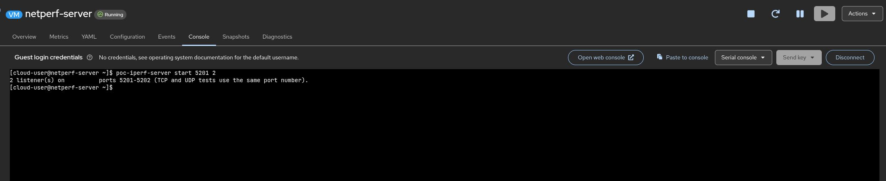
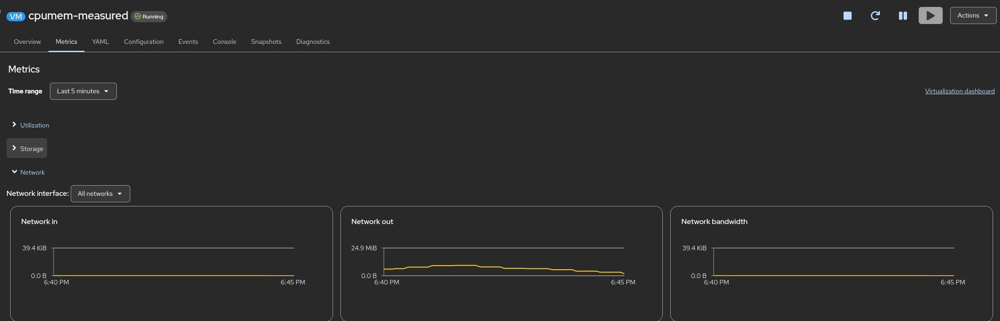
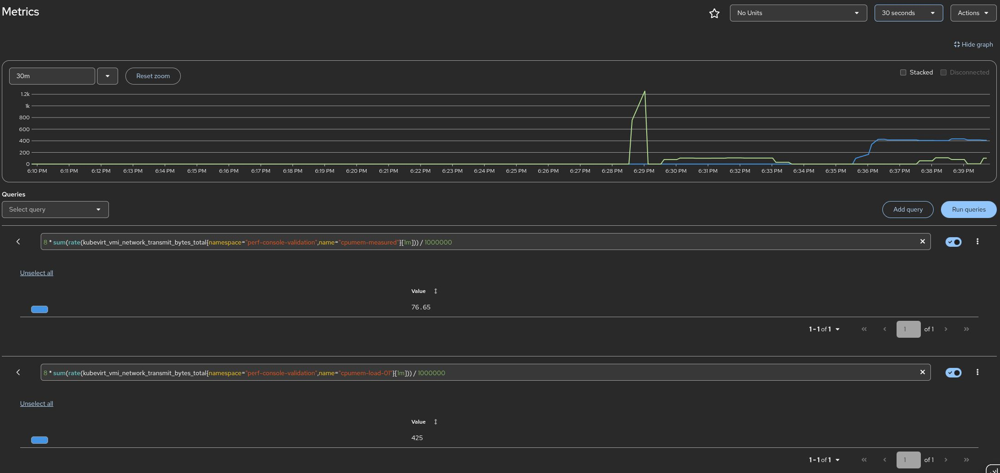

# Administrator guide: network oversubscription

> **Client validation pending.** Target: OpenShift **4.21.31**. Check the client’s
> installed APIs, console paths, metric series and guest packages before the session.
> Procedures are checked against the official 4.21 and 4.22 references; no
> production capacity ratio is implied.


The customer follows the [walkthrough](RUNBOOK.md). This guide holds the
complex parts: approvals, topology, the shared bottleneck, tools, firewall, ports,
metrics, reset.

<a id="prepare"></a>

## Preparation checklist

- [ ] [Approvals](#approvals) recorded.
- [ ] [Preflight](#preflight) done; network facts recorded.
- [ ] **Path A first:** [existing VMs checked, tools added](#path-a). Only if none suit: Path B.
- [ ] Path B only: [tool image](#tools), [labels](#labels), [lab created](#create).
- [ ] [Bottleneck and load plan](#plan) written and approved.
- [ ] [Metrics](#metrics) queries verified.

<a id="approvals"></a>

## 1. Approvals

- Written approval by the client owner (and Red Hat if they advise) for the layout,
  the **maximum offered load**, the window, an abort rule and a named contact.
  There is no universal safe ratio.
- **Oversubscription needs a real shared physical bottleneck** (a node NIC, a
  bonded uplink, a switch port or an inter-switch link). **Same-host traffic is a
  control only**: it never leaves the node and cannot show uplink contention.
- Test traffic can disturb real traffic on that link. Choose a quiet link and window.

<a id="preflight"></a>

## 2. Read-only preflight: record network facts

Console: **Administration → Cluster Settings**; **Networking → NetworkPolicies**
(project of the VMs); **Compute → Nodes → node → Details**.

| Record | How |
| --- | --- |
| OpenShift and Virtualization versions | Cluster Settings, **Operators → Installed Operators** |
| Cluster network (CNI) and its **MTU** | `oc get network.config cluster -o jsonpath='{.status.networkType}{" "}{.status.clusterNetworkMTU}{"\n"}'`; guest MTU from `poc-net-info` |
| NIC model and **rate** per test node, bond/teaming mode | Node shell `ip -d link`, `ethtool IFACE` (or your inventory), per node |
| Topology | Same switch or different, uplink speed, **switch oversubscription ratio**, LACP hash mode, other traffic on the link. Ask the network team; this cannot be read from the cluster |
| NetworkPolicy | Any policy in the VM project that blocks pod-to-pod traffic on the test ports |
| Egress / external path | If an external server is used: its address kept **outside this repository**, the firewall rule, the route |

Remember that a bond with hash-based load balancing may send **one** flow down one
member link; several competitor flows may then spread over different links, and
no single link is full. Record the bond mode and the hash policy.

<a id="path-a"></a>

## 3. Path A (preferred): use existing VMs, unchanged

Use VMs that already exist and already reach each other. **Nothing is applied,
moved, resized or restarted.** Path B (new lab VMs) is a fallback.

### 3.1 Suitability checklist (all must be yes)

| Check | How |
| --- | --- |
| Owner permission, non-critical approved window | Written, with abort rule and contact |
| Linux (RHEL-like) guests; **Windows is not assumed compatible** (scripts and commands are Linux only) | VM **Overview** (OS) |
| `iperf3` present or addable; console/guest access you are allowed to use | `iperf3 --version` in the guest |
| Resources fixed in the window | Record vCPU and RAM from **Configuration → Details** |
| Placement mapping | **Overview → Node** (or `oc get vmi -A -o wide`): record which VM is on which worker; pick a pair that already crosses the link you want to test. Prefer selecting existing VMs over moving any |
| Existing connectivity | From the client guest, `ping` and a short `iperf3` to the server's existing reachable address work (Step 3.3) |
| Shared bottleneck, isolation | See [section 6](#plan) |

If all pass, **no change is required** beyond optional guest tools. Record current
sizes and placement on the sheet.

### 3.2 Address to use

1. **First choice: the server VM's existing Pod IP**, or an address clients can already reach. In the VM **Overview → General → Pod**, open the launcher Pod, then read its **Details → Pod IP**. This is different from the guest bind address that the listener may print. Verify it from the client and use the same address in every phase.
2. A `ClusterIP` Service (an internal name that forwards to the VM) only if the Pod IP
   cannot be used. A Service adds a forwarding step, so its results are **not
   comparable** with Pod-IP results. Never mix them in one comparison, and never use
   a Service result to stand for a secondary-network (direct NIC) path.
3. A new interface or an externally exposed Service (LoadBalancer, NodePort) is **out
   of scope**; stop and decide with the owner.

### 3.3 Tools, ports and firewall: smallest reversible change first

| Missing | Smallest change | Disruption |
| --- | --- | --- |
| helper commands | Copy the four `poc-*` files from `guest-tools/` into `~/poc-bin` of the ordinary guest account (steps below). Write "helpers in `~/poc-bin`" on the sheet so participants set the path at each login | Guest only, **no restart**. Undo: remove only the copied helper files |
| iperf3 | Install via the owner's approved package route (normally in RHEL 9 AppStream; verify). Record version | Guest only. Undo with the package manager |
| Listener reachable | Listeners use ports 5201-5208 above 1024, so no root is needed to start them. If the **guest firewall** blocks them, the **owner** opens just those ports on the **server** VMs, for example `sudo firewall-cmd --add-port=5201-5208/tcp --add-port=5201-5208/udp` (runtime only, gone at reboot, which is the safest) | Guest only |
| NetworkPolicy blocks | Ask the project owner to allow the test ports from the client VM for the window; remove afterwards | Project object, record and undo |
| VM interface lists ports | A masquerade VM with an explicit `ports:` list only accepts those ports; if the existing VM lists some, use those port numbers (or Step 3.5) | Port numbers only |

**Copy the helpers into one guest** (as the ordinary guest user, in the VM's serial
console):

```sh
mkdir -p ~/poc-bin
ls ~/poc-bin
```

The list must not already contain any `poc-*` name used here. If it does, stop: they
are someone else's files. Then, for each of `poc-iperf-server`, `poc-iperf-run`,
`poc-net-load` and `poc-net-info`: type `cat > ~/poc-bin/NAME` (the file's name),
press **Enter**, paste that file's full contents from `guest-tools/`, press **Enter**,
then **Ctrl+D**. If SSH access to the guest already exists, you can copy the files with
`scp` instead; do not enable SSH just for this. Then:

```sh
chmod 0755 ~/poc-bin/poc-iperf-server ~/poc-bin/poc-iperf-run ~/poc-bin/poc-net-load ~/poc-bin/poc-net-info
export PATH="$HOME/poc-bin:$PATH"
command -v poc-iperf-server poc-iperf-run poc-net-load poc-net-info
poc-net-info
```

**Expected:** four paths, then the guest's interface and addresses. The `export` line
lasts only for this login; participants repeat it at every new login (walkthrough
section 1).

**Which network card is tested.** The helpers bind to one guest address. By default
that is the address on the card holding the default route. `poc-net-info` lists all
addresses. If the agreed path uses another card, write that guest address on the
sheet as the VM's **test address**; participants then run `export POC_BIND=<address>`
after each login. `poc-iperf-run` also sends its ping from that address.

Do **not** edit cloud-init, users or storage, delete guest data, or restart workloads
to make the test work. Anything needing a **VM restart or configuration edit** is in 3.5.

Console access: open the VM's **Console** tab and choose **Serial console** in the dropdown.
After the helper commands are in place, `poc-iperf-server start` confirms its listeners (address hidden in this example):




### 3.4 Existing application as the measured workload

An existing application path can be the approved representative workload. Freeze its
**dataset, version and concurrency** and run it identically in every phase. Keep
`iperf3` as the reproducible reference. The application must report its own
throughput and latency (p95/p99); otherwise record **not reported**.

<a id="adapt"></a>

### 3.5 Last resort: adapt one stopped, disposable existing VM

Only if no unchanged VM works, the owner agrees, and the VM's current definition is saved
privately (console **YAML → copy**). **A stopped VM must be started again: that is a restart
of that VM.** Edit only these fields under `spec.template.spec`, note the old value of each,
and restore only those:

| Field | Why | Rollback |
| --- | --- | --- |
| `domain.devices.interfaces[name=default].ports` | add the listener ports (TCP and UDP 5201-5208) only if a `ports:` list already exists and omits them | put the old list back |

Keep existing placement rules unchanged; choose an already suitable VM or the
optional new pair. Adding a node-affinity term can broaden an existing rule.

Never replace `cloudInitNoCloud`, users or volumes; never paste a whole saved copy over
the object. After the test: stop, restore the port list, start, record the restart.

<a id="tools"></a>

## 4. Path B: tool image

The manifests install nothing: Path B VMs call `iperf3` and the helpers but do not
install them, and set no password. Their cloud-init is minimal (Kubernetes limits
`cloudInitNoCloud.userData` to **2048 bytes**), so the tools come from a prepared image.
`guest-tools/` is the single source of the helpers.

1. Build one VM from the approved RHEL 9 source using the owner's authorized method (for
   example a temporary administrator-only cloud-init with an approved SSH public key, over
   an approved repository).
2. Install `iperf3` and, as root, `install -m 0755 guest-tools/poc-* /usr/local/bin/`. If
   the image also opens TCP and UDP **5201-5208** in `firewalld` for server VMs, do it once
   here (`firewall-cmd --permanent --add-port=...`).
3. **Before sealing**, if you added temporary access to the guest, remove it inside the
   guest: delete the temporary key line from that user's `~/.ssh/authorized_keys` (or the
   temporary user). Removing the cloud-init setting from the source VM later does not
   change disks already copied from the image. Skip this if no temporary access was added.
4. Run `sudo cloud-init clean --logs`, stop the VM, publish its disk as a DataSource
   (**Virtualization → Bootable volumes → Add volume**) and put its name and namespace into
   the `REPLACE_*` values.
5. In one new VM made from the image, check `iperf3 --version`, that `poc-net-info` runs,
   and that the temporary key is absent.

<a id="labels"></a>

## 5. Path B: topology labels (applied by you, never automatically)

Servers need node label `perf-lab.example.com/net-server-host=true`, clients
`perf-lab.example.com/net-client-host=true`. **Console: Compute → Nodes → node →
Actions → Edit labels.**

| Layout | Labels |
| --- | --- |
| Same-host control | **Both** labels on **one** worker. Cannot show physical contention |
| Cross-host | Server label on worker A only, client label on worker B only (no other node labelled) |
| External server | Client label only; the server is outside (address kept private) |

Verify exactly the intended nodes carry each label:
`oc get nodes -l perf-lab.example.com/net-server-host=true` and `…net-client-host=true`.
Competitor VMs use the same labels so their flows share the same two hosts.
Before changing labels, record each original value privately. At the end, restore
those values; remove a label only if it was absent before this case.

<a id="plan"></a>

## 6. Bottleneck, offered load and accounting

1. **Name the shared bottleneck** (for example *worker A uplink, 25 Gbit/s*). If the
   layout has none (same-host), say "control only" on the sheet.
2. **Offered load plan.** Level N total = competitor flows × rate per flow. Choose
   levels, from light to approved maximum, relative to the bottleneck: e.g. 25%, 50%,
   100%, 125% of its line rate, **only if the owner approves**. Defaults are
   conservative: 2 flows × 200 Mbit/s. The rate is a cap per flow
   (`poc-net-load start … MBPS_PER_FLOW`).
3. **Check the generators are not the limit.** A 2-vCPU VM may top out before a fast
   link: watch guest CPU during the baseline. Add competitor pairs rather than raising
   one VM's load past its CPU.
4. **Accounting.** Count each transfer **once, at its receiver**. A host NIC counts
   send and receive; for a cross-host transfer do not add worker A's transmit to worker
   B's receive. Per-link totals compare against that link's rate. Never average over
   the cluster.
5. **Phases / runs.** Baseline, increasing levels, recovery baseline; each = warm-up,
   measure, repeats (proposal 5 min / 15 min / 3, negotiable), same in all phases; UTC
   timestamps printed by the scripts.
6. **Measured flow stays unchanged.** Same command, VM pair, port and address every run.
   TCP forward and optional TCP reverse (`tcp-rev`). The measured TCP flow has no rate
   cap: it can take all the bandwidth it finds, so count it in the load plan as up to the
   bottleneck's available rate. Record TCP goodput from the **receiver** line and
   retransmissions (`Retr`) from the **sender** line; the client prints both summary
   lines, also in `tcp-rev` where the server is the sender. **Ping RTT is recorded
   separately** (it is answered by the pod network and may not reach the guest). Bounded
   UDP (fixed offered rate) measures loss and jitter at the receiver.
7. **Ports.** One listener per simultaneous test (`iperf3` serves one test at a time
   and answers "server busy" otherwise). Measured server: 5201 (TCP), 5202 (UDP).
   Competitor server: 5201…5204, one per flow.
8. `iperf3 -B` binds to the guest's own interface address: the default-route card unless
   `POC_BIND` is set (section 3.3). `poc-net-info` lists the addresses. Record the card and
   address used for each VM on the sheet.
9. **Listeners.** `poc-iperf-server start` refuses to start while listeners from an earlier
   start are still running. Run `poc-iperf-server stop` first, then start the new set.

<a id="create"></a>

## 7. Path B: create the lab

After creation, record the name and `metadata.uid` of each VM, DataVolume, PVC and case Service
privately (**VM → YAML**, or `oc get vm,dv,pvc,svc -n perf-network-lab -o yaml`).
Keep this record for cleanup. Do not reuse a pre-existing object as a new one.

Replace the remaining `REPLACE_*` values (tool DataSource name and namespace).
New disks default to **vxflexos / Block / ReadWriteMany**. In **Storage →
StorageClasses**, open **vxflexos**; check its StorageProfile supports this
combination and ask the storage administrator to confirm the image can be copied
or cloned into it. The DataSource must be Ready and fit the requested disk.
After population, open each PVC and verify **Bound**, **vxflexos**, **Block**, and
**ReadWriteMany**. Stop on unsupported storage or clone errors. Existing VMs on
Path A can keep their current storage. Fill private copies outside the checkout,
then create them from the case directory (console **+ → Import YAML**). `oc create`
refuses an object that already exists, so nothing existing is changed:

~~~sh
P="$HOME/poc-private/case04"; mkdir -p "$P" && chmod 700 "$P"
cp manifests/00-namespace.yaml manifests/01-measured-pair.yaml manifests/02-competitor-pair-01.yaml manifests/03-competitor-pair-02.yaml "$P/"
# fill REPLACE_* in the copies, then:
oc create -f "$P/00-namespace.yaml"
oc create -f "$P/01-measured-pair.yaml"
oc create -f "$P/02-competitor-pair-01.yaml" -f "$P/03-competitor-pair-02.yaml"
~~~

If a create reports *already exists*, stop: that object is not yours.

| Object | Name |
| --- | --- |
| Measured | VMs `netperf-server`, `netperf-client`; Service `netperf-server` |
| Pair 01 | `netload-server-01`, `netload-client-01`; Service `netload-server-01` |
| Pair 02 | `netload-server-02`, `netload-client-02`; Service `netload-server-02` |

More pairs: every name must be unique (VM, DataVolume, hostname, both labels, Service and its
selector). Generate rather than copy by hand:

~~~sh
bash scripts/render-competitor-pair.sh 03 > "$HOME/poc-private/case04/netload-pair-03.yaml"   # then fill REPLACE_*
~~~

The VMs declare TCP+UDP **ports 5201-5208** (competitor servers 5201-5204, measured
server 5201-5202) on the default masquerade interface, because a masquerade VM with a
port list accepts only those ports. The **guest firewall** on **server VMs** must also allow
them (baked into the image, or opened by the owner as in 3.3); clients need no inbound port. The **ClusterIP** Services are internal, selected by one VM's label, and
unused by default (see 3.2).

Verify: VMs **Stopped**, DataVolumes **Succeeded**, labels on the right nodes
(section 5), `oc get svc -n perf-network-lab` shows only `ClusterIP`.

### Boot readiness: Running is not ready

Check these as **separate statuses** and record each on the sheet. Do not assume
**Running** means the guest is usable.

1. **Disk first.** The DataVolume must be **Succeeded** (console **Storage →
   PersistentVolumeClaims**, or `oc get dv -n NAMESPACE`). With `WaitForFirstConsumer`
   storage the clone only starts when the VM first starts: wait for it. Snapshot- or
   clone-based sources need a compatible image (the VM's UEFI boot, a disk at least as
   large as the source) and a StorageClass whose clone strategy is supported; confirm with
   the storage owner before any workload.
2. **Boots to a login.** Open the **Console** tab: a login prompt, then the auto-login shell.
3. **Guest agent** shows as connected on the VM **Overview** (separate from Running). Missing
   agent is a note, not a blocker, unless the plan needs it.
4. **Tools present** (`command -v` for each, below) and **firewall** as described for the case.
5. **Block on storage errors.** If **VM events** or the console show I/O errors or the VM
   is **Paused** with a storage reason, stop. Do **not** keep resuming or restarting it, and do
   not proceed to measuring: hand it to the storage owner.
6. **Firewall and listener.** From the client, a short `poc-iperf-run tcp SERVER_IP 5201 0 5` works.

<a id="metrics"></a>

## 8. Metrics

In **Observe → Metrics**, set **Refresh → 30 seconds** while watching a run.
Choose a time span that includes baseline, load and recovery. Keep the exact
UTC windows on the results sheet; a live chart is not a saved result.
For short runs, use **Last 5 minutes** in VM Metrics. The native graphs smooth
values over their selected range; use the fixed `[1m]` queries below to inspect
short changes over a longer chart span.


Example of a VM **Metrics** tab with the **Network** section expanded:



Console: VM **Metrics** tab; **Observe → Dashboards** (*Node Exporter / USE Method /
Node*, *Node Exporter / Nodes*), choose the node and the UTC window (names pending
verification). Queries in **Observe → Metrics** — **verify each series exists** before
using it; write "not available" otherwise. Replace `NODE`, `DEV`, `NS` and `VM`.
Find the host's exact scrape `INSTANCE` with `node_uname_info{nodename="NODE"}`;
use that instance in every host query. Choose the interface carrying the agreed
path. Do not add a physical interface, its bond and its VLAN counters together.
For each VM, discover its exported interface labels with
`count by (interface) (kubevirt_vmi_network_transmit_bytes_total{namespace="NS",name="VM"})`.
Record the label for the agreed path as `INTERFACE`; filter it in both VM queries.
Do not sum unrelated interfaces on an existing VM.

| Need | Query (verify series first) |
| --- | --- |
| NIC throughput | `rate(node_network_transmit_bytes_total{instance="INSTANCE",device="DEV"}[1m])`, `rate(node_network_receive_bytes_total{instance="INSTANCE",device="DEV"}[1m])` (× 8 for bit/s) |
| NIC rate | `node_network_speed_bytes{instance="INSTANCE",device="DEV"}` |
| Drops | `rate(node_network_receive_drop_total{instance="INSTANCE",device="DEV"}[1m])`, `rate(node_network_transmit_drop_total{instance="INSTANCE",device="DEV"}[1m])` |
| Errors | `rate(node_network_receive_errs_total{instance="INSTANCE",device="DEV"}[1m])`, `rate(node_network_transmit_errs_total{instance="INSTANCE",device="DEV"}[1m])` |
| Host TCP retransmits | `rate(node_netstat_Tcp_RetransSegs{instance="INSTANCE"}[1m])` |
| Per-VM transmit bytes/s | `sum(rate(kubevirt_vmi_network_transmit_bytes_total{namespace="NS",name="VM",interface="INTERFACE"}[1m]))` |
| Per-VM receive bytes/s | `sum(rate(kubevirt_vmi_network_receive_bytes_total{namespace="NS",name="VM",interface="INTERFACE"}[1m]))` |
| Guest CPU (generator limit) | VM **Metrics** tab; guest `top` |

To show Mbit/s, multiply a per-VM bytes/s query by `8 / 1000000`. Run one
query for the measured VM and another for the competitor VM, filtered to the
agreed interface. The screenshot uses VMs with only one exported interface. The series show
interface traffic, which includes protocol overhead rather than just delivered data.



Also record per run: iperf3 goodput, Retr, RTT, UDP loss/jitter, UDP offered rate.
Any **VM migration, restart, or node event** in the window invalidates the run.

<a id="storage"></a>

## 9. Optional: storage over the network (fio)

`fio` is **not** a network benchmark. Storage-over-network testing is a separate,
optional measurement with its own approved storage procedure, directory, size,
duration and cleanup. Do not improvise a write command or reuse an existing file.
This network walkthrough provides no storage write command. Record any separately
approved storage results apart from the iperf3 results.

<a id="reset"></a>

## 10. Reset between takes and clean up

- Stop all flows: `poc-net-load stop` on every competitor client, `poc-iperf-server stop`
  on servers; wait 5 minutes between takes.
- **Path A (existing VMs):** remove only the exact helper files you copied for this
  case. Keep any pre-existing tools and other files in `~/poc-bin`. Ask the owner
  before removing packages. Confirm VM sizes and placement still match the sheet.
- **Path B (new VMs):** save results first. Use **Virtualization → VirtualMachines**,
  select project `perf-network-lab`, and delete only the named VMs you created
  for this case. Check each name and UID against your private creation record
  (**VM → YAML → metadata.uid**); a project label alone does not prove you created it.
  Delete associated disks only after the storage owner agrees. A `Retain` PV
  keeps its data after PVC deletion; report it rather than deleting the PV yourself.

CLI alternative, one verified object at a time (replace `NAME`):

~~~sh
oc get vm NAME -n perf-network-lab -o jsonpath='{.metadata.uid}{"\n"}'
oc delete vm NAME -n perf-network-lab
oc get dv,pvc,svc -n perf-network-lab
~~~

If a DataVolume, PVC or case Service remains, verify its name and UID against the creation record,
then delete only that named object. For Services, use **Networking → Services**,
select the project, open the recorded Service and choose **Delete**. Keep the project; its owner can check all
resource types before deciding whether to remove it. Never use `--all` for cleanup.
Restore node labels to the values recorded before setup, using **Compute → Nodes →
node → Actions → Edit labels**. Remove only labels this case added; preserve
pre-existing labels. Undo only firewall/NetworkPolicy changes made for this test.

<a id="sources"></a>

## Sources

- [REFERENCES.md](REFERENCES.md): source matrix for OpenShift 4.21 and 4.22 (networking, monitoring, managing VMs) and the differences that matter.
- [iperf3 manual page](https://github.com/esnet/iperf/blob/master/src/iperf3.1): `-B`, `-R`, `-p`, `-u`, `-b`, `-t`, `-O`, `-J`, `-D`.
- [sysbench](https://github.com/akopytov/sysbench) and [stress-ng](https://github.com/ColinIanKing/stress-ng) (case 03).
- OpenShift 4.21 Virtualization documentation: virtual machine networking (masquerade, port lists, Services).
