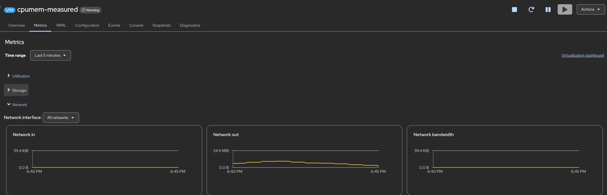
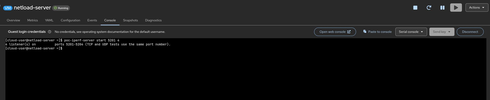
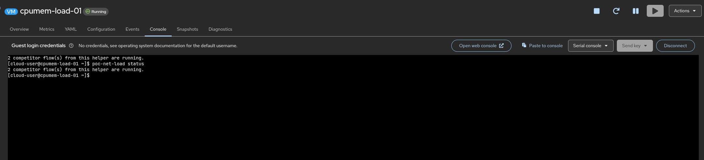
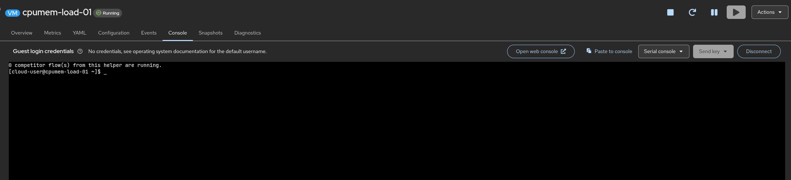
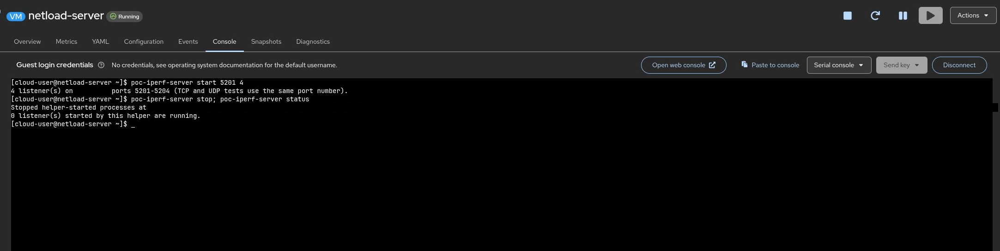
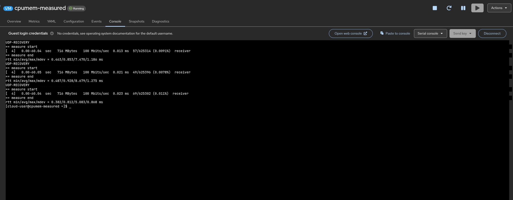
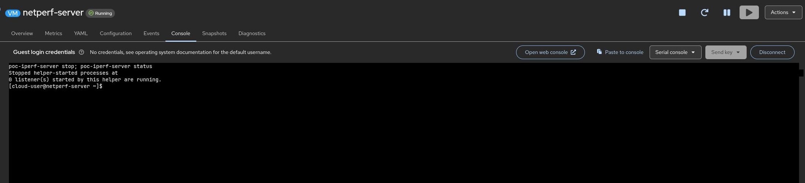

# Network sharing: customer walkthrough

**Goal:** compare the same transfer before, during and after other VMs add
traffic to the same network link.

**Start with existing VMs and their current network.** The administrator
[checks suitability](ADMIN-GUIDE.md#path-a) and prepares the
[results sheet](RESULTS-TEMPLATE.md), tools and graphs. New test VMs are optional.
Do not add network interfaces or change existing VM sizes for this walkthrough.

The bounded UDP console walkthrough has been rehearsed on OpenShift 4.22.
OpenShift 4.21 execution, full TCP measurements and actual physical-link
oversubscription remain unverified. Complete your results sheet before calling a test passed. A short test does not establish a
safe production oversubscription ratio.

The pictures show the controls and reference output. Private values are covered
with black boxes. Use the VMs, addresses, directory and times on **your results
sheet**; the pictures are not results for your environment.

## 1. Open the VMs

1. Open **Workloads → Pods** and select the project on your sheet. Then open **Virtualization → VirtualMachines → Virtual machines**. This also works when the VM project filter is disabled.
2. Open the **measured server** and **measured client**. Check their **Node** values
   match the sheet. A node is the host running a VM.
3. Open each VM’s **Console**, use the **VNC console** dropdown to select **Serial console**, wait for connection, click inside the terminal and press **Enter**. Log in with your existing guest account; the optional new test VMs log in automatically.
4. Keep each VM’s **Metrics → Network** section and the prepared host/network
   graphs open in separate tabs. Select the interface on your sheet. Set the VM
   time range to **Last 5 minutes** for short runs; use the prepared graphs for
   the complete baseline, load and recovery window.

   

   

**Expected:** both VMs are Running, their consoles work, and graphs show data.
Use the **server address on the sheet**. With the default network, the guest’s
own address can differ from its reachable cluster address; do not guess from
an address shown in the VM overview. The administrator supplies and verifies it.

Paste **one command at a time** into the guest console, press **Enter**, and wait for
its expected output before continuing. If the existing guest uses a different console,
use the working console the administrator lists on your sheet.

## 2. Record a baseline

In the **measured server’s** console:

```sh
poc-iperf-server start 5201 2
```

**Expected:** `2 listener(s)`. Leave this server running. Use the server address on
your sheet for the client commands; the listener can print a different guest bind address.


In the **measured client’s** console, replace `SERVER_IP` with the address on
your sheet:

```sh
poc-iperf-run tcp SERVER_IP 5201
```

This warms up for 5 minutes and measures for 15 minutes. Repeat three times.
For shorter agreed runs, use the same arguments throughout, for example
`poc-iperf-run tcp SERVER_IP 5201 60 300`.

**Expected:** `Saved:` and a summary. Record the UTC start/end times, the
**receiver Mbits/sec** (data delivered), **sender Retr** (retransmissions),
and **ping min/avg/max** (round-trip delay). Ping measures the reachable endpoint;
it may be answered by the pod network rather than the guest.


## 3. Add competing traffic

For each load level on the sheet, use the agreed protocol in both measured and
competitor commands (`tcp`, `tcp-rev` or `udp`). The screenshots illustrate the
bounded UDP alternative in **Other agreed measurements** below.

For each load level:

1. Check the **competitor server and client** are Running on the planned nodes.
2. In the competitor **server** console run `poc-iperf-server start 5201 4`.

   
3. In the competitor **client** console run the command on the sheet. Example:

   ```sh
   poc-net-load start tcp COMPETITOR_SERVER_IP 5201 2 200 4500
   ```

   Replace the address. This starts **2 transfers**, each capped at **200 Mbit/s**,
   for at most **75 minutes**. The administrator sets the rates and number of
   competitors to reach the agreed load; these example rates may not fill the link.
4. After two minutes, run `poc-net-load status` in each competitor client. Expect
   the planned number of flows (for the example, `2 competitor flow(s) from this helper are running.`).
   Repeat the **same measured client command** three times. Check that flow count
   before every repeat; if it drops, stop and tell the administrator.
   Record the results and matching graph time windows.

   

   

5. Run `poc-net-load stop` in each competitor client before changing load levels.

**Expected:** `Started 2 tcp flow(s)` and `2 competitor flow(s) from this helper are running.` for the
example. When the shared link fills, throughput may fall or delay/retransmissions
may rise. The administrator confirms the actual link utilization. A same-host
test is only a control and does not demonstrate physical uplink oversubscription.

## 4. Check recovery and finish

1. Stop competitor traffic with `poc-net-load stop` and competitor listeners with
   `poc-iperf-server stop`. Run `poc-net-load status` in each competitor client and
   `poc-iperf-server status` in each competitor server; expect zero flows/listeners.

   

   

2. Wait five minutes, then repeat the measured baseline command three times.

   

3. Stop the measured server’s listeners: `poc-iperf-server stop`.

   

4. Leave existing VMs running. Give the results sheet to the administrator for
   [cleanup](ADMIN-GUIDE.md#reset).

**Expected:** recovery results close to baseline. Record any difference.

## Other agreed measurements

To test the reverse direction, repeat steps 2–4 using `tcp-rev` instead of `tcp`.
For UDP, repeat them using `udp` and port `5202`, with an agreed fixed rate:

```sh
poc-iperf-run udp SERVER_IP 5202 60 300 100
```

This sends at **100 Mbit/s**. Record the receiver’s **Jitter** (variation in arrival
time) and **Lost/Total** as well as throughput. Keep rate and duration unchanged
between baseline, load and recovery. Restart the agreed competitor load for each
protocol; do not assume a previous 75-minute load is still running.

**Stop the load and contact the administrator** on `BLOCKED`, `FAILED`,
`RUN FAILED`, a VM restart/pause, or missing graphs. Keep the error and time;
do not record failed numbers as a successful result.
