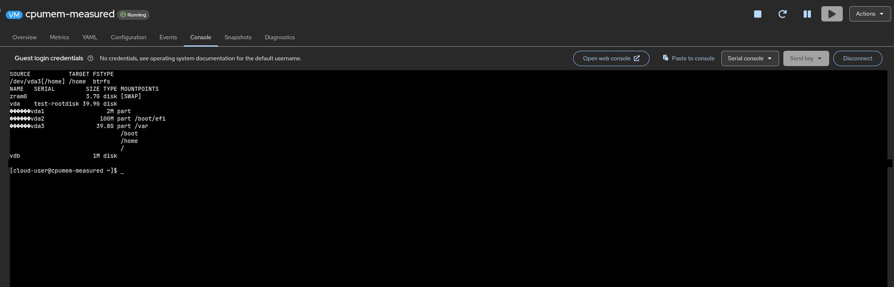
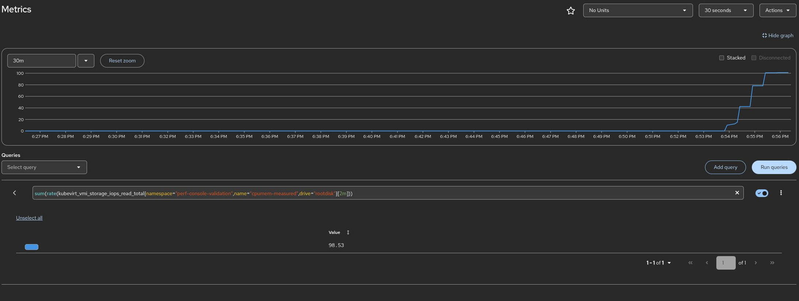
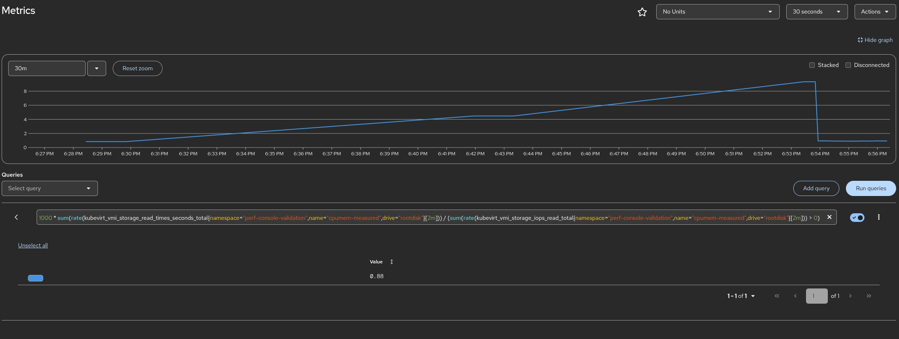
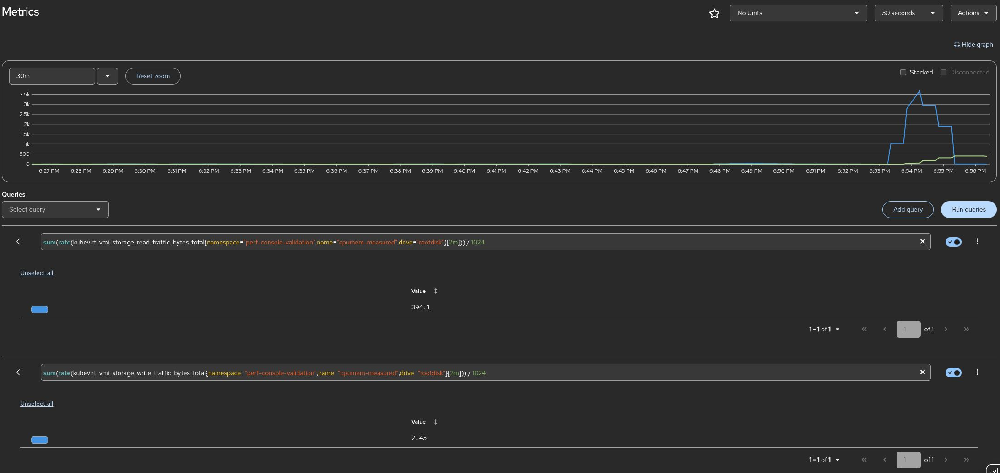
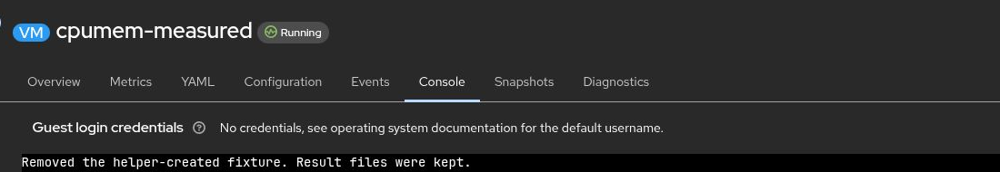

# Administrator guide: storage IOPS

> **Client validation pending.** Check installed APIs, console paths and metric series on the
> installed version before the session. Nothing here proves a capacity or a Dell/PowerFlex result.

The customer follows the [walkthrough](RUNBOOK.md). This guide holds every `oc` command, the
mapping, the metric calculations and cleanup.

## Checklist

- [ ] [Approvals](#approvals) written; [private folder](#private) created.
- [ ] [VM and filesystem chosen, mapped](#mapping); an ambiguous mapping is **Blocked** for that layer.
- [ ] [Metric series verified](#metrics); baseline, workload and recovery windows planned.
- [ ] [Tools](#tools) only if the reference workload is used.
- [ ] Dell layer: optional and **deferred** ([DELL-OBSERVABILITY.md](DELL-OBSERVABILITY.md)); record it separately.

## 1. Approvals and rules

- The owner approves in writing: VM, **directory** (existing, on the filesystem under test), window,
  maximum IOPS cap, abort rule and contact.
- Unchanged by default: no VM restart or edit, no guest, system or cluster default changed just to
  benchmark, no raw-device I/O, formatting, cache dropping, snapshots, migrations, driver upgrades
  or node changes.
- The VM's **existing approved workload can be the test** with no helper. `poc-fio` is an optional
  synthetic reference.
- Preparation is **not zero-write**: it writes one new 256 MiB fixture (cap 1 GiB), paced at 16 MiB/s
  (buffered pacing, not a backend guarantee). The measured run only reads. Tell the storage owner
  about that write and its time.

### Private notes folder (outside the repository)

~~~sh
umask 077
mkdir -p "$HOME/poc-private/storage-iops"
chmod 700 "$HOME/poc-private" "$HOME/poc-private/storage-iops"
~~~

Keep mapping, saved queries, results and any saved object copies there.

## 2. Map file → disk → volume (exact and private)

Do not join on namespace alone and do not assume `/dev/vdb` is stable. Replace `NS`, `VM`, `DIR`, `PVC`, `PV`.

~~~sh
# a. Guest (console): the device behind the directory, and its parent disk
findmnt -n -o SOURCE,TARGET,FSTYPE -T DIR
lsblk -s -o NAME,TYPE,SERIAL,SIZE,MOUNTPOINTS "$(findmnt --nofsroot -n -o SOURCE -T DIR)"
# b. VM disk definitions (name and optional serial), then volumes (volume name -> PVC/DataVolume)
oc get vm VM -n NS -o jsonpath='{range .spec.template.spec.domain.devices.disks[*]}{.name}{"\t"}{.serial}{"\n"}{end}'
oc get vm VM -n NS -o jsonpath='{range .spec.template.spec.volumes[*]}{.name}{"\t"}{.persistentVolumeClaim.claimName}{.dataVolume.name}{"\n"}{end}'
# c. Running VMI: which guest device name (target, e.g. vda) belongs to which disk name
oc get vmi VM -n NS -o jsonpath='{range .status.volumeStatus[*]}{.name}{"\t"}{.target}{"\n"}{end}'
# d. PVC -> PV -> CSI volume handle
oc get pvc PVC -n NS -o jsonpath='{.spec.volumeName}{"\n"}'
oc get pv PV -o jsonpath='{.spec.csi.driver}{"\t"}{.spec.csi.volumeHandle}{"\n"}'
~~~

`--nofsroot` removes a bind or Btrfs subvolume suffix (such as `[/home]`) before passing the device to `lsblk`. It does not change the mount.

Read it as: guest device (for example `vda`) = `target` in step c → the `name` beside it is the disk
name, which should be the metric `drive` label (confirm in [section 5](#metrics)) → the volume with that name →
PVC → PV → volumeHandle. Where a serial is set, it must also match `lsblk`'s SERIAL.

Step a in the VM's **Console** tab (**Serial console**), on an example VM; read the device name and SERIAL columns:

If the device is a logical volume or the target, serial or name do not line up **unambiguously**, the
mapping is **ambiguous: that layer is Blocked**. Size or order is not accepted as a mapping. Do not edit the VM
(for example to add a serial) to resolve it. The root disk also carries OS background I/O; say so on the sheet.

## 3. Tools (reference workload only)

Smallest reversible change, as an ordinary guest user, **no restart**:

1. Transfer `guest-tools/poc-fio` from this repository to the guest account. If SSH is already available,
   from this case directory on the administrator workstation run `scp guest-tools/poc-fio USER@VM_ADDRESS:poc-fio`
   (replace the account and address). Use existing access; do not enable SSH just for this test. Alternatively,
   use an approved image with the helper already present. If `command -v poc-fio`
   already prints its installed path, skip the copy block. Otherwise, after transferring
   the file to `~/poc-fio`, run in the guest console:

   ~~~sh
   mkdir -p "$HOME/poc-bin"
   cp "$HOME/poc-fio" "$HOME/poc-bin/poc-fio"
   chmod 0755 "$HOME/poc-bin/poc-fio"
   export PATH="$HOME/poc-bin:$PATH"
   ~~~

   It needs `python3`, `findmnt` and `lsblk`. The PATH change lasts for this console session.
2. If `fio` is missing, install it only through the owner's approved package route (on RHEL 9 usually the
   AppStream `fio` package; verify). The owner can run `sudo dnf install fio`; the test account needs no sudo.
   `fio --version` must print `fio-3.x`; the helper refuses an incompatible tool.
3. Do not change guest defaults, add disks or edit cloud-init to make this work.

Console access: on the VM's **Console** tab choose **Serial console** in the dropdown:

Helper properties (check them in review): one shared non-blocking lock covers `prepare`, `run` and `cleanup`
(an overlapping command is refused); it refuses symlinked, device or virtual paths, unusual characters and
tmpfs-like filesystems; it needs free space ≥ 3× size + 2 GiB; the fixture is created exclusively in a new
private `0700` directory (never reusing or truncating a file) and its identity is saved; reads use
`--readonly --allow_file_create=0`; identity is re-checked before the warm-up and again right before every
measured phase; `cleanup` removes only that fixture and fails closed on absent, mismatched or replaced state;
results are never deleted. Caps: size 1024 MiB, measure 600 s, 5 repeats, 500 IOPS, depth 32.

## 4. Workload and run plan

| Item | Default |
| --- | --- |
| Pattern | 4 KiB random read, 1 job, iodepth 8, `direct=1`, read-only, `rate_iops` 100 (200 allowed) |
| Fixture | 256 MiB new file (cap 1 GiB) |
| Timing | 30 s warm-up (excluded), 180 s measured, 3 repeats |
| Not claimed | `direct=1` bypasses only the guest page cache, not host or array caches; capacity is not measured |

Windows: an idle baseline of **at least 2 minutes** and a recovery idle of at least 2 minutes (for a 30 s
scrape interval), a measured window with **at least four scrapes** inside it, and the same UTC clock for every
graph. If the scrape interval is longer than 30 s, lengthen baseline, recovery and measure windows to cover at
least four intervals **within the caps**, or mark the layer **Blocked**. Keep the prepare-time fixture write
out of measured windows. A cap-limited IOPS value means the cap, not the disk, set the rate; raise `--rate-iops`
only inside the approved maximum and still call the result bounded.

## 5. Metrics: VM layer

In **Observe → Metrics**, set **Refresh → 30 seconds** while watching a run.
For live VM cards, select **Last 5 minutes**. Their rate window follows the
selected range, which can smooth a short run heavily. Use the fixed-window
queries below for the measured figures. Choose an Observe chart span that
includes baseline, load and recovery. Keep the exact
UTC windows on the results sheet; a live chart is not a saved result.

All are **counters**; use `rate()`. Console: **Observe → Metrics**, and the VM **Metrics → Storage** tab if it
shows storage graphs. Confirm the names on the installed version
([KubeVirt metrics](https://kubevirt.io/monitoring/metrics.html), [REFERENCES](REFERENCES.md)).

| Counter | Meaning |
| --- | --- |
| `kubevirt_vmi_storage_iops_read_total`, `…_write_total` | operations |
| `kubevirt_vmi_storage_read_traffic_bytes_total`, `…_write_traffic_bytes_total` | bytes |
| `kubevirt_vmi_storage_read_times_seconds_total`, `…_write_times_seconds_total` | summed operation time |
| `kubevirt_vmi_storage_flush_requests_total`, `…_flush_times_seconds_total` | flushes |

Discover labels first; do not assume them:

~~~promql
count by (namespace, name, drive) (kubevirt_vmi_storage_iops_read_total{namespace="NS",name="VM"})
~~~

Put the mapped disk name in the selector: `SEL` = `namespace="NS",name="VM",drive="DRIVE"`. Defaults use a
**`[2m]` window** (at least four scrape intervals; use a longer window for a longer interval). Read the value at the
end of each measured window, so the rate window lies inside the 180 s measured phase.
Check actual samples with `count_over_time(kubevirt_vmi_storage_iops_read_total{SEL}[2m])`.
If fewer than four samples are present, use a longer window that still fits entirely
inside the measured phase (for example `[150s]`), or mark that layer **Blocked**.
Choose the same window for all three workload repeats and re-evaluate each one;
do not mix window lengths. Save each query, its returned series and evaluation UTC.
The reference screenshots below illustrate the verified two-minute queries.

| Quantity | Query |
| --- | --- |
| Total IOPS (read + write, once) | `sum(rate(kubevirt_vmi_storage_iops_read_total{SEL}[2m])) + sum(rate(kubevirt_vmi_storage_iops_write_total{SEL}[2m]))` |
| Read IOPS (write: `_write_`) | `sum(rate(kubevirt_vmi_storage_iops_read_total{SEL}[2m]))` |
| Throughput bytes/s (÷1024 = KiB/s) | `sum(rate(kubevirt_vmi_storage_read_traffic_bytes_total{SEL}[2m])) + sum(rate(kubevirt_vmi_storage_write_traffic_bytes_total{SEL}[2m]))` |
| Read latency ms | `1000 * sum(rate(kubevirt_vmi_storage_read_times_seconds_total{SEL}[2m])) / (sum(rate(kubevirt_vmi_storage_iops_read_total{SEL}[2m])) > 0)` |
| Write latency ms | the same with `write` |
| Flush rate (context) | `sum(rate(kubevirt_vmi_storage_flush_requests_total{SEL}[2m]))` |

Rules:

- The `> 0` mask makes an idle interval return **no data**. **No data is recorded as "not available", never 0.**
- Latency is total time ÷ total operations over the same window: weighted. Never average per-disk latency means.
- Save the exact queries privately. Filter to the one VM and disk; do not add or multiply unrelated series.
- Native PVC capacity metrics (`kubelet_volume_stats_*`) report space, **not IOPS**.

**How to compare layers.** Compare timing and trend: the graphs should rise when the workload starts, hold
while it runs and fall at the end, and be broadly the same order of magnitude. Do **not** expect the same figure as the
guest: the guest tool, the VM disk counters and any backend count different things (merged or split I/O, OS
background I/O, journaling and flushes, caches, and different averaging). Guest `clat` mean/p95/p99 and the VM
disk's latency average are different measurements; infer no backend percentile from either.

A run is **invalid** only on I/O errors, a VM restart, pause or migration, or a change outside the plan during
its window. Ordinary operating-system flushes are normal and do not invalidate it.

### Native-card display limitation

In the 4.22 rehearsal, the native Storage IOPS card did not match its linked
query while a read workload ran; reopening the page did not resolve it. Its
numerical readout remains **unverified**. Use the mapped-disk **Observe → Metrics**
queries as the recorded VM-disk layer, checking the actual series and windows.
Record the display limitation; do not change the VM or cluster to force a chart.

### Console query examples

These redacted views use the mapped disk and fixed `[2m]` windows. Use your own
VM, disk and UTC windows. The read workload is capped, so these are reference
measurements rather than storage-capacity results.

## 6. Optional: new Halted VM (template, not deployment proof)

Use only if no existing VM suits and the owner approves. `optional/01-storage-vm.yaml` has
one root disk, `runStrategy: Halted`, cloud-init under 2048 bytes with no helper, and a dedicated unprivileged
`poc-user` with `sudo: false` and no password (the image must not give that user sudo). It is a template; no
provisioning of it has been run, so verify it on the installed version. The image must already contain
`python3` and `fio`, and optionally `poc-fio`. Replace the remaining `REPLACE_*`
image DataSource values first. The new disk uses **vxflexos / Block / ReadWriteMany**.
In **Storage → StorageClasses**, check **vxflexos** and its StorageProfile support
this combination. Have the storage administrator confirm the image can be populated
into it. After population, open its PVC and check **Bound**, **vxflexos**, **Block**,
and **ReadWriteMany**. Stop on unsupported storage or clone errors. Existing VMs
can keep their current storage; do not convert their bound PVCs in place.

~~~sh
oc get namespace perf-storage-lab
# Only if NotFound, and after approval:
oc create -f optional/00-namespace.yaml
oc apply --dry-run=server -f optional/01-storage-vm.yaml
oc create -f optional/01-storage-vm.yaml
~~~

Continue only if dry-run succeeds and neither named VM nor root-disk DataVolume/PVC already exists;
`create` refuses an existing VM. A dry-run cannot create a namespace for subsequent requests.
After the owner approves starting it, open **Virtualization → VirtualMachines**, project `perf-storage-lab`,
select `storage-iops-vm`, choose **Actions → Control → Start**, and wait for **Running**. Open **Console**, choose **Serial console** from the **VNC console** dropdown, click inside the terminal and press **Enter**.
Use the prepared image only if its tools and access have been checked. Starting the VM is a separate decision. The test directory is on the **root disk**; do not require an extra disk, `mkfs` or a raw
device. If an approved separate, already formatted and mounted filesystem exists, use its directory and map it as in
section 2.

## 7. Pass and not-run rules

- Agree the **required layers** in advance (normally: the guest workload and the VM disk metrics) and list any
  optional layers (Dell) separately.
- The native case is **Pass only if every required layer has its evidence**: workload ran as agreed, windows
  recorded, mapping unambiguous, queries saved, no invalidating event.
- A missing or blocked required layer makes the case **Blocked** or **Not run**, not Pass.
- An unavailable **optional** layer is recorded as Not available; it does not fail the native case, and it never
  counts as a pass. The Dell layer is never inferred from another backend.
- Record IOPS, latency, throughput, I/O pattern, volume, duration and UTC windows.

## 8. Cleanup (only what this case created)

**Guest** (the customer ran `poc-fio cleanup`; check `poc-fio status` reports no fixture and that no
`.poc-fio-*` folder remains under the approved directory). Example of the customer's cleanup console:

~~~sh
rm -f "$HOME/poc-bin/poc-fio"
rmdir "$HOME/poc-bin" 2>/dev/null || true
~~~

Remove only that exact copied file; do not `rm -rf` the folder. Do not uninstall shared packages
automatically; if `fio` was installed for this case, ask the owner whether to remove it. Keep `~/poc-fio-results`
until copied to the private folder.

**Cluster.** Options A and B change nothing. If you applied the optional VM, delete only named resources that
you verified you created: compare each object's `metadata.uid` and creation time with the values you noted when
applying, and its `perf-lab.example.com/case=05` label. Never use `--all`. A label on a project does not make the
project yours.

~~~sh
oc get vm,vmi,dv,pvc,svc,cm,secret -n perf-storage-lab                      # look at everything first
oc get vm storage-iops-vm -n perf-storage-lab -o jsonpath='{.metadata.uid}{"\t"}{.metadata.labels}{"\n"}'
oc get pvc storage-iops-vm-rootdisk -n perf-storage-lab -o jsonpath='{.spec.volumeName}{"\n"}'
oc get pv PV -o jsonpath='{.spec.persistentVolumeReclaimPolicy}{"\n"}'     # Delete or Retain?
~~~

If the reclaim policy is `Retain`, the volume and its data will remain after deletion: tell the storage owner and
do not delete the PV yourself. Otherwise delete the named VM, and the VM's own DataVolume and PVC if they remain:

~~~sh
oc delete vm storage-iops-vm -n perf-storage-lab
oc get dv,pvc -n perf-storage-lab
oc delete dv storage-iops-vm-rootdisk -n perf-storage-lab    # only if still listed
~~~

Keep the project; its owner can remove it after checking all resource types for unrelated contents.
Confirm the original VM's size, placement and restart count still match the sheet.
