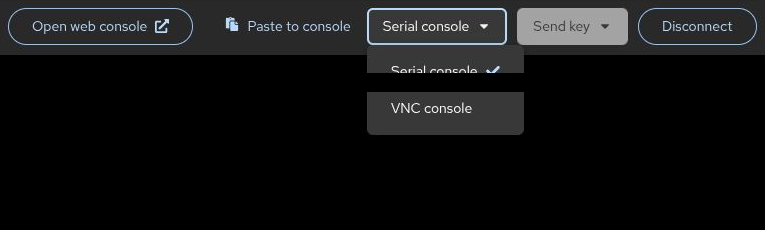
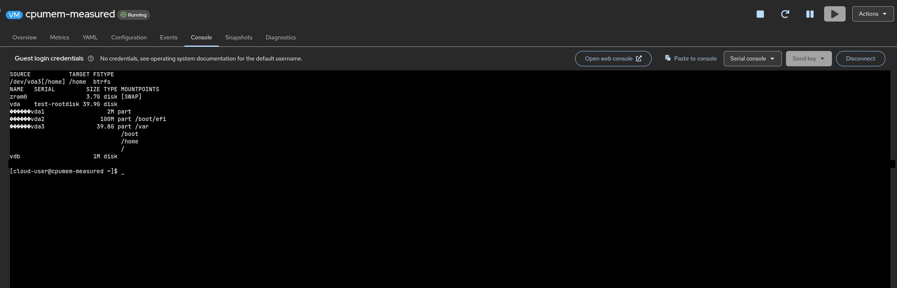
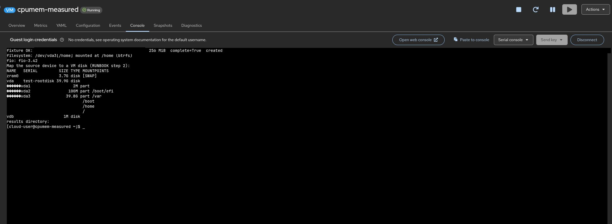
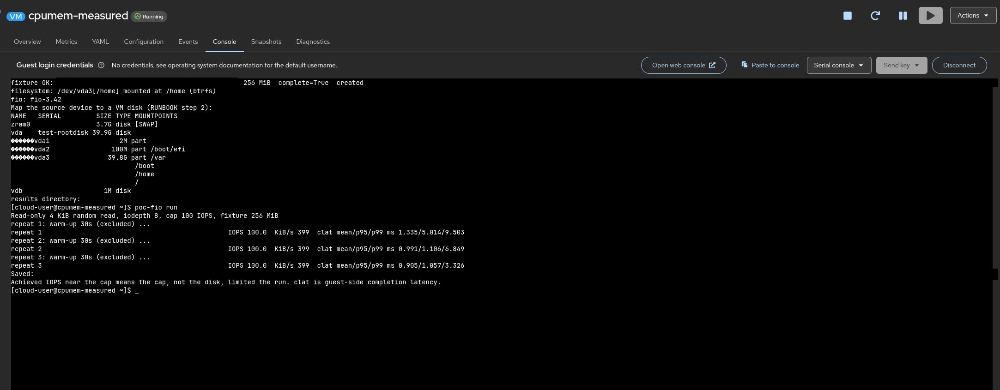
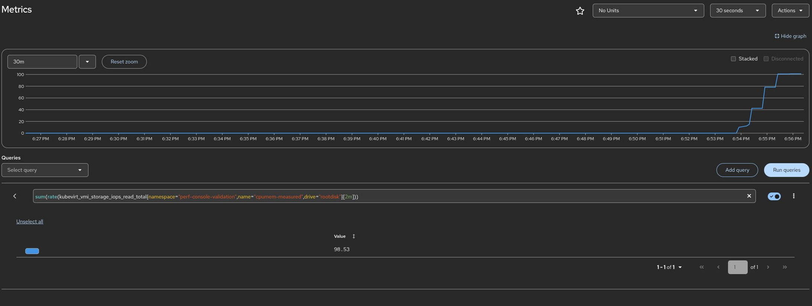
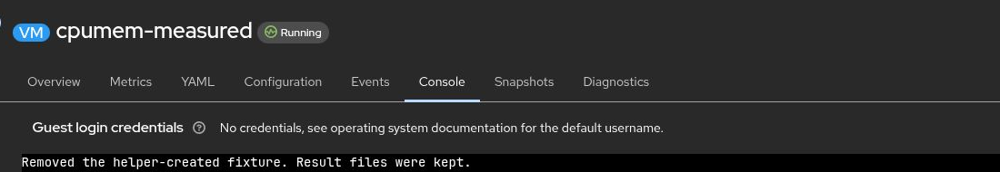
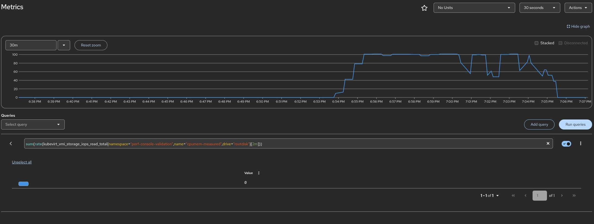

# Storage IOPS: customer walkthrough

**Goal:** run one agreed read workload in an existing VM and see its IOPS, throughput and
latency in the guest and in the OpenShift console.

The administrator [prepares and approves](ADMIN-GUIDE.md#prepare) first and gives you the
[results sheet](RESULTS-TEMPLATE.md): VM, project, **directory to use**, graph links and
times. Do not resize, restart, snapshot or migrate the VM. The reference fio workload
and console metrics were rehearsed on OpenShift 4.22; tests on the target cluster are still pending.

The pictures show the controls and reference output. Private values are covered
with black boxes. Use the VMs, addresses, directory and times on **your results
sheet**; the pictures are not results for your environment.

## 1. Open the VM and the graphs

1. Open **Workloads → Pods** and select the project on your sheet. Then open **Virtualization → VirtualMachines → Virtual machines** and choose the VM. This also works when the VM project filter is disabled.
2. **Overview**: confirm **Running**. Open the three prepared graph links on your
   sheet: **IOPS**, **throughput** and **latency**. They open **Observe → Metrics**
   already filtered to your VM disk. Keep them open for recording results.
3. Open **Console**, use the **VNC console** dropdown to select **Serial console**, wait for connection, click inside the terminal and press **Enter**. Log in with your existing guest account. Type the commands below there.

   

**Expected:** VM Running, console prompt. Keep the VM's current workload as it is.

Paste **one command at a time**, press **Enter**, and wait for its expected output.
Use the working console listed on your sheet if the existing guest uses a different console.

## 2. Confirm the approved directory and disk

Replace `/APPROVED/DIRECTORY` below **and in step 4** with the exact directory on your sheet.
The administrator can provide both commands with that value already filled in.
Do not type the placeholder literally.

```sh
findmnt -T /APPROVED/DIRECTORY -o SOURCE,TARGET,FSTYPE
lsblk -o NAME,SERIAL,SIZE,TYPE,MOUNTPOINTS
```

**Expected:** a device such as `vda1` or `vdb1` mounted where your directory lives. Write
down the device name and **SERIAL**. The administrator maps it to the VM disk name; if the
sheet says the mapping is unclear, stop (do not guess). The
**root disk** also carries the operating system's own I/O, so its numbers include background noise.



## 3. Record an idle baseline

Run `date -u +%FT%TZ` and record **baseline start**. Leave the existing workload unchanged
for **at least 2 minutes** (longer if the sheet says so), then run the same command
and record **baseline end**.

**Expected:** the VM storage graph is flat near zero (or at the existing workload's normal level).


## 4. Measure

Your sheet says which option you use. Do only that option.

**Option A (no installation): the existing approved workload.** Run it exactly as the
sheet says.

1. Run `date -u +%FT%TZ` and record **workload start**.
2. Start the workload as the sheet says, and let it run for the time on the sheet.
3. When it ends, run `date -u +%FT%TZ` again and record **workload end**.
4. Save the application's own results (its report or screen output) as the sheet says.

Then skip to step 5. Option A does not use `poc-fio`.

**Option B: reference workload with `poc-fio`.** If the sheet says the helper is in
`~/poc-bin`, run `export PATH="$HOME/poc-bin:$PATH"` first after every login. If
`poc-fio` or `fio` is missing, the administrator supplies them
([how](ADMIN-GUIDE.md#tools)); no VM restart is needed.

```sh
poc-fio prepare --dir /APPROVED/DIRECTORY
poc-fio status
poc-fio run
```

- `prepare` **writes one new 256 MiB file once** in a fresh hidden folder. It never touches
  existing files. Expected: `Prepared 256 MiB fixture`.
- `run` does 4 KiB random **reads**, one job, queue depth 8, capped at 100 IOPS: **30 s
  warm-up (not counted) + 180 s measured, three times** (about 11 minutes).
- Expected lines like
  `repeat 1  <UTC start> -> <UTC end>  IOPS 99.x  KiB/s 39x  clat mean/p95/p99 ms ...`
  then `Saved:` with a folder name. IOPS near 100 means the cap, not the disk, set the rate.
- Stop early with **Ctrl-C**: only the test process stops; partial results are kept.

After `prepare` and `status`, the console should confirm the fixture (example screen):



While `run` works and after it finishes, the console shows each repeat and the saved folder:



## 5. Read the console graphs

Each prepared graph link shows one value per point in time, averaged over the last
2 minutes (the *rate window*). For each measured window, read the value at the end
of that window, so the 2 minutes lie inside it:

- **Option A:** use your recorded workload start and end. If the workload ran for
  less than 2 minutes (or the window on your sheet), tell the administrator; that
  graph value is then **not available** for that run.
- **Option B:** use each `repeat` line's start and end printed by `poc-fio`.

Note read/write IOPS, throughput and latency from the three links.
The VM **Metrics → Storage** cards are an optional live view. Their selected
time range smooths the values, and their numerical display was not verified in
the rehearsal. Use the prepared **Observe → Metrics** links for your recorded results. If a graph is missing,
write **not available**; never write 0.

**Expected:** the graphs rise when the workload starts and fall when it ends, at the same times as
your guest figures. The numbers need not match: each layer counts differently (merged or split I/O,
background I/O, caches). Console latency is a virtual-disk average, not the guest's p95/p99.



## 6. Recovery and cleanup

Run `date -u +%FT%TZ` and record **recovery start**. Wait at least 2 minutes
(or the time on your sheet), then record **recovery end** with the same command.
Note whether the graph returns to baseline.

**Option A:** give the sheet, your UTC times and the application's own results to the
administrator.

**Option B:** remove the test file, then hand over:

```sh
poc-fio cleanup
```

**Expected:** `Removed the helper-created fixture. Result files were kept.` Give the sheet
and the results folder name printed after `Saved:` to the administrator.



Compare the read-IOPS graph over the recovery window (example of an idle graph after the workload stopped):



## Stop and call the administrator if

- a command prints `ERROR` (read it out; do not retry in a loop),
- the VM restarts, pauses, shows disk errors, or the existing application slows noticeably,
- graphs are missing entirely, or `prepare` says the free space is too low.

Do not record failed runs as results.
