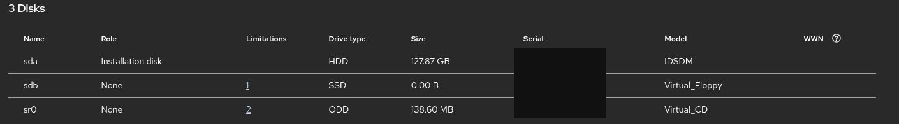

# Administrator guide: CIM worker expansion

> **Status: results verified with a 4.21 hub and 4.22 workload cluster.**
> Registration, installation, added Ready capacity and a Running check pod were
> exercised. After the latest run, cleanup was held for review; an earlier
> rehearsal removed its check workload. A 4.21 workload cluster was not tested;
> this remains manual expansion.

Reference for commands and safety detail; the step-by-step flow is the
[runbook](RUNBOOK.md) and is not repeated here. This case is a **manual**
expansion, not policy- or load-triggered autoscaling.

Official reference: [ACM 2.16 — Clusters](https://docs.redhat.com/en/documentation/red_hat_advanced_cluster_management_for_kubernetes/2.16/html-single/clusters/index).
Installing ACM/MCE and importing the workload cluster are pre-existing
prerequisites and are out of scope here.

Terms: **CIM** is Central Infrastructure Management. **BMC** is the server's
remote-management controller. An **InfraEnv** (the "inventory") is the
host-inventory object on the hub.

## Prepare

### Requirements

- Existing, configured CIM and a managed workload cluster. Do not create or
  initialise the hub.
- A host-inventory InfraEnv, reused **unchanged**: do not edit its pull secret,
  SSH key, NTP, proxy or labels.
- A spare approved physical host with BMC access and **only disposable disks
  connected**. Disconnect disks or unpresent SAN LUNs containing data or another
  OS before discovery. The install disk will be overwritten.
- A BMC address with the vendor-appropriate URI. Dell iDRAC uses
  `idrac-virtualmedia://`, not the generic `redfish-virtualmedia://`.
- BMC credentials stay private. No password goes in this repository.
- Network and storage reach: the new host must reach the hub for discovery, the
  workload cluster's machine network, and the networks and storage its VMs will
  use. Reusing an inventory that already gives hosts those networks needs no
  extra network configuration. If bonds, VLANs or static addresses are needed and
  the inventory does not provide them, the network administrator supplies them.

### Administrator preparation (runbook A4)

This is the one entry point for preparation. Work on the **hub**, in one
terminal, and do the four steps in order. You hand back a usable inventory, a
private BMC Secret and a filled, paused host file. Do not upload the file or
start discovery here.

**1. Set the values** (names from runbook A1). `BMC_SECRET` must be a name that
does not exist yet in the inventory namespace:

~~~sh
export INV_NS='REPLACE_INVENTORY_NAMESPACE'     # namespace of the host-inventory InfraEnv
export INV='REPLACE_INFRAENV_NAME'
export HOST='REPLACE_SPARE_HOST_NAME'
export BMC_SECRET="$HOST-bmc-secret"
oc get secret "$BMC_SECRET" -n "$INV_NS"        # expected: NotFound
~~~

If the Secret already exists, it belongs to something else. Leave it alone and
choose another `BMC_SECRET` name.

**2. Choose the inventory.** Reuse an existing one, unchanged, if it passes
this read-only check: `clusterRef` empty and `autoApprove` not `true`.

~~~sh
oc get infraenv "$INV" -n "$INV_NS" -o jsonpath='{.metadata.name}{" clusterRef="}{.spec.clusterRef}{" autoApprove="}{.spec.agentApproval.autoApprove}{"\n"}'
oc get agent -n "$INV_NS" -o custom-columns=NAME:.metadata.name,APPROVED:.spec.approved,ROLE:.spec.role,CLUSTER:.spec.clusterDeploymentName.name,STAGE:.status.progress.currentStage
oc get baremetalhost -n "$INV_NS"
~~~

Hosts found by BMC can still be approved automatically, so keep the new host
unassigned until the disk review. If `clusterRef` is set the inventory is not
suitable. Create a separate one (optional):

1. In **Host inventory**, note the namespace and approved pull-Secret name of
   the existing inventory. Do not display or copy the Secret's contents.
2. Fill [`03-unassigned-inventory.yaml`](manifests/03-unassigned-inventory.yaml)
   with a new inventory name, that namespace, the existing pull-Secret name and
   your SSH public key. Match the OpenShift version to the workload cluster.
3. The example uses DHCP. For bonds, VLANs or static IPs, have the network
   administrator supply a host-specific NMStateConfig labelled to match the
   template's selector, including the storage network if the worker will run VMs.
   Create the inventory with `oc create` (below), which never changes an existing one.
4. Console: **Quick create (+) → Import YAML**, choose the inventory project,
   paste the definition, **Create**. Or:
   ~~~sh
   oc create -f manifests/03-unassigned-inventory.yaml
   ~~~
5. Wait until the new inventory shows its discovery image. Then set `INV` and
   `INV_NS` (step 1) to it.

**3. Create the private BMC Secret.** Use a separate Secret for this host: the
host controller treats it as part of the host and can remove it when the host is deleted.
Create it from files, never from literals. The keys are `username` and
`password`. (The console's **With BMC Form** takes them directly; this runbook
uses the paused file, which needs the Secret.)

Paste the whole block. It prints `OK` or `STOP` on its last line, and always
removes the temporary password files.

~~~sh
umask 077
if PRIV=$(mktemp -d); then
  read -r -p 'BMC username: ' u; printf '%s' "$u" > "$PRIV/username"
  read -r -s -p 'BMC password: ' p; printf '%s' "$p" > "$PRIV/password"; echo
  unset u p
  if oc create secret generic "$BMC_SECRET" -n "$INV_NS" \
       --from-file=username="$PRIV/username" --from-file=password="$PRIV/password"; then
    RESULT="OK: Secret $BMC_SECRET created"
  else
    RESULT="STOP: Secret not created. Do not continue."
  fi
  rm -f "$PRIV/username" "$PRIV/password"; rmdir "$PRIV"; unset PRIV
  echo "$RESULT"
else
  echo "STOP: could not make a private folder. Nothing was created."
fi
~~~

Only on `OK`, check the new Secret. This prints its keys, never their values:

~~~sh
oc get secret "$BMC_SECRET" -n "$INV_NS" -o json | jq '{uid: .metadata.uid, created: .metadata.creationTimestamp, keys: (.data | keys)}'
~~~

**Expected:** created a moment ago, keys `password` and `username`. On `STOP`,
fix the cause (for example a name that already exists) and run the block again
with a new name. Never point the host file at a Secret this step did not create.

No Secret YAML is shipped, so a template cannot be applied by mistake.

**4. Fill the paused host file.** Make a private copy outside the checkout and
fill the names you already set:

~~~sh
mkdir -p "$HOME/poc-private/case06" && chmod 700 "$HOME/poc-private" "$HOME/poc-private/case06"
sed -e "s/REPLACE_HOST_NAME/$HOST/g" -e "s/REPLACE_INVENTORY_NAMESPACE/$INV_NS/g" \
    -e "s/REPLACE_INFRAENV_NAME/$INV/g" -e "s/REPLACE_BMC_SECRET_NAME/$BMC_SECRET/g" \
    manifests/02-baremetalhost-paused.yaml > "$HOME/poc-private/case06/bmh.yaml"
~~~

Then open `$HOME/poc-private/case06/bmh.yaml` in a text editor and fill the rest:

| Placeholder | Value |
| --- | --- |
| `REPLACE_BMC_HOST` | The spare server's BMC address |
| `REPLACE_SYSTEM_ID` | Its Redfish system ID (Dell iDRAC is usually `System.Embedded.1`; check, do not assume) |
| `REPLACE_BOOT_NIC_MAC` | MAC address of the network card the server boots from |
| `idrac-virtualmedia://` | Keep for Dell iDRAC; change to `redfish-virtualmedia://` for another Redfish BMC (runbook A2) |

Check that nothing is left to fill:

~~~sh
grep -n '^[^#]*REPLACE_' "$HOME/poc-private/case06/bmh.yaml"; echo "grep exit $?"
~~~

**Expected:** only `grep exit 1` (nothing left to fill). Any listed line with `grep exit 0`
means a placeholder remains; `grep exit 2` or an error means the file is missing or
unreadable. In both cases, stop and fix the file.

The file starts paused with cleaning disabled and certificate verification on.
It holds the Secret's name, not its contents. Turning certificate verification
off is a host-specific exception that needs written owner approval.

Disabled cleaning does not protect other disks or boot records, and the
Assisted Installer's disk preparation is separate. Only disposable disks may be
connected; the **Format** checkbox is no protection.

Return to the runbook (section B).

### Start discovery (runbook C1, after the upload)

The runbook's C1 does the upload. Right after it, with `INV_NS`, `INV`, `HOST`
and `BMC_SECRET` set, review what the hub saved:

~~~sh
oc get baremetalhost "$HOST" -n "$INV_NS" -o jsonpath='inventory={.metadata.labels.infraenvs\.agent-install\.openshift\.io} secret={.spec.bmc.credentialsName} cleaning={.spec.automatedCleaningMode} paused={.metadata.annotations.baremetalhost\.metal3\.io/paused} online={.spec.online} skipCertCheck={.spec.bmc.disableCertificateVerification}{"\n"}'
~~~

**Expected:** `inventory=` your inventory, `secret=` your Secret, `cleaning=disabled`,
`paused=true`, `online=false`, and `skipCertCheck=` empty or `false` (`true` only
with the written exception). If anything differs or the command fails, stop here
and ask the owner. Do not run the next block.

When the review matches, start discovery. This block changes the host only if
it is still paused with cleaning disabled:

~~~sh
if [ "$(oc get baremetalhost "$HOST" -n "$INV_NS" -o jsonpath='{.spec.automatedCleaningMode}/{.metadata.annotations.baremetalhost\.metal3\.io/paused}')" = "disabled/true" ]; then
  oc patch baremetalhost "$HOST" -n "$INV_NS" --type=merge -p '{"spec":{"online":true}}' &&
  oc annotate baremetalhost "$HOST" -n "$INV_NS" baremetalhost.metal3.io/paused-
else
  echo "STOP: the host is not paused with cleaning disabled. Nothing was changed."
fi
~~~

Then do the runbook's disk review (C2) before approving (C2) or assigning (C3).

For reference, **Add hosts → With BMC form** shows the fields below. It also
offers NMState and MAC-to-interface mapping for static or bonded networks.
The runbook's YAML upload makes the cleaning and TLS settings explicit.

## Observe the host (hub)

Registration, approval and assignment are separate stages. Check each before moving on.

BMC registration can approve the resulting Agent automatically even when the
InfraEnv does not approve ISO-discovered hosts automatically. Keep this test's
inventory unassigned: no `spec.clusterRef`. Review the disk before assigning the
host to any cluster; assignment can immediately start installation.

~~~sh
oc get baremetalhost "$HOST" -n "$INV_NS" -o jsonpath='{.status.provisioning.state} {.status.poweredOn}{"\n"}'
oc get agent -n "$INV_NS" -o custom-columns=NAME:.metadata.name,APPROVED:.spec.approved,ROLE:.spec.role,STAGE:.status.progress.currentStage
oc get agent AGENT_NAME -n "$INV_NS" -o jsonpath='{.status.inventory.disks}{"\n"}'     # confirm the install disk
~~~

## Workload cluster checks

Switch to the workload cluster context before running these.

~~~sh
oc get nodes -l node-role.kubernetes.io/worker,'!node-role.kubernetes.io/control-plane'
oc get node REPLACE_NEW_WORKER_NODE -o jsonpath='{.status.conditions[?(@.type=="Ready")].status}{"\n"}'
oc get node REPLACE_NEW_WORKER_NODE -o jsonpath='cpu={.status.allocatable.cpu} memory={.status.allocatable.memory}{"\n"}'
oc get csr | grep -i pending      # only if the node stays pending
~~~

Approve a CSR only if you recognise it as this host's bootstrap request.

## Troubleshooting

- **Host not discovered:** check BMC address form, boot MAC, credentials and
  network path to the BMC; see the host's conditions with `oc describe baremetalhost`.
- **Agent not approved or not available:** approval is a separate action
  (runbook C2); assignment needs an approved Agent.
- **Install fails or stalls:** read the Agent's conditions and the installation
  events in the console; confirm the install disk and cluster were correct.
- **Node pending:** check pending CSRs (above), then the Agent stage.

Stop and ask the owner before repeating an installation on a host.

## Cleanup summary

| Object | Action |
| --- | --- |
| `new-worker-check` pod in the project chosen in runbook C5 | Delete only if its UID matches the one recorded (it may already be gone if Case 02 recovery removed it) |
| That check project | Delete only if this run created it and it holds nothing else |
| New worker | Leave installed for the next agreed test |
| Inventory InfraEnv | Leave unchanged |
| BMC Secret referenced by the installed host | Keep; the host registration still needs it |
| Private password files | Removed by the Secret step |
| Filled host file in `$HOME/poc-private/case06` | Keep privately or delete with the owner |
