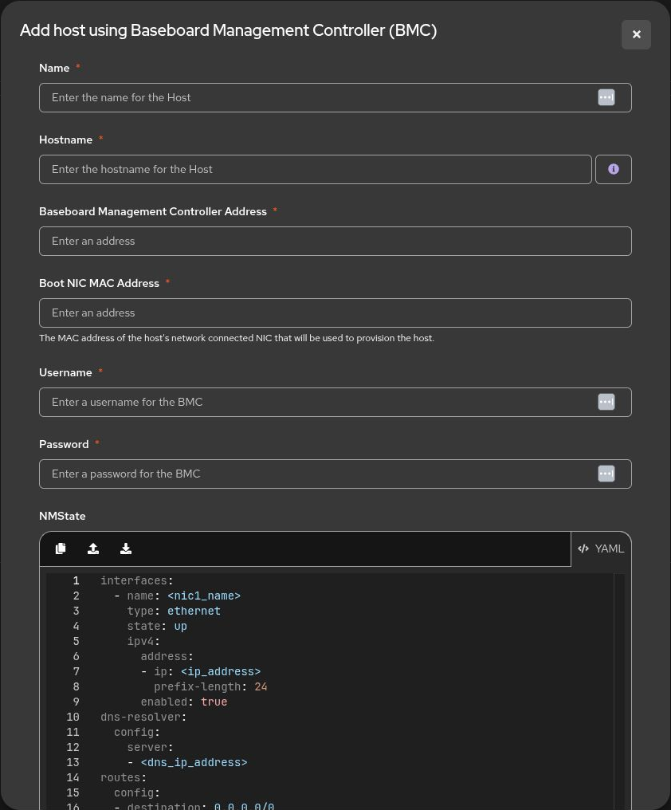

# Administrator guide: CIM worker expansion

> **Status: expansion verified on 4.22.** Registration, installation,
> added Ready capacity, a Running check pod and check-workload cleanup were exercised.
> The 4.21 procedure was documentation-reviewed; this remains manual expansion.

Reference for commands and safety detail; the step-by-step flow is the
[runbook](RUNBOOK.md) and is not repeated here. This case is a **manual**
expansion, not policy- or load-triggered autoscaling.

Official reference: [ACM 2.16 — Clusters](https://docs.redhat.com/en/documentation/red_hat_advanced_cluster_management_for_kubernetes/2.16/html-single/clusters/index).
Installing ACM/MCE and importing the workload cluster are pre-existing
prerequisites and are out of scope here.

## Prepare

~~~sh
export INV_NS='REPLACE_INVENTORY_NAMESPACE'     # namespace of the host-inventory InfraEnv (hub)
export INV='REPLACE_INFRAENV_NAME'
export HOST='REPLACE_SPARE_HOST_NAME'
~~~

### Requirements

- Existing, configured CIM and a managed workload cluster. Do not create or
  initialise the hub.
- A host-inventory InfraEnv, reused **unchanged**: do not edit its pull secret,
  SSH key, NTP, proxy or labels.
- A spare approved physical host with a **separate install disk** and BMC access.
  The install disk contents will be overwritten; every other disk must be a
  data disk that is not selected.
- A BMC address with the vendor-appropriate URI. Dell iDRAC uses
  `idrac-virtualmedia://`, not the generic `redfish-virtualmedia://`.
- BMC credentials stay private (see below). No password goes in this repository.

### Read-only hub checks

~~~sh
oc get infraenv "$INV" -n "$INV_NS" -o jsonpath='{.metadata.name}{"\n"}'
oc get agent -n "$INV_NS" -o custom-columns=NAME:.metadata.name,APPROVED:.spec.approved,ROLE:.spec.role,CLUSTER:.spec.clusterDeploymentName.name,STAGE:.status.progress.currentStage
oc get baremetalhost -n "$INV_NS"
~~~

### Create a separate inventory, only if needed

Reuse an existing inventory unchanged if it is unassigned and does not approve
hosts automatically. An installation inventory with `spec.clusterRef` already
set is not suitable for this walkthrough's separate approval and assignment steps.

1. In **Host inventory**, note the namespace and approved pull-Secret name of
   the existing inventory. Do not display or copy its Secret contents.
2. Fill [`03-unassigned-inventory.yaml`](manifests/03-unassigned-inventory.yaml)
   with a new inventory name, that namespace, the existing pull-Secret name and
   your SSH public key. Match the OpenShift version to the workload cluster.
3. The example uses DHCP. For bonds, VLANs or static IPs, have the network
   administrator supply a host-specific NMStateConfig and label it to match the
   template's selector. Existing network configuration stays unchanged.
4. Use **Quick create (+) → Import YAML**, choose the inventory project, paste
   the completed definition and click **Create**. Alternatively:
   ~~~sh
   oc create -f manifests/03-unassigned-inventory.yaml
   ~~~
5. Return to **Host inventory**, open the new inventory and wait until its
   discovery image is available. Use this inventory for the remaining steps.

### BMC credentials (only if you create the Secret by CLI)

The console **With BMC Form** takes the username and password directly. If your
process uses a Secret instead, create it privately from files, never from
literals, and delete the files afterwards. Keys follow the BareMetalHost
convention (`username`, `password`).

Use a separate Secret for this test host. BareMetalHost controllers can take
ownership of the referenced Secret and remove it when the host is deleted.
Do not reference a shared credential Secret belonging to another host or service.

~~~sh
umask 077; PRIV=$(mktemp -d)
read -r -p 'BMC username: ' u; printf '%s' "$u" > "$PRIV/username"
read -r -s -p 'BMC password: ' p; printf '%s' "$p" > "$PRIV/password"; echo
unset u p
oc create secret generic "$HOST-bmc-secret" -n "$INV_NS" \
  --from-file=username="$PRIV/username" --from-file=password="$PRIV/password"
~~~

No placeholder Secret YAML is shipped, so a template cannot be applied by mistake.

### TLS

Certificate verification stays enabled. A "disable certificate verification"
choice is a host-specific exception that needs written owner approval; do not
make it the default.

### Host with disks to preserve

The BMC form does not offer a disk-cleaning setting. Use this path if other
disks must stay intact. The runbook uses it for all test hosts so the settings
can be reviewed before discovery starts:

1. Create the private BMC Secret above in the inventory namespace.
2. Fill [`02-baremetalhost-paused.yaml`](manifests/02-baremetalhost-paused.yaml).
   The BMC URI must match the vendor. The template starts paused with cleaning
   disabled; this does not yet select the operating system's install disk.
3. On the inventory page choose **Add hosts → By uploading a YAML → Open file**,
   select the filled template, then **Upload**. The existing Secret is referenced
   by name; do not include its contents in the uploaded file.
4. Confirm the saved settings, then start discovery:
   ~~~sh
   oc get baremetalhost "$HOST" -n "$INV_NS" -o jsonpath='{.spec.automatedCleaningMode}{" "}{.metadata.annotations.baremetalhost\.metal3\.io/paused}{"\n"}'
   # Expected: disabled true
   oc patch baremetalhost "$HOST" -n "$INV_NS" --type=merge -p '{"spec":{"online":true}}'
   oc annotate baremetalhost "$HOST" -n "$INV_NS" baremetalhost.metal3.io/paused-
   ~~~
5. Return to the runbook's discovered-host review. Confirm the install disk
   before approving or assigning the host. Selecting an install disk does not
   protect other disks from automated cleaning; cleaning stays disabled here.

For reference, **Add hosts → With BMC form** shows the fields below. It also
offers NMState and MAC-to-interface mapping for static or bonded networks.
The runbook's YAML upload makes the cleaning and TLS settings explicit.

## Observe the host (hub)

Registration, approval and assignment are separate stages. Check each before moving on.

BMC registration can approve the resulting Agent automatically even when the
InfraEnv does not approve ISO-discovered hosts automatically. Keep this test's
inventory unassigned: no `spec.clusterRef`. Review the disk before assigning the
host to any cluster; assignment can immediately start installation.

~~~sh
oc get baremetalhost "$HOST" -n "$INV_NS" -o jsonpath='{.status.provisioning.state} {.status.poweredOn}{"\n"}'
oc get agent -n "$INV_NS" -o custom-columns=NAME:.metadata.name,APPROVED:.spec.approved,ROLE:.spec.role,STAGE:.status.progress.currentStage
oc get agent AGENT_NAME -n "$INV_NS" -o jsonpath='{.status.inventory.disks}{"\n"}'     # confirm the install disk
~~~

## Workload cluster checks

Switch to the workload cluster context before running these.

~~~sh
oc get nodes -l node-role.kubernetes.io/worker,'!node-role.kubernetes.io/control-plane'
oc get node REPLACE_NEW_WORKER_NODE -o jsonpath='{.status.conditions[?(@.type=="Ready")].status}{"\n"}'
oc describe node REPLACE_NEW_WORKER_NODE | grep -A8 -i 'Allocatable'
oc get csr | grep -i pending      # only if the node stays pending
~~~

Approve a CSR only if you recognise it as this host's bootstrap request.

## Troubleshooting

- **Host not discovered:** check BMC address form, boot MAC, credentials and
  network path to the BMC; see the host's conditions with `oc describe baremetalhost`.
- **Agent not approved or not available:** approval is a separate action
  (runbook C2); assignment needs an approved Agent.
- **Install fails or stalls:** read the Agent's conditions and the installation
  events in the console; confirm the install disk and cluster were correct.
- **Node pending:** check pending CSRs (above), then the Agent stage.

Stop and ask the owner before repeating an installation on a host.

## Cleanup summary

| Object | Action |
| --- | --- |
| `new-worker-check` pod | Delete |
| `cim-expansion-check` project | Delete only if this run created it and it is empty |
| New worker | Leave installed for the next agreed test |
| Inventory InfraEnv | Leave unchanged |
| BMC Secret referenced by the installed host | Keep; the host registration still needs it |
| `$PRIV` | Securely remove |
