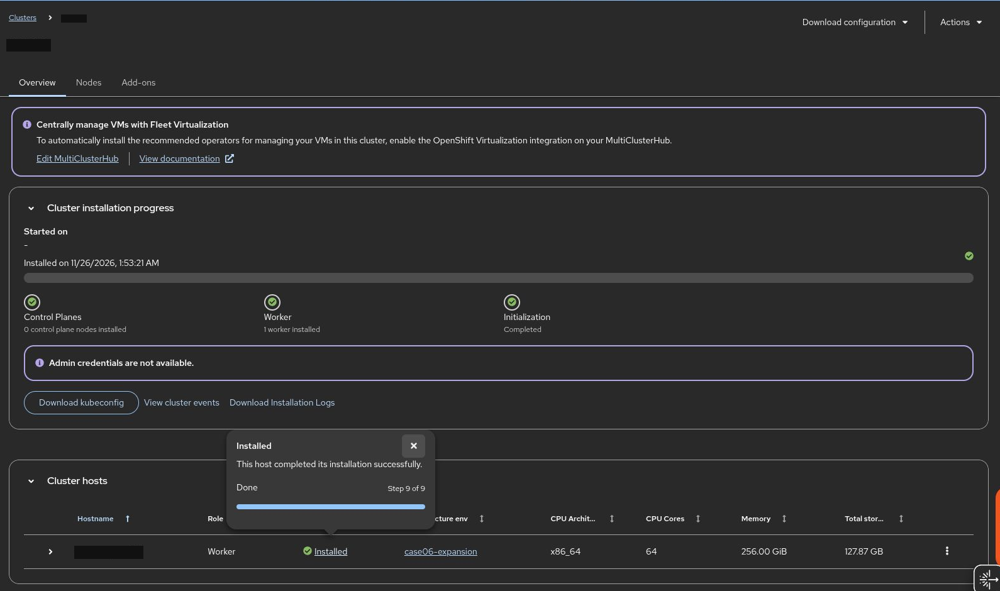
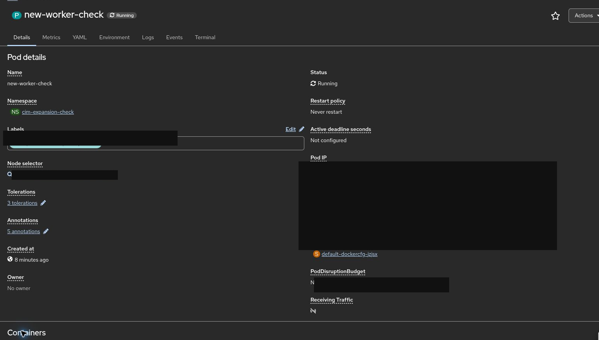

# Runbook: add a spare physical worker with CIM

> **Status: results verified with a 4.21 hub and 4.22 workload cluster.**
> Registration, installation, added Ready capacity and a Running check pod were
> exercised. Cleanup was held for review. A 4.21 workload cluster was not tested;
> this remains manual expansion.

**Goal:** use the existing Central Infrastructure Management (CIM) setup to add
one spare physical server as a worker of a managed workload cluster, and show
the cluster gained a Ready worker and its capacity. Then, optionally, use that
worker as SOURCE for the [Case 02](../02-host-failure-recovery/RUNBOOK.md)
automatic recovery test.

**Boundary:** this is a **manual** expansion that you start. It is **not**
policy- or load-triggered autoscaling, and nothing here shows the cluster
growing by itself.

Flow: **A. Prepare → B. Readiness check (once) → C. Test and results → D. Stop and clean up.**

Official reference: [Red Hat Advanced Cluster Management 2.16 — Clusters](https://docs.redhat.com/en/documentation/red_hat_advanced_cluster_management_for_kubernetes/2.16/html-single/clusters/index)
(host inventory and adding hosts to a cluster). If this runbook and the docs or
your console disagree, the docs and the console win. Command detail and safety
reasoning are in the [administrator guide](ADMIN-GUIDE.md).

Two clusters are involved. Console steps for the host happen on the **hub**
(Fleet Management); node and workload checks happen on the **workload cluster**.
Use the console or the CLI for each change, never both.

## A. Prepare

This case starts from an **existing** environment; it does not set one up:

- A hub with ACM/MCE and CIM already configured, and a managed workload cluster
  already imported.
- A **host-inventory InfraEnv** (the "inventory") that you reuse **unchanged**.
  It must be unassigned to a cluster (`clusterRef` absent), with its InfraEnv
  automatic approval setting off. BMC-discovered hosts can still be approved
  automatically; keep them unassigned until you review their disks.
  If the existing installation inventory is
  already assigned, create a separate inventory for this test; leave it intact.
- One **spare approved physical server** with BMC access. Every connected disk
  must be disposable. Disconnect disks and unpresent SAN LUNs containing data
  or another OS before discovery; selecting an install disk is not protection.
- Owner approval to add, use and retain the spare worker.

**A1. Choose and record names.** Write on the results sheet: inventory name,
workload cluster name, spare host name, BMC vendor, intended install disk.

**A2. Choose the BMC address format.** It must match the vendor. Do **not** use
the generic `redfish-virtualmedia` form for a Dell server; Dell iDRAC uses
`idrac-virtualmedia`. Typical shapes (confirm in the docs and with the vendor):

| Vendor | BMC address form |
| --- | --- |
| Dell iDRAC | `idrac-virtualmedia://<bmc-host>/redfish/v1/Systems/System.Embedded.1` |
| Other Redfish BMC | `redfish-virtualmedia://<bmc-host>/redfish/v1/Systems/<system-id>` |

Use the host's own Systems id; do not assume it. Have the BMC username and
password ready privately. Use them to create the private Secret in A4; never
write them in files in this repository or in the host upload file.

**A3. Record the "before" size** on the **workload cluster**: **Compute → Nodes**,
total Ready nodes, dedicated worker nodes, and allocatable CPU and memory
(CLI below).

CLI (workload cluster)

~~~sh
oc get nodes
oc get nodes -l node-role.kubernetes.io/worker,'!node-role.kubernetes.io/control-plane' \
  --no-headers | wc -l
oc get nodes -o custom-columns=NAME:.metadata.name,CPU:.status.allocatable.cpu,MEMORY:.status.allocatable.memory
~~~

**A4. Prepare the host file.** Follow the
[host-file preparation steps](ADMIN-GUIDE.md#prepare-the-paused-host-file) to
create a private BMC Secret and fill the paused BareMetalHost template. Keep
the filled file outside the repository. The file references the Secret by name.

## B. Readiness check (one check, all must be yes)

Run once before adding the host. Any **no** means **stop**.

| # | Must be true | Where to look |
| --- | --- | --- |
| 1 | The inventory exists and is healthy (hub) | **Fleet Management → Infrastructure → Host inventory** |
| 1a | Inventory is unassigned; its InfraEnv automatic approval setting is off | Administrator checks the InfraEnv YAML |
| 2 | The workload cluster is **Ready** (hub) | **Fleet Management → Infrastructure → Clusters** |
| 3 | The spare's BMC is powered and reachable; the host is not already in the inventory | Host inventory **Hosts** tab; server may stay off |
| 4 | The BMC address uses the vendor-appropriate form (A2) | Your notes |
| 5 | Owner approval and install disk recorded; all connected disks disposable | Results sheet |
| 6 | Before-count of workers and capacity is recorded (A3) | Results sheet |

CLI (hub, one block)

~~~sh
oc get infraenv -A
oc get infraenv REPLACE_INVENTORY_NAME -n REPLACE_INVENTORY_NAMESPACE -o jsonpath='{.spec.clusterRef}{" autoApprove="}{.spec.agentApproval.autoApprove}{"\n"}'
# clusterRef must be absent; autoApprove must not be true.
oc get agent -A
oc get baremetalhost -A
oc get managedcluster
~~~

## C. Test and results

### C1. Register the host

Use the host file prepared in A4. Cleaning starts disabled and certificate
verification stays enabled. The file contains the Secret's name, not its
username or password.

On the **hub**: **Fleet Management → Infrastructure → Host inventory →** select
your inventory **→ Add hosts → By uploading a YAML → Open file**. Choose the
filled host file, then click **Upload**. Open the **Hosts** tab.

The host initially shows **Pending** because the file starts paused. A new
paused host can also show **Metal3 operator is not configured** until discovery
starts. Complete the saved-settings check and start discovery using the two commands in the
host-file preparation steps. Wait for the host's discovered hardware to appear.
If the warning remains or registration does not start, ask the administrator to
check CIM; do not upload the host again.
If it boots an old operating system, stop and use the BMC's one-time **UEFI
virtual optical/CD** boot selection; do not start an installation on that disk.

**Expected:** the host appears on the inventory's **Hosts** tab and moves
through registration and discovery. This step only **registers** the host.
Wait until it shows as discovered or needing approval.

### C2. Review the disks and approve the discovered host

On the inventory's **Hosts** tab, expand the arrow at the left of the host row
(**Details**). Check the hardware and disks against what you recorded. Clicking
the hostname opens a rename dialog, so use the arrow for hardware details.

BMC-discovered hosts can already be approved automatically. An **Available**
host with **Actions → Approve** disabled needs no extra approval click. If
approval is offered, review the hardware first, select the host and choose
**Actions → Approve**. Keep the host **unassigned** until C3's disk review.

**Expected:** the host shows approved/available and is not yet in any cluster.

### C3. Assign to the cluster as a worker (separate step)

1. Open **Fleet Management → Infrastructure → Clusters →** the workload cluster
   you want to expand. Confirm its name and current nodes.
2. Choose the cluster's **Actions → Add hosts**.
3. Turn **Auto-select hosts** off. Select only the approved spare host and check
   that its **Role** is **Worker**.
4. Expand the host's **Details** arrow. Under **Disks**, confirm the approved OS
   disk has role **Installation disk**. To choose another disk, open that disk's
   **Role** button (**None**) and select **Installation disk**. Check its serial
   and size. Other disks stay **None**. The **Format?** column can be disabled;
   an unchecked box is not proof that another disk will remain untouched.
   **Stop if any connected disk contains data or an OS to preserve.**
5. Only when the host, cluster, role and install disk are correct, click
   **Submit**. This assigns the host and starts installation.

**Expected:** the host shows installation progress, then completes. Do not
power it off or cancel while installing.

Click the host's **Installing** status to see its current step and progress.

### C4. Confirm the Agent and node

Hub: the host/Agent reaches its final installed state with no errors. Workload
cluster: **Compute → Nodes** lists a **new** node with role **worker** and status **Ready**.

CLI

~~~sh
# hub
oc get agent -A -o custom-columns=NS:.metadata.namespace,NAME:.metadata.name,APPROVED:.spec.approved,ROLE:.spec.role,STAGE:.status.progress.currentStage
# workload cluster
oc get nodes -l node-role.kubernetes.io/worker,'!node-role.kubernetes.io/control-plane'
~~~

**Expected:** total Ready nodes and dedicated worker count are **before + 1**; allocatable CPU and memory
are higher by that node's amount. If the node stays NotReady or pending, use
[troubleshooting](ADMIN-GUIDE.md#troubleshooting) and stop; do not guess.

### C5. Run a simple workload on the new worker

On the **workload cluster**, use a new project for the small check pod from
[`00-namespace.yaml`](manifests/00-namespace.yaml) and
[`01-worker-check-pod.yaml`](manifests/01-worker-check-pod.yaml) (fill the new
worker's node name; console: **Import YAML**). If the project already exists,
stop and choose an unused name in both manifests; do not take over its contents.

~~~sh
oc create -f manifests/00-namespace.yaml
oc create -f manifests/01-worker-check-pod.yaml
oc get pod new-worker-check -n cim-expansion-check -o wide
~~~

**Expected:** the pod is **Running** on the new worker.

### C6. Optional: automatic recovery of the new worker

You may now run [Case 02](../02-host-failure-recovery/RUNBOOK.md)
with the new worker as **SOURCE** and a separate healthy host as **TARGET**. It
power-cycles the new worker through its BMC and restarts a test VM elsewhere.
It has its own approvals, readiness check and results; record them there.

### C7. Record the result

Results are **Pass**, **Fail**, **Blocked** or **Not run** on the
[results sheet](RESULTS-TEMPLATE.md). Pass for expansion requires: host
registered, approved and assigned as worker, node Ready, worker count and
capacity increased, and the check pod Running on it.

## D. Stop and clean up

If the owner wants to review the retained test resources first, stop before
step 1. Cleanup was held in the latest verification run.

1. Delete the check workload (workload cluster):
   ~~~sh
   oc delete pod new-worker-check -n cim-expansion-check
   ~~~
   Delete the project only if this run created it and it contains no unrelated
   resources. Otherwise leave the project in place.
2. Leave the worker installed and available for the next agreed test. Keep shared
   inventory and BMC registration intact.
3. Complete the [results sheet](RESULTS-TEMPLATE.md).
