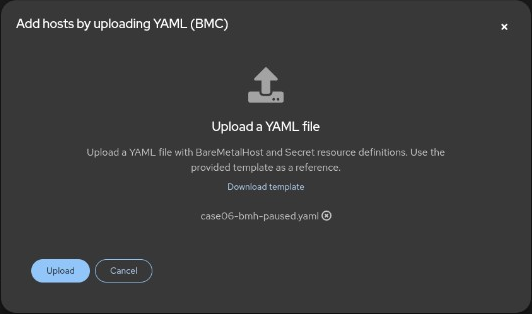
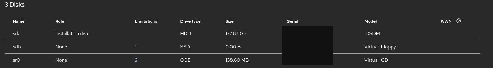
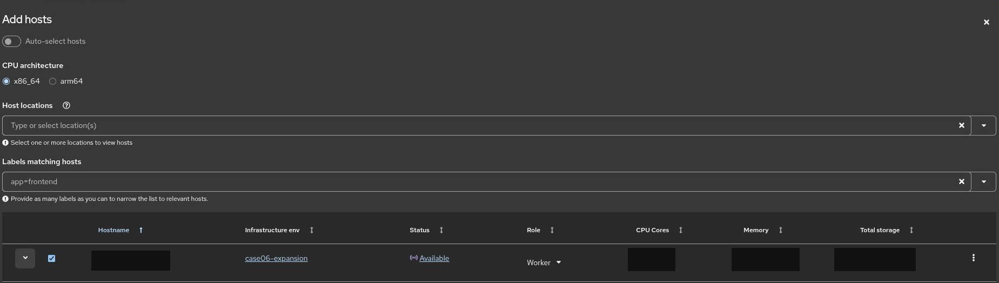
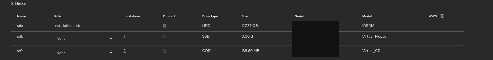
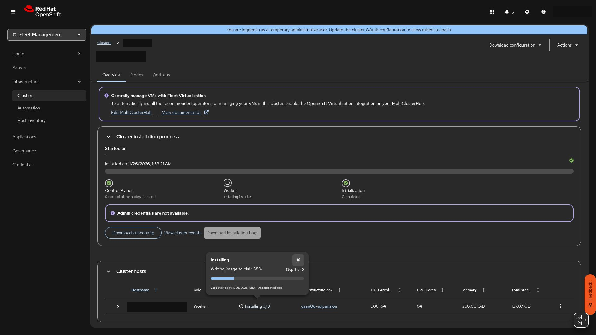
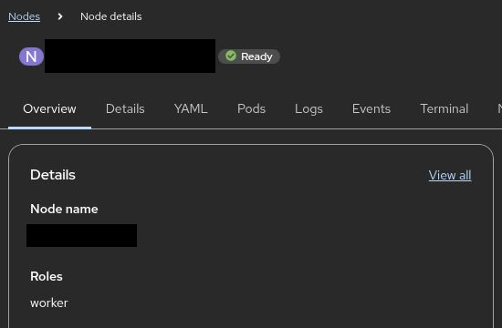

# Runbook: add a spare physical worker with CIM

> **Status: results verified with a 4.21 hub and 4.22 workload cluster.**
> Registration, installation, added Ready capacity and a Running check pod were
> exercised. After the latest run, cleanup was held for review; an earlier
> rehearsal removed its check workload. A 4.21 workload cluster was not tested;
> this remains manual expansion.

**Goal:** use the existing Central Infrastructure Management (CIM) setup to add
one spare physical server as a worker of a managed workload cluster, and show
the cluster gained a Ready worker and its capacity. Then, optionally, use that
worker as SOURCE for the [Case 02](../02-host-failure-recovery/RUNBOOK.md)
automatic recovery test.

**Boundary:** this is a **manual** expansion that you start. It is **not**
policy- or load-triggered autoscaling, and nothing here shows the cluster
growing by itself.

Flow: **A. Prepare → B. Readiness check → C. Test and results → D. Stop and clean up.**
Terms: **BMC** is the server's remote-management controller; the **inventory**
is the host-inventory InfraEnv on the hub.

Official reference: [Red Hat Advanced Cluster Management 2.16 — Clusters](https://docs.redhat.com/en/documentation/red_hat_advanced_cluster_management_for_kubernetes/2.16/html-single/clusters/index)
(host inventory and adding hosts to a cluster). If this runbook and the docs or
your console disagree, the docs and the console win. Command detail and safety
reasoning are in the [administrator guide](ADMIN-GUIDE.md).

Two clusters are involved. Console steps for the host happen on the **hub**
(Fleet Management); node and workload checks happen on the **workload cluster**.
Use the console or the CLI for each change, never both.

## A. Prepare

This case starts from an **existing** environment; it does not set one up:

- A hub with ACM/MCE and CIM already configured, and a managed workload cluster
  already imported.
- A **host inventory** you can reuse unchanged: not assigned to a cluster and
  with automatic approval off. If it is assigned, the administrator makes a
  separate one (A4).
- One **spare approved physical server** with BMC access. **Only disposable
  disks may be connected.** Disconnect disks and unpresent SAN LUNs that hold
  data or another OS before discovery; choosing an install disk does not
  protect the others.
- Owner approval to add, use and retain the spare worker.
- Network and storage reach: the spare server can reach the hub for discovery,
  and once installed it can reach the cluster network and the networks and
  storage its VMs will use. An inventory that already works for the cluster's
  hosts needs no extra network setup. If bonds, VLANs or static addresses are
  needed, ask the network administrator before A4.

**A1. Choose and record names.** Write on the results sheet: inventory name,
workload cluster name, spare host name, BMC vendor, intended install disk.

**A2. Choose the BMC address format.** It must match the vendor. A Dell server
uses `idrac-virtualmedia`, not the generic `redfish-virtualmedia`. Typical
shapes (confirm in the docs and with the vendor):

| Vendor | BMC address form |
| --- | --- |
| Dell iDRAC | `idrac-virtualmedia://<bmc-host>/redfish/v1/Systems/System.Embedded.1` |
| Other Redfish BMC | `redfish-virtualmedia://<bmc-host>/redfish/v1/Systems/<system-id>` |

Use the host's own Systems id; do not assume it. Have the BMC username and
password ready privately for the administrator (A4). They never go in this
repository or in the host file.

**A3. Record the "before" size** on the **workload cluster**. Write down:

- total Ready nodes: read from **Compute → Nodes**
- the dedicated worker nodes and each one's allocatable CPU and memory
  (*allocatable* is what workloads may use after the system's own share). The
  Nodes table shows usage and capacity, not allocatable, so the administrator
  runs the CLI block below.

Use this same CLI method for the "after" values in C4.

CLI (workload cluster)

~~~sh
oc get nodes
oc get nodes -l node-role.kubernetes.io/worker,'!node-role.kubernetes.io/control-plane' \
  -o custom-columns='NAME:.metadata.name,READY:.status.conditions[?(@.type=="Ready")].status,CPU:.status.allocatable.cpu,MEMORY:.status.allocatable.memory'
~~~

**Reading the numbers.** The second command lists one row per dedicated worker.
Count the rows with `READY` `True`. CPU shows whole cores (`16`) or millicores
(`15500m` = 15.5 cores; divide by 1000). Memory is usually in `Ki`: divide by
1,048,576 for GiB (`65690624Ki` is about 62.6 GiB); `Mi` divides by 1024. Copy
the rows to the results sheet. A total is just the sum of the rows; you do not
need one to pass. What matters in C4 is one more Ready worker row, and the other
rows unchanged.

> **HANDOFF → administrator.** **A4. Prepare the host.** Open
> [administrator preparation](ADMIN-GUIDE.md#administrator-preparation-runbook-a4).
> It is self-contained: it sets the inventory and host names, picks (or creates)
> the inventory, creates the private BMC Secret and fills the paused host file.
> Come back here with a usable inventory, the Secret and the filled file kept
> outside the repository. Nothing is uploaded and discovery is not started yet.

## B. Readiness check (all must be yes)

Run before adding the host. Any **no** means **stop**.

| # | Must be true | Where to look |
| --- | --- | --- |
| 1 | The inventory exists and is healthy (hub) | **Fleet Management → Infrastructure → Host inventory** |
| 1a | Inventory is unassigned; its InfraEnv automatic approval setting is off | Administrator checks the InfraEnv YAML |
| 2 | The workload cluster is **Ready** (hub) | **Fleet Management → Infrastructure → Clusters** |
| 3 | The spare's BMC is powered and reachable. **If the host is already in the inventory, stop** and ask the administrator; do not add it again | Host inventory **Hosts** tab; server may stay off |
| 4 | The BMC address uses the vendor-appropriate form (A2) | Your notes |
| 5 | Owner approval and install disk recorded; all connected disks disposable | Results sheet |
| 6 | Before-count of workers and capacity is recorded (A3) | Results sheet |

CLI (hub, one block)

~~~sh
oc get infraenv -A
oc get infraenv REPLACE_INVENTORY_NAME -n REPLACE_INVENTORY_NAMESPACE -o jsonpath='{.spec.clusterRef}{" autoApprove="}{.spec.agentApproval.autoApprove}{"\n"}'
# clusterRef must be absent; autoApprove must not be true.
oc get agent -A
oc get baremetalhost -A
oc get managedcluster
~~~

## C. Test and results

### C1. Register the host

Do this only after section B passed, using the host file from A4. Upload it
once; if anything looks wrong, ask the administrator instead of uploading again.

1. On the **hub**: **Fleet Management → Infrastructure → Host inventory →**
   select your inventory **→ Add hosts → By uploading a YAML → Open file**.
2. Choose the filled host file and click **Upload**. Open the **Hosts** tab.

The host shows **Pending** because the file starts paused. It can also show
**Metal3 operator is not configured** until discovery starts.

> **HANDOFF → administrator.** Right after the upload, run the commands in
> [start discovery](ADMIN-GUIDE.md#start-discovery-runbook-c1-after-the-upload).
> The administrator first reviews what the hub saved (inventory, Secret name,
> cleaning disabled, still paused). Only if it matches does the second block
> start discovery; otherwise nothing is changed and you stop here. If the warning
> stays or registration does not start, the administrator checks CIM; do not
> rerun the blocks.

**Expected:** the host appears on the **Hosts** tab, registers, and shows its
discovered hardware. Wait until it shows as discovered or needing approval.
This step only registers the host. If the server boots an old operating system,
stop and pick the BMC's one-time **UEFI virtual optical/CD** boot; do not start
an installation on that disk.

### C2. Review the disks and approve the discovered host

On the inventory's **Hosts** tab, expand the arrow at the left of the host row
(**Details**). Check the hardware and disks against what you recorded. Clicking
the hostname opens a rename dialog, so use the arrow for hardware details.

A host found by BMC may already be approved. If it shows **Available** and
**Actions → Approve** is disabled, no click is needed. If approval is offered,
select the host and choose **Actions → Approve** after the review. Keep the host
**unassigned** until the C3 disk check.

**Expected:** the host shows approved/available and is not yet in any cluster.

### C3. Assign to the cluster as a worker (separate step)

1. Open **Fleet Management → Infrastructure → Clusters →** the workload cluster
   you want to expand. Confirm its name and current nodes.
2. Choose the cluster's **Actions → Add hosts**.
3. Turn **Auto-select hosts** off. Select only the approved spare host and check
   that its **Role** is **Worker**.
4. Expand the host's **Details** arrow. Under **Disks**, confirm the approved OS
   disk has role **Installation disk**. To choose another disk, open that disk's
   **Role** button (**None**) and select **Installation disk**. Check its serial
   and size. Other disks stay **None**. The **Format?** column can be disabled;
   an unchecked box is not proof that another disk will remain untouched.
   **Stop if any connected disk contains data or an OS to preserve.**
5. Only when the host, cluster, role and install disk are correct, click
   **Submit**. This assigns the host and starts installation.

**Expected:** the host shows installation progress, then completes. Do not
power it off or cancel while installing.

Click the host's **Installing** status to see its current step and progress.

### C4. Confirm the Agent and node

Hub: the host/Agent reaches its final installed state with no errors. Workload
cluster: **Compute → Nodes** lists a **new** node with role **worker** and status **Ready**.

CLI

~~~sh
# hub
oc get agent -A -o custom-columns=NS:.metadata.namespace,NAME:.metadata.name,APPROVED:.spec.approved,ROLE:.spec.role,STAGE:.status.progress.currentStage
# workload cluster
oc get nodes -l node-role.kubernetes.io/worker,'!node-role.kubernetes.io/control-plane'
~~~

**Expected:** total Ready nodes (Nodes page) and Ready dedicated workers are
**before + 1**. The new worker's row adds its allocatable CPU and memory; the
other rows are unchanged. Take the rows with the **same CLI block as A3**
(administrator), not from the Nodes table, and record the new worker's own
values on the sheet. If the node stays NotReady or pending, use
[troubleshooting](ADMIN-GUIDE.md#troubleshooting) and stop; do not guess.

### C5. Run a simple workload on the new worker

On the **workload cluster**, create a new project and a small check pod from
[`00-namespace.yaml`](manifests/00-namespace.yaml) and
[`01-worker-check-pod.yaml`](manifests/01-worker-check-pod.yaml).

1. Choose the project name: `cim-expansion-check`, or another name if that one
   already exists. Write it on the results sheet. Every later step uses this name.
2. Make filled copies outside the checkout (CLI below), or edit both files' text
   before pasting them into **Quick create (+) → Import YAML**. Set the project
   name in both files and the new worker's node name in the pod file.
3. Create the project first, then the pod.

~~~sh
export CHECK_NS='cim-expansion-check'      # or the unused name you chose
export NEW_NODE='REPLACE_NEW_WORKER_NODE'
oc get namespace "$CHECK_NS"               # expected: NotFound
~~~

If the project exists, choose another name, set `CHECK_NS` again and repeat the
check. Do not reuse a project that holds anything else. When it says `NotFound`,
create the project and the pod. Each line runs only if the one before it
succeeded, so a failed step (for example *already exists*) creates nothing after it:

~~~sh
P="$HOME/poc-private/case06"
mkdir -p "$P" &&
  sed "s/cim-expansion-check/$CHECK_NS/" manifests/00-namespace.yaml > "$P/check-ns.yaml" &&
  sed -e "s/cim-expansion-check/$CHECK_NS/" -e "s/REPLACE_NEW_WORKER_NODE/$NEW_NODE/" manifests/01-worker-check-pod.yaml > "$P/check-pod.yaml" &&
  oc create -f "$P/check-ns.yaml" &&
  oc create -f "$P/check-pod.yaml" &&
  oc get pod new-worker-check -n "$CHECK_NS" -o jsonpath='{.metadata.uid} {.spec.nodeName} {.status.phase}{"\n"}' | tee "$P/check-pod.uid"
~~~

**Expected:** `namespace/... created`, `pod/new-worker-check created`, then one line
with the pod's UID, node and phase. That line is saved so cleanup removes only this
pod. If any command prints an error, stop: nothing after it ran. Pick another name
if the project already existed.

The phase can show `Pending` right after creation; that is normal. Wait for
**Running** before recording the result (console: **Workloads → Pods**, select the
project and refresh), or:

~~~sh
oc wait pod/new-worker-check -n "$CHECK_NS" --for=jsonpath='{.status.phase}'=Running --timeout=5m &&
  oc get pod new-worker-check -n "$CHECK_NS" -o wide
~~~

**Expected:** the pod is **Running** on the new worker. If it does not reach Running
within five minutes, stop and use [troubleshooting](ADMIN-GUIDE.md#troubleshooting).

### C6. Record the expansion result now

Do this **before** any recovery test. Recovery can remove the check pod, and
the Running pod you just saw is still valid evidence.

On the [results sheet](RESULTS-TEMPLATE.md), record **Pass**, **Fail**,
**Blocked** or **Not run**. **Pass** needs all of these:

- host registered, approved and assigned as a worker
- node Ready
- worker count and capacity higher than before (A3)
- check pod Running on the new worker

Save the pod's screenshot or output with the sheet.

### C7. Optional: automatic recovery of the new worker

Only after C6 is recorded, you may run [Case 02](../02-host-failure-recovery/RUNBOOK.md)
with the new worker as **SOURCE** and a separate healthy host as **TARGET**. It
power-cycles the new worker through its BMC and restarts a test VM elsewhere.
It has its own approvals, readiness check and results; record them there. Do not
re-collect expansion evidence afterwards.

## D. Stop and clean up

If the owner wants to review the retained test resources first, stop before
step 1. Cleanup was held in the latest verification run.

1. Delete the check workload (workload cluster), in the project recorded in C5.
   It may already be gone if Case 02 recovery removed it; that is fine. Set
   `CHECK_NS` again if this is a new terminal.
   ~~~sh
   CUR=$(oc get pod new-worker-check -n "$CHECK_NS" -o jsonpath='{.metadata.uid}')
   if [ -n "$CUR" ] && [ "$CUR" = "$(cut -d' ' -f1 "$HOME/poc-private/case06/check-pod.uid")" ]; then oc delete pod new-worker-check -n "$CHECK_NS"; else echo "Not deleting: the pod is gone or is not the one this run created."; fi
   ~~~
   Keep the project for review. Its administrator can remove it later after
   checking its full contents. The worker and shared setup stay in place.
2. Leave the worker installed and available for the next agreed test. Keep shared
   inventory and BMC registration intact.
3. Complete the [results sheet](RESULTS-TEMPLATE.md).
