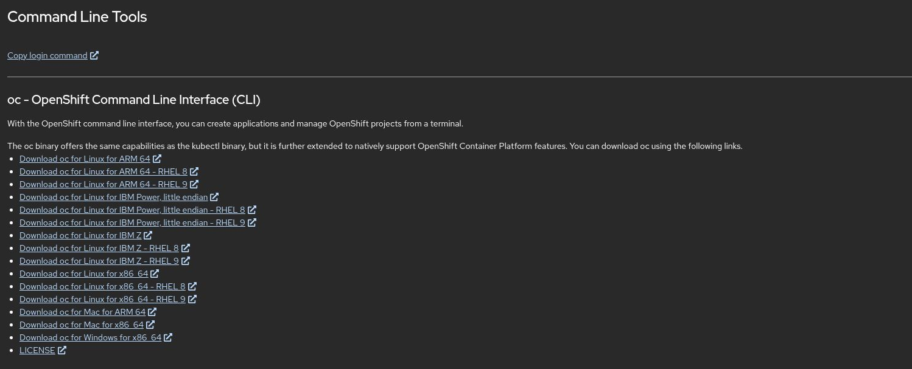
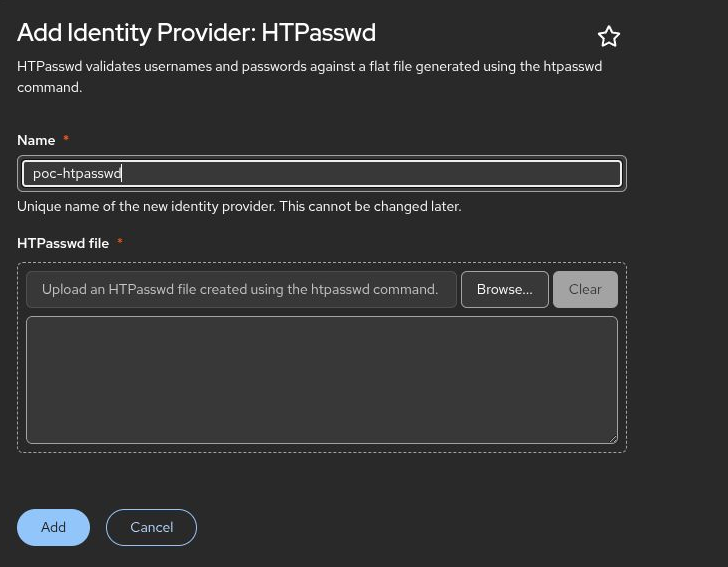
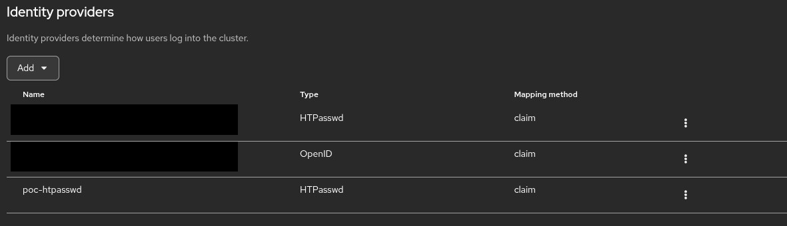
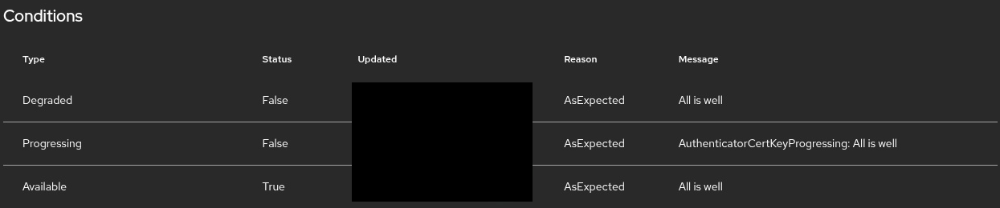
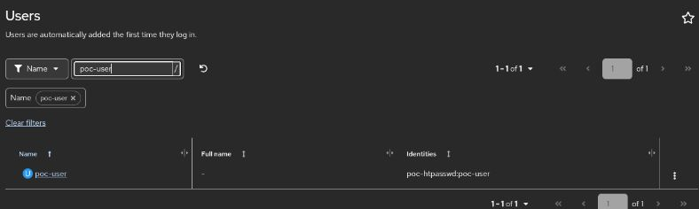
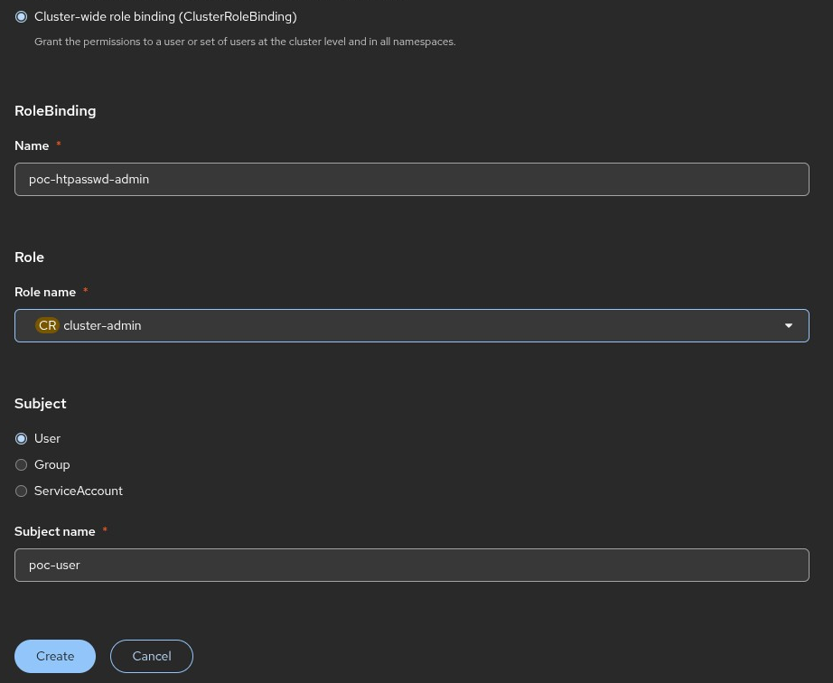
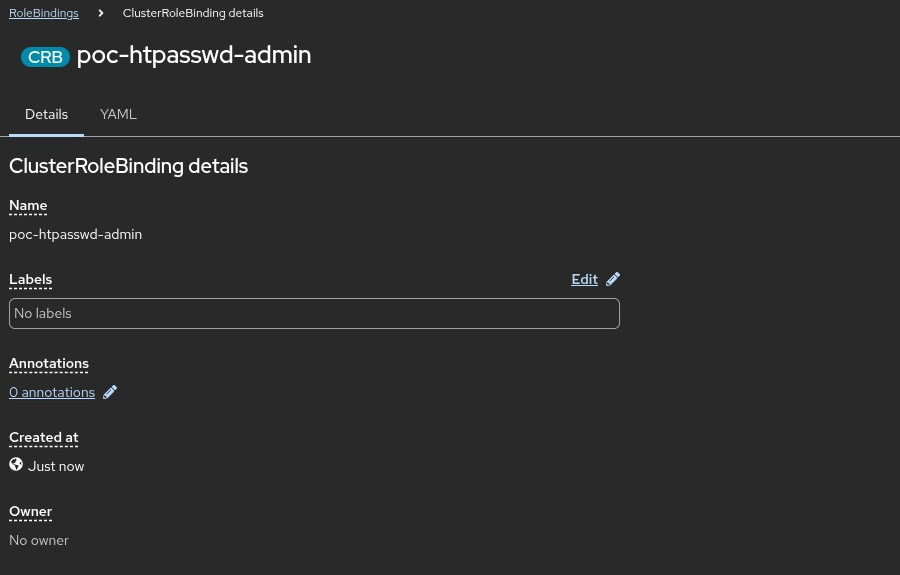
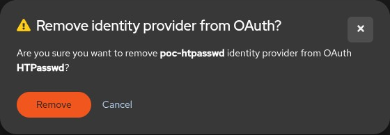
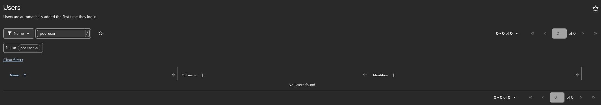

# Administrator guide: HTPasswd user management

> **Verification status.** Console provider setup, first login, `cluster-admin` access and
> cleanup were exercised on OpenShift 4.22. The standard file/Secret create, add, rotate and
> remove commands were verified separately on 4.22 using temporary Secrets. The 4.21 steps
> were checked against documentation only. Managed password sources, GitOps integration
> and existing production identity providers remain unverified.

The customer follows the [walkthrough](RUNBOOK.md). This guide holds the commands. They are
standard Linux jump-host commands from Red Hat's *Update users for an htpasswd identity
provider* procedure ([sources](REFERENCES.md)). Passwords are typed at the `htpasswd` prompt
(no `-b`), so they never appear in arguments or shell history.

**Scope of the file/Secret commands:** a dedicated, unmanaged HTPasswd-only Secret. If GitOps
or an operator owns the source, or the Secret holds other data or metadata that must be
preserved, its owner updates the owning source instead of using this simple replacement.

<a id="prepare"></a>

## Stage 1: Prepare

- [ ] The agreed user name and who it is for. `cluster-admin` gives that user full control of the cluster, so grant it only to the agreed user.
- [ ] A **second administrator session** (different browser profile or a kubeconfig) that stays open until the new login is verified.
- [ ] Inventory of providers, users and Secret ownership (below).
- [ ] A Linux jump host with `oc` (logged in), `htpasswd` and `base64`.
- [ ] An unused test user name: letters, digits and `. _ @ + -` only.

On RHEL, install the hash tool with `sudo dnf install httpd-tools`. Get `oc` from the console's
**Help → Command line tools** page if it is not already installed. Choose the download for your
jump host's operating system and CPU architecture.



Use a **Bash** terminal. The first command stops on errors, including a failed download,
so an empty file is not uploaded. Make a private folder **outside the checkout** (once per shell). The commands below use this
file, called `PRIVATE_FILE`: `$HOME/poc-private/htpasswd/users.htpasswd`.

```bash
set -euo pipefail
umask 077
mkdir -p "$HOME/poc-private/htpasswd"
chmod 700 "$HOME/poc-private" "$HOME/poc-private/htpasswd"
```

### Inventory

```sh
oc get oauth cluster -o jsonpath='{range .spec.identityProviders[*]}{.name}{"\t"}{.type}{"\t"}{.mappingMethod}{"\t"}{.htpasswd.fileData.name}{"\n"}{end}'
oc get users
oc get identities
```

Record names and types only. For each HTPasswd provider note its Secret, then check who owns
it:

```sh
oc get secret SECRET_NAME -n openshift-config -o jsonpath='{.metadata.labels}{"\n"}{.metadata.annotations}{"\n"}{.metadata.ownerReferences}{"\n"}'
```

Argo CD or Flux labels, or an `ExternalSecret` owner, mean another system owns the Secret.
Then **edit the owning source or ask its owner**; a live edit would be reverted and the two would
fight. Do the same for the OAuth resource if it is managed.

### Choose the path

| Situation | Path |
| --- | --- |
| Existing HTPasswd provider, dedicated Secret **not** managed by GitOps or External Secrets | **Reuse:** retrieve the file, change one user's line, replace the Secret (3.1) |
| Secret or OAuth resource managed by GitOps or an operator (even if you own it) | **Owner/source path:** change the owning source; do not replace the Secret live |
| No HTPasswd provider, or you want a separate demonstration provider | **Create:** new file (`-c`) and a new dedicated provider. Other providers may exist; the provider and user names must be unused and the OAuth owner must permit it |

Never remove the last user of a retained provider; the provider is not yours to delete.

Only one administrator updates this Secret at a time. If another edit occurs, retrieve
the latest file and repeat your change before replacing the Secret.

<a id="check"></a>

## Stage 2: Quick readiness check (ONE check)

```sh
oc whoami                                              # your existing admin
oc get clusteroperator authentication                  # Available=True, Progressing=False, Degraded=False
oc get oauth cluster -o jsonpath='{.spec.identityProviders[*].name}{"\n"}'   # providers match the inventory
```

**Reuse path only:** also confirm the existing Secret with
`oc get secret SECRET_NAME -n openshift-config -o name`. Skip this for a new provider.

Ready only if the operator is settled, the providers match the inventory, the second session
works and the user name is not already used by another provider's identity (`oc get identities`).
Run it once.

<a id="user"></a>

## Stage 3: Perform

### 3.1 Create or update the password file

**Create path (no HTPasswd provider yet).** `-c` creates a **new** file and would erase an
existing one, so use it only here. `htpasswd` prompts for the password:

```sh
htpasswd -c -B "$HOME/poc-private/htpasswd/users.htpasswd" poc-user
```

Replace `poc-user` with the agreed user. Upload this file in 3.2 and delete it in Stage 4.
Never put it in the repository, tickets, chat or screenshots.

**Reuse path (existing Secret).** Retrieve the latest file first every time, then change it, then
replace the Secret. `SECRET_NAME` is the Secret referenced by this provider: read it from the OAuth YAML
(`htpasswd.fileData.name`). No `-c`: `htpasswd -B` adds the user, or changes the password if the
line already exists, and leaves other users' lines alone.

```sh
oc get secret SECRET_NAME -n openshift-config -o jsonpath='{.data.htpasswd}' | base64 --decode > "$HOME/poc-private/htpasswd/users.htpasswd"
htpasswd -B "$HOME/poc-private/htpasswd/users.htpasswd" TEST_USER
oc create secret generic SECRET_NAME --from-file=htpasswd="$HOME/poc-private/htpasswd/users.htpasswd" --dry-run=client -o yaml -n openshift-config | oc replace -f -
```

Do not edit the OAuth resource; the provider list is untouched.

### 3.2 Provider and Secret

- **Create path, console (preferred):** **Administration → Cluster Settings → Configuration**,
  filter for `OAuth`, open **OAuth → Add → HTPasswd**, enter a unique name, use **Browse…** to
  choose the file, then press **Add**. The console creates a generated Secret and appends the
  provider (`mappingMethod: claim`) to the existing list, keeping the other providers. **Record
  the generated Secret name**: on the OAuth page open **YAML**, find your provider under
  `identityProviders`, and read its `htpasswd.fileData.name`. Record the name only; do not edit.
  **Stop any screenshot or recording before loading the file:** the upload form shows the file
  contents, including hashes. Resume only after you are back on the OAuth details page. YAML
  fallback: append the
  [entry snippet](templates/oauth-htpasswd-entry.snippet.yaml) to the existing OAuth list; do
  **not** apply it as a resource. If you create the Secret yourself, base the
  [template](templates/htpasswd-secret.template.yaml) on the private file.

  The empty form, before a file is chosen (names and layout only; no file contents):

  

  After **Add**, the provider appears in the **Identity providers** table (existing provider names are hidden in this example):

  

- **Reuse path:** the commands in 3.1 already replaced the Secret. Do not paste hashes into the
  console by hand.

Wait for the rollout. After **Add**, the page links **View authentication conditions for
reconfiguration status.** (or use **Administration → Cluster Settings → ClusterOperators →
authentication**). Wait for Available True, Progressing False, Degraded False. CLI alternative (run again until it settles):

```sh
oc get clusteroperator authentication
```

Settled conditions look like this (dates are hidden):



The provider's `mappingMethod` is `claim`: the identity is `PROVIDER_NAME:TEST_USER` and a login
whose user name is already taken by an identity from another provider is **refused**, which
prevents silent account takeover. Confirm no other provider has `TEST_USER` (the readiness check).

### 3.3 First login creates the User

Log in as the test user in a fresh separate browser session (private window or another
profile). Before the grant, the account should lack node-administration access. This creates the `User`
and `Identity`:

```sh
oc get user TEST_USER
oc get identity PROVIDER_NAME:TEST_USER
```

In the console, **User Management → Users** shows the same User and its provider identity:



Do not create a `User` yourself and do not put a password in any object.

### 3.4 Grant cluster-admin (explicit full privilege)

Console: **User Management → RoleBindings → Create binding → Cluster-wide role binding**, role
`cluster-admin`, subject User `TEST_USER`. Example form before **Create**:



The binding's details page after creation:



CLI equivalent, or the [template](templates/cluster-admin-binding.template.yaml):

```sh
oc adm policy add-cluster-role-to-user cluster-admin TEST_USER
```

(The CLI binding has a generated name; record it. The console form lets you choose the name.)
Verify as the test user: reload and confirm **Compute → Nodes** opens. A sidebar label alone is
not proof of authorization. For a CLI check, `oc auth can-i '*' '*' --all-namespaces` run as
the test user should say `yes`.

Keep the second administrator session open until this works.

<a id="rotate"></a>

### 3.5 Rotate the password

Retrieve the latest file, change only this user's password (no `-c`), replace the Secret:

```sh
oc get secret SECRET_NAME -n openshift-config -o jsonpath='{.data.htpasswd}' | base64 --decode > "$HOME/poc-private/htpasswd/users.htpasswd"
htpasswd -B "$HOME/poc-private/htpasswd/users.htpasswd" TEST_USER
oc create secret generic SECRET_NAME --from-file=htpasswd="$HOME/poc-private/htpasswd/users.htpasswd" --dry-run=client -o yaml -n openshift-config | oc replace -f -
oc get clusteroperator authentication
```

After the rollout, sign the test user out and log in with the **new** password (works).
Sign out again, then try the **old** password once: it is refused (for example,
"Invalid login or password. Please try again."). Check that other users still log in.

**Sessions:** changing the password does **not** revoke existing OAuth tokens or console
sessions. If access must end, that is a separate action (sign-out, or deleting that
user's OAuth access tokens per the authentication documentation). Do not claim rotation
revoked access.

### Recovery and rollback

Never restore an old saved copy of the file: it would drop users added since and could
revive a retired password. Retrieve the current Secret again and repeat the change.
If the operator does not settle, check its conditions and the OAuth pods, do not edit further, and
keep the second session.

## Stage 4: Stop and clean up

Remove **only what this test created**.

**Cleanup, provider created by this test** (the Secret then holds only the test user, so do not
use `htpasswd -D`; remove the whole provider, admin binding first):

1. `oc delete clusterrolebinding BINDING_NAME` (console: **User Management → RoleBindings**).
2. Remove **only this provider**: on the **OAuth** page, in the **Identity providers** table, open
   **Actions** (three dots) on **only this provider's row** → **Remove identity provider** →
   **Remove**. Names in the table are not links. Confirm the remaining list equals the inventory.

   

3. Wait for the authentication operator: Available True, Progressing False, Degraded False.
4. `oc delete secret SECRET_NAME -n openshift-config` (only the generated Secret this test
   created; removing the provider does not delete it).
5. `oc delete user TEST_USER` and `oc delete identity PROVIDER_NAME:TEST_USER`.
6. Retiring this account (not keeping it):
   `oc delete oauthaccesstokens --field-selector=userName=TEST_USER`. Never list token values.
7. `rm "$HOME/poc-private/htpasswd/users.htpasswd"`.

**Cleanup, existing unmanaged provider reused** (remove only the test user's line and its own
account resources; keep the provider, Secret and other users):

```sh
oc delete clusterrolebinding BINDING_NAME
oc get secret SECRET_NAME -n openshift-config -o jsonpath='{.data.htpasswd}' | base64 --decode > "$HOME/poc-private/htpasswd/users.htpasswd"
cut -d: -f1 "$HOME/poc-private/htpasswd/users.htpasswd"
```

The last command shows user names only. **Confirm another user will remain** after the
test user is removed. If not, stop and contact the provider owner. Then continue:

```sh
htpasswd -D "$HOME/poc-private/htpasswd/users.htpasswd" TEST_USER
oc create secret generic SECRET_NAME --from-file=htpasswd="$HOME/poc-private/htpasswd/users.htpasswd" --dry-run=client -o yaml -n openshift-config | oc replace -f -
oc get clusteroperator authentication
```

Wait for Available True, Progressing False and Degraded False. Run the last command
again if needed. Once settled, remove the retired account resources:

```sh
oc delete user TEST_USER
oc delete identity PROVIDER_NAME:TEST_USER
oc delete oauthaccesstokens --field-selector=userName=TEST_USER
rm "$HOME/poc-private/htpasswd/users.htpasswd"
```

Do not remove the last user of a retained provider. Never delete the provider or Secret on this
path, and never remove existing providers, users or Secrets. The `oauthaccesstokens` line applies
when the account is retired (not kept).

After retiring the account, open **User Management → Users**, filter by the exact test user
name and confirm it is absent. This checks the User object only; also complete the Identity,
token and binding cleanup above.



**Keep-account path:** keep the provider, Secret, user and binding. Delete the local hash file,
record the owner and review date, and apply your own credential policy. The account remains full
cluster-admin until someone removes the binding. Deleting a local file does not guarantee
secure erasure on an SSD.

## Troubleshooting

| Symptom | Check |
| --- | --- |
| Login says invalid | Secret updated? operator settled? hash from `-B`? name case |
| Login refused after a collision | Another provider owns that user name (`claim`) |
| Existing users broke | Stop, keep the administrator session open, and check the authentication operator and owning source; do not reset other users' passwords |
| Change reverted | A GitOps or operator owner reconciled it; edit the owning source |
| Provider missing in console | OAuth list edited elsewhere; compare with the inventory |
