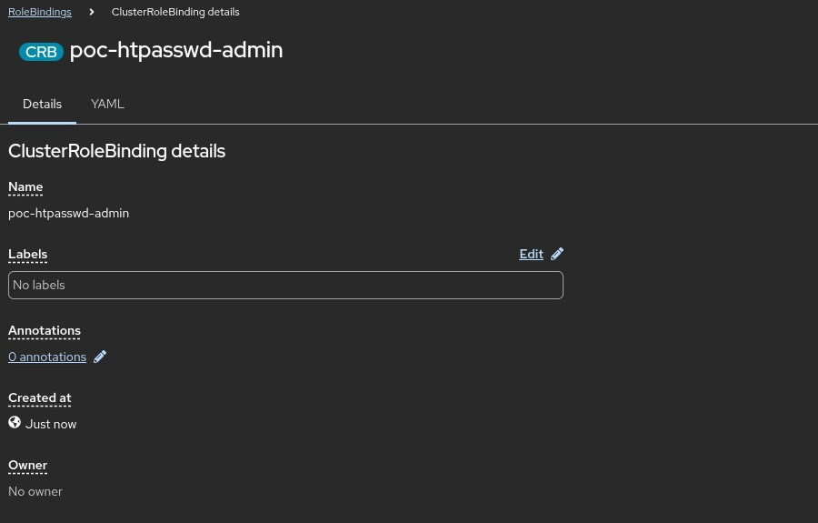
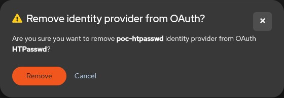

# HTPasswd user management: customer walkthrough

> **Verification status.** Console provider setup, login, `cluster-admin` access and cleanup
> were exercised on 4.22. The administrator guide’s standard file/Secret commands were
> verified separately on 4.22. The 4.21 steps were checked against documentation only.
> Managed password sources and GitOps integrations remain unverified.

**Goal:** see a local test user added, made a cluster administrator and given a new
password, while existing logins keep working.

The administrator [prepares](ADMIN-GUIDE.md#prepare) first and gives you the
[results sheet](RESULTS-TEMPLATE.md): console link, provider name, test user name, and
whether you are on the **create** path or the **reuse** path. Passwords are handed over
privately by the administrator and never written on the sheet. **Stay signed in with your
existing administrator session until the sheet says the new login works.**

## Stage 1: Prepare (done by the administrator)

Your sheet identifies the agreed user and provider. Keep a second working administrator
session open and follow the administrator guide's short preparation steps.

## Stage 2: Quick readiness check (ONE check)

The administrator runs the single check ([details](ADMIN-GUIDE.md#check)). Wait for "ready".
Do not continue without it.

## Stage 3: Perform and show results

### A. Provider

1. **Administration → Cluster Settings → Configuration**, filter for `OAuth`, open **OAuth**.
   Write down the providers listed. Expected: your existing providers are all there.
2. **Create path:** open **Add → HTPasswd**, enter the unique provider name from your sheet, and
   use **Browse…** to upload the password file the administrator prepared. **Pause any
   screenshot or recording first: the form shows the file contents.** Click **Add**, return to
   the OAuth details page, then resume. To find the generated Secret name, open **YAML**,
   find your provider under `identityProviders`, and read its `htpasswd.fileData.name`.
   Write only that name on your sheet; do not edit the YAML.
   **Reuse path:** nothing is added here; the administrator updates the existing provider's
   Secret in step B instead.
3. Click **View authentication conditions for reconfiguration status.** (or open
   **Administration → Cluster Settings → ClusterOperators → authentication**). Wait for
   Available True, Progressing False, Degraded False. This can take minutes.

### B. Test user

**Create path:** the uploaded file already contains the test user; continue to C.

**Reuse path:** the administrator retrieves the Secret's file, adds the user with the `htpasswd -B`
password prompt and replaces the Secret, as shown in the [admin guide](ADMIN-GUIDE.md#user).
The other users' lines are left untouched.

### C. First login and cluster-admin

1. Open a fresh separate browser session (private window or another profile). On the login
   page choose the provider on your sheet and sign in as the test user. Expected: login
   succeeds, but node-administration access has not been granted yet.
2. In your retained administrator session: **User Management → Users**. The user now exists (it was created by the login). Do not
   create it by hand.
3. In your administrator session: **User Management → RoleBindings → Create binding**.
   Binding type **Cluster-wide role binding**, name from your sheet, role **cluster-admin**,
   subject **User**, the test user's name. Create.
4. In the test user's window, reload. Expected: **Compute → Nodes** now opens.

### D. Rotate the password

1. The administrator changes only this user's password with `htpasswd -B` and replaces the Secret
([admin guide](ADMIN-GUIDE.md#rotate)), then waits for the
   authentication ClusterOperator to settle.
2. Sign out the test user. Sign in with the **new** password: works. Sign out again,
   then try the **old** password once: it is refused (for example, "Invalid login or
   password. Please try again.").

Note: a password change does **not** end a session or token that already exists. Sign-out or
token deletion is a separate action.

## Stage 4: Stop and clean up

Follow the path on your sheet.

- **Cleanup path:** the administrator removes the ClusterRoleBinding first. For a provider this
  test created, only that provider is then removed (OAuth → Identity providers table →
  **Actions** on its row → **Remove identity provider**), followed by its generated Secret and
  the test User, Identity and tokens. For a reused provider, only the test user's line is
  removed (`htpasswd -D`), never the provider or Secret, and never the provider's last user.
  Other providers and users are not touched.
- **Keep-account path:** keep the account for real use; sign off the sheet and record the
  owner and the approval, then follow your own password policy.

## Stop and call the administrator if

- a certificate warning appears,
- an existing user can no longer log in,
- the authentication ClusterOperator stays Progressing or Degraded,
- the provider list changed unexpectedly.

Do not retry in a loop. Record the failure and stop; do not mark the test Pass.
