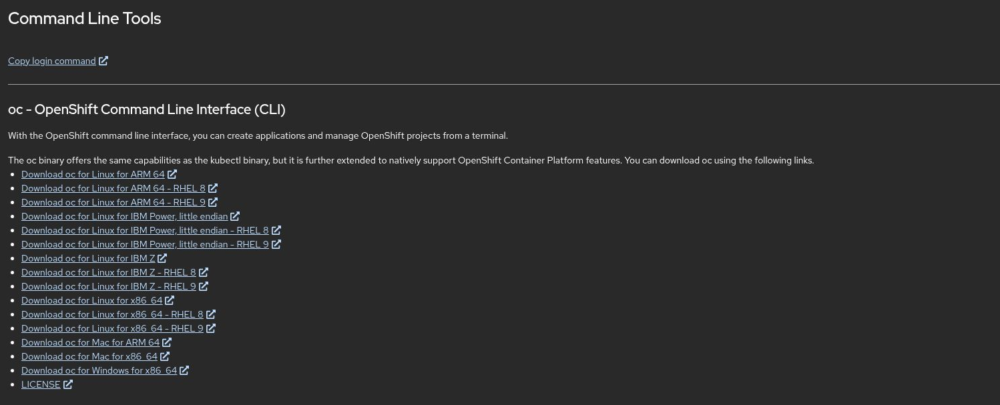
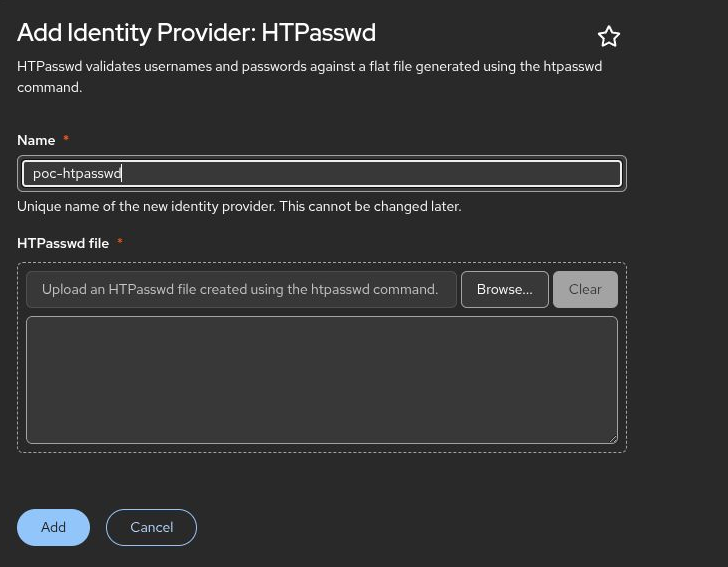
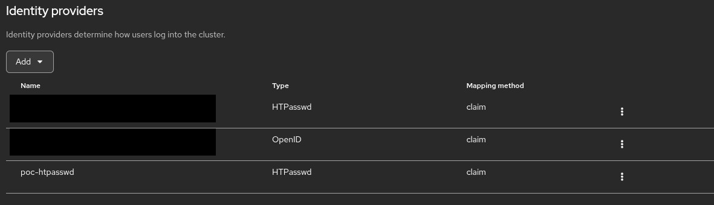
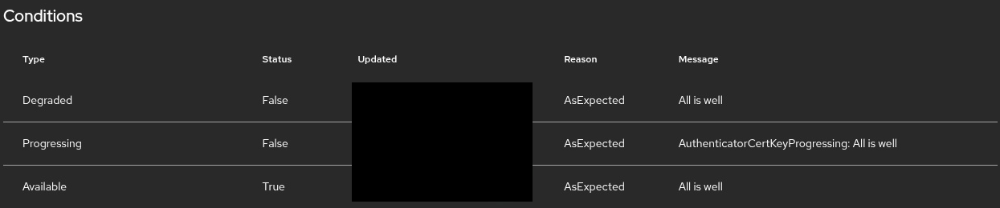
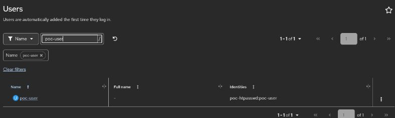
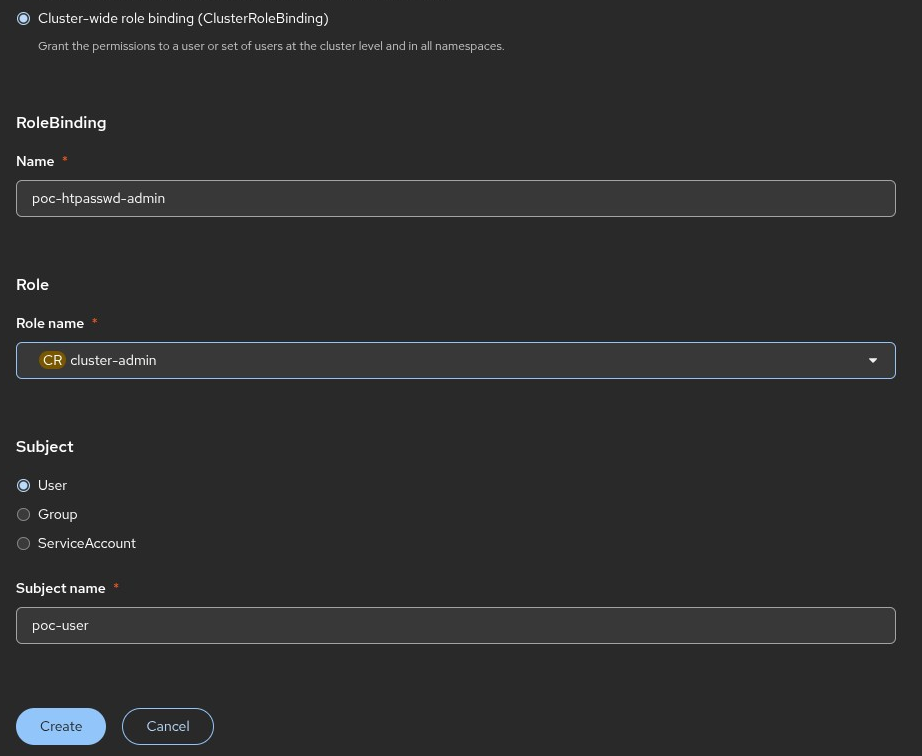
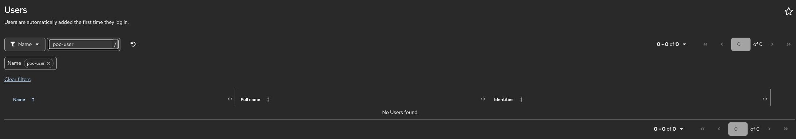

# HTPasswd: complete walkthrough

> **Verification status.** Console provider setup, login, `cluster-admin` access and cleanup
> were exercised on 4.22. The standard `htpasswd`/`oc` file and Secret commands were verified
> separately on 4.22. The 4.21 steps were checked against documentation only. Managed
> password sources and GitOps integrations remain unverified.

**Goal:** from start to finish, add a **new temporary HTPasswd provider** with one test user,
make that user a cluster administrator, change its password, and remove everything again,
while your existing logins keep working.

This is the one complete path. To reuse an **existing** HTPasswd provider instead, or to
roll back or troubleshoot, see the short [administrator reference](ADMIN-GUIDE.md).

Passwords are typed at the `htpasswd` prompt (never `-b`), so they never appear in command
arguments or shell history. Passwords, hash files and Secret data never go into Git, tickets,
chat or screenshots.

Use these placeholders throughout. Replace them with your agreed names:

| Placeholder | Meaning |
| --- | --- |
| `TEST_USER` | The new test user: letters, digits and `. _ @ + -` only, not used by any other provider |
| `PROVIDER_NAME` | A new, unused provider name, for example `poc-htpasswd` |
| `SECRET_NAME` | The Secret the console generates; you read it in step 3 |
| `BINDING_NAME` | The name you give the `cluster-admin` binding in step 5 |

`cluster-admin` gives the user full control of the cluster, so grant it only to the agreed
user. **Keep your existing administrator session open until the new login works.**

<a id="prepare"></a>

## 1. Prepare

You need a second administrator session (another browser profile, or a kubeconfig) and a
Linux jump host with `oc` (logged in as your existing administrator), `htpasswd` and `base64`.
Keep that jump-host login as the existing administrator throughout. Use the separate browser
window for all test-user sign-ins.

On RHEL, install the hash tool with `sudo dnf install httpd-tools`. Get `oc` from the
console's **Help → Command line tools** page if it is not already installed; choose the
download for your jump host's operating system and CPU architecture.



Use a **Bash** terminal. Make a private folder **outside the checkout** (once per shell). The
first command stops on errors, so a failed step does not carry on. The commands below call the
password file `PRIVATE_FILE`: `$HOME/poc-private/htpasswd/users.htpasswd`.

```bash
set -euo pipefail
umask 077
mkdir -p "$HOME/poc-private/htpasswd"
chmod 700 "$HOME/poc-private" "$HOME/poc-private/htpasswd"
```

Record the existing providers, users and identities (names and types only):

```bash
oc get oauth cluster -o jsonpath='{range .spec.identityProviders[*]}{.name}{"\t"}{.type}{"\t"}{.mappingMethod}{"\t"}{.htpasswd.fileData.name}{"\n"}{end}'
oc get users
oc get identities
```

Existing providers are not changed by this walkthrough. If an existing HTPasswd Secret or the
OAuth resource is managed by GitOps or an operator, see the
[ownership check](ADMIN-GUIDE.md#prepare) first.

Create the password file for the new user. `-c` creates a **new** file and would erase an
existing one, so use it only here. `htpasswd` asks for the password twice:

```bash
htpasswd -c -B "$HOME/poc-private/htpasswd/users.htpasswd" TEST_USER
```

<a id="check"></a>

## 2. Quick readiness check (run once)

```bash
oc whoami                                              # your existing admin
oc get clusteroperator authentication                  # Available=True, Progressing=False, Degraded=False
oc get oauth cluster -o jsonpath='{.spec.identityProviders[*].name}{"\n"}'   # providers match the inventory
```

Ready only if the operator is settled, the providers match your inventory, the second session
works, and `TEST_USER` is not already used by another provider's identity (`oc get identities`).
Do not continue otherwise.

## 3. Create the provider in the console

1. **Administration → Cluster Settings → Configuration**, filter for `OAuth`, open **OAuth**.
   Write down the providers listed. Your existing providers should all be there.
2. Open **Add → HTPasswd**. The empty form (names and layout only):

   

3. Enter `PROVIDER_NAME`, then use **Browse…** to choose the file
   `$HOME/poc-private/htpasswd/users.htpasswd`.
   **Pause any screenshot or recording before loading the file: the form shows the file
   contents, including hashes.** Click **Add**, return to the OAuth details page, then resume.
4. The provider appears in the **Identity providers** table (existing names are hidden here):

   

5. Read the generated Secret name: open **YAML**, find your provider under `identityProviders`,
   and read its `htpasswd.fileData.name`. That is `SECRET_NAME`. Write down the name only; do
   not edit the YAML. The provider's `mappingMethod` is `claim`: a login whose user name is
   already taken by another provider's identity is refused.
6. Wait for the authentication operator. Click **View authentication conditions for
   reconfiguration status.** (or open **Administration → Cluster Settings → ClusterOperators →
   authentication**) until Available is True, Progressing False, Degraded False. This can take
   minutes. Command-line alternative; run it again until it settles:

   ```bash
   oc get clusteroperator authentication
   ```

   

<a id="first-login"></a>

## 4. First login as the new user

Open a fresh separate browser session (private window or another profile). On the login page
choose `PROVIDER_NAME` and sign in as `TEST_USER`. Expected: login succeeds, but
node-administration access has not been granted yet.

In your retained administrator session, check that the login created the user and identity.
Do not create the `User` yourself and never put a password in any object:

```bash
oc get user TEST_USER
oc get identity PROVIDER_NAME:TEST_USER
```

In the console, **User Management → Users** shows the same user:



<a id="user"></a>

## 5. Make the user a cluster administrator

In your administrator session: **User Management → RoleBindings → Create binding**. Binding
type **Cluster-wide role binding**, name `BINDING_NAME`, role **cluster-admin**, subject
**User**, name `TEST_USER`. Check the form, then click **Create**:




## 6. Verify as the new user

In the test user's window, reload. Open **Compute → Nodes**. Expected: the node list
loads without an access-denied message. A sidebar label alone is not proof of authorization.

Also confirm that your existing users still log in.

<a id="rotate"></a>

## 7. Rotate the password

In your existing administrator's jump-host terminal, fetch the latest file first, change only
this user's password (no `-c`), then replace the
Secret and wait for the operator:

```bash
oc get secret SECRET_NAME -n openshift-config -o jsonpath='{.data.htpasswd}' | base64 --decode > "$HOME/poc-private/htpasswd/users.htpasswd"
htpasswd -B "$HOME/poc-private/htpasswd/users.htpasswd" TEST_USER
oc create secret generic SECRET_NAME --from-file=htpasswd="$HOME/poc-private/htpasswd/users.htpasswd" --dry-run=client -o yaml -n openshift-config | oc replace -f -
oc get clusteroperator authentication
```

This is for a dedicated, unmanaged HTPasswd-only Secret, which is what the console created.
Run the last command again until Available is True, Progressing False, Degraded False.

Then, in the test user's window:

1. Sign out, and sign in with the **new** password: it works.
2. Sign out **again**, then try the **old** password once: it is refused (for example,
   "Invalid login or password. Please try again.").

A password change does **not** end a session or token that already exists; signing out or
deleting tokens is a separate action.

## 8. Clean up (in this order)

This section is only for the new temporary provider created in step 3. If you reused an
existing provider, use [reuse cleanup](ADMIN-GUIDE.md#reuse-cleanup) instead.
Remove only what this walkthrough created. Do not touch other providers, users or Secrets.

1. Remove the binding. In the console use **User Management → RoleBindings**, or:

   ```bash
   oc delete clusterrolebinding BINDING_NAME
   ```

2. Remove **only your provider**: on the **OAuth** page, in the **Identity providers** table,
   open **Actions** (three dots) on **only that provider's row** → **Remove identity
   provider** → **Remove**. Names in the table are not links. Confirm the remaining list equals
   your inventory. Do not use `htpasswd -D` here: this Secret holds only the test user.

   

3. **Wait** for the authentication operator (Available True, Progressing False, Degraded False)
   before removing the account:

   ```bash
   oc get clusteroperator authentication
   ```

4. Remove the generated Secret (removing the provider does not delete it):

   ```bash
   oc delete secret SECRET_NAME -n openshift-config
   ```

5. Remove the User, Identity and the user's tokens (never list token values):

   ```bash
   oc delete user TEST_USER
   oc delete identity PROVIDER_NAME:TEST_USER
   oc delete oauthaccesstokens --field-selector=userName=TEST_USER
   ```

6. Delete the private file:

   ```bash
   rm "$HOME/poc-private/htpasswd/users.htpasswd"
   ```

7. Check: **User Management → Users**, filter by the exact test user name. This checks the
   User object only; the commands above handled the rest.

   

**Keep-account alternative:** keep the provider, Secret, user and binding. Delete the local
file, record the owner and review date, and apply your own credential policy. The account
stays full cluster-admin until someone removes the binding. Deleting a local file does not
guarantee secure erasure on an SSD.

## Stop and call the administrator if

- a certificate warning appears,
- an existing user can no longer log in,
- the authentication ClusterOperator stays Progressing or Degraded,
- the provider list changed unexpectedly.

Do not retry in a loop. Record the failure and stop; do not mark the test Pass. Record
results in the [results sheet](RESULTS-TEMPLATE.md).
